# C – Beregningskjerne og domenemodell for norsk lønnsmotor

**Dato:** 2026-10-28 · **Målgruppe:** utviklere og gründer · **Avgrensning:** beregning og datamodell. Myndighetsgrensesnitt (Altinn, skattekort-API, a-melding-innsending, NAV-API-er) dekkes av en annen analyse. A-melding omtales her bare der rapporteringsreglene styrer hvordan beregningen må fungere.

**Merking i dokumentet**
- **[VERIFISERT 2026]**: tallet eller regelen er sjekket mot offisiell kilde (Skatteetaten, NAV, Lovdata, regjeringen.no) i oktober 2026.
- **[SEKUNDÆRKILDE]**: hentet fra Sticos, Azets, Revisorforeningen eller lignende og ikke bekreftet hos myndighetene.
- **[USIKKER]**: bygger på domenekunnskap eller motstridende kilder og må verifiseres før det kodes som fasit.
- **[KONFIG]**: varierer mellom tariffavtaler eller virksomheter og må derfor være en parameter, ikke hardkodes.

---

## 0. Sammendrag for utviklere

1. **Lønnsarten er kjernen.** Hver lønnsart har versjonerte flagg: trekkmetode, AGA, feriepengegrunnlag, pensjonsgrunnlag, a-meldingskode og kontering. Hver lønnslinje får et øyeblikksbilde av flaggene den ble beregnet med.
2. **Kontantprinsippet styrer alt.** Utbetalingsdatoen avgjør inntektsår, a-meldingsperiode, AGA-sats og -sone, feriepengeopptjeningsår og pensjonsår. Opptjeningsperioden er tilleggsinformasjon.
3. **Endringer fra 2026 som påvirker motoren** [VERIFISERT 2026]:
   - Forskuddstrekk og utleggstrekk betales **første virkedag etter lønnsutbetaling**. Skattetrekkskontoen er avviklet.
   - A-meldingen krever lønnsutbetalingsdato og **sum forskuddstrekk per lønnsutbetalingsdato**.
   - Nytt **samordnet utleggstrekk**: ett trekk per ansatt, unik KID per ansatt, egen a-meldingskode `utleggstrekkSamordnet` med trekkdato.
4. **Godkjente lønnskjøringer kan aldri endres.** Alt rettes med nye linjer i nye kjøringer (retro eller korreksjon) som peker tilbake til originalen. Datamodellen må derfor være **bitemporal** (virkningstid × registreringstid).
5. **Tabelltrekk skal ikke reimplementeres fra bunnen av.** Skatteetaten publiserer den offisielle trekkrutinen som Java-kode på GitHub (`Skatteetaten/trekktabell`). Bruk den, eller port den med testene som orakel.

### 0.1 Nøkkeltall 2026 som motoren trenger (alle skal ligge i en versjonert satstabell)

| Parameter | Verdi | Status / kilde |
|---|---|---|
| G (grunnbeløp) fra 1.5.2026 | 136 549 kr (før 1.5: 130 160; snitt 2026: 134 419) | [VERIFISERT 2026] NAV/regjeringen/Skatteetaten |
| 6G / 12G / 7,1G / 2G / 1,5G / 3/5G | 819 294 / 1 638 588 / 969 498 / 273 098 / 204 824 / 81 929 | [VERIFISERT 2026] (6G, 12G, 1,5G og 3/5G oppgitt av Skatteetaten) |
| AGA-satser sone I / Ia / II / III / IV / IVa / V | 14,1 / 10,6→14,1 / 10,6 / 6,4 / 5,1 / 7,9 / 0 % | [VERIFISERT 2026] |
| AGA-fribeløp (sone Ia m.fl.) | 850 000 kr i spart avgift per juridisk enhet/konsern (≈ 24,3 mill. kr i lønn i sone Ia) | [VERIFISERT 2026] |
| Ekstra AGA (5 %) | **Avviklet fra 1.1.2025** | [VERIFISERT] |
| Trygdeavgift lønn | 7,6 % (nedre grense 99 650; opptrapping 25 %) | [VERIFISERT 2026] |
| Trinnskatt | 1,7 % fra 226 100 · 4,0 % fra 318 300 · 13,7 % fra 725 050 · 16,8 % fra 980 100 · 17,8 % fra 1 467 200 | [VERIFISERT 2026] |
| Personfradrag / minstefradrag | 114 540 / 46 %, maks 95 700 | [VERIFISERT 2026] |
| Frikortgrense | 100 000 kr | [SEKUNDÆRKILDE] Azets |
| Kildeskatt på lønn (PAYE) | 25 % (17,4 % uten trygdeavgift), inntektsgrense 725 050 | [VERIFISERT 2026] Skatteetaten |
| Km-godtgjørelse, statens sats | 5,30 kr/km | [SEKUNDÆRKILDE] Revisorforeningen/Sticos |
| Km-godtgjørelse, trekkfri | 3,50 kr/km (passasjer-, tilhenger- og anleggsveitillegg 1,00 kr/km) | [SEKUNDÆRKILDE] Azets |
| Diett, statens sats (særavtalen) | Overnatting >12 t: 1 012 · 6–12 t: 397 · >12 t uten overnatting: 736 | [SEKUNDÆRKILDE] Revisorforeningen |
| Diett, trekkfri sats | Hotell 693 (554 med frokost) · uten overnatting 6–12 t: 200, >12 t: 400 · ulegitimert nattillegg 452 · pensjonat/brakke/hybel uten kokemulighet 400 · hybel med kokemulighet/privat 107 · egen brakke/campingvogn 80 · måltidstrekk 20/30/50 % | [VERIFISERT 2026] Skatteetaten satsside |
| Bilfordel (sjablong) | 30 % av listepris opp til 370 300 + 20 % av overskytende; bil eldre enn 3 år: 75 % av listepris; ingen elbilrabatt | [SEKUNDÆRKILDE] Smartepenger/Sticos. Ny modell er foreslått fra 2027 |
| Normrente (rentefordel) | 4,8 % (jan–aug), 4,7 % (sep–okt), 4,8 % (nov–des) | [SEKUNDÆRKILDE] Sticos |
| Skattefritt lån | ≤ 3/5 G ved utbetaling og nedbetalt innen ett år | [VERIFISERT 2026] |
| Skattefrie gaver | 5 000 kr/år (generell grense) | [SEKUNDÆRKILDE] |
| EK-sjablong (telefon/internett) | 4 392 kr/år | [USIKKER] for 2026, men oppgitt i gjeldende veiledning |
| Livsoppholdssats ved utleggstrekk (fra 1.7.2026) | Enslig 11 388 · gift/samboer 9 644 · forsørger ektefelle 19 288 · barn 0–5: 3 645, 6–10: 4 835, 11–14: 6 102, 15+: 7 020 per måned | [VERIFISERT 2026] regjeringen.no |
| Minstegrenser forskuddstrekk | Trekk ≤ 100 kr/mnd; ytelser ≤ 500 kr/mnd eller ≤ 2 000 kr/år; skattefrie organisasjoner ≤ 10 000 kr/år | [VERIFISERT] Skatteetaten |
| Særfradrag sjøfolk | 30 %, maks 86 300 | [VERIFISERT 2026] |
| Permittering, lønnsplikt | 15 arbeidsdager (arbeidsgiverperiode 1); maks 26 uker uten lønn i løpet av 18 måneder | [VERIFISERT 2026] NAV |
| Sykepenger | Arbeidsgiverperiode 16 kalenderdager; NAV dekker opp til 6G; 4 ukers opptjening | [VERIFISERT 2026] NAV |

---

## 1. Lønnsarter

### 1.1 Struktur og klassifikasjon

En lønnsart (intern kode, f.eks. `1000 Fastlønn`) er en **regel og en klassifikasjon**, ikke et beløp. Den bør modelleres som en versjonert entitet med følgende akser.

| Akse | Verdier | Hvorfor |
|---|---|---|
| **Kategori** | Kontantytelse · Naturalytelse (fordel) · Utgiftsgodtgjørelse · Fradrag før skatt · Trekk etter skatt · Arbeidsgiverkostnad (AGA, OTP-premie, feriepengeavsetning) · Informasjon (timer, statistikk) | Styrer om linjen påvirker netto, trekkgrunnlag og AGA |
| **A-melding** | Inntektstype (lønnsinntekt, ytelse fra offentlig, pensjon …), *fordel* (kontantytelse, naturalytelse, utgiftsgodtgjørelse), *beskrivelse* (kodeliste), tilleggsinformasjon (f.eks. «lønn opptjent i utlandet», «Svalbard», «skattefri organisasjon»), krav om antall (timer, km, døgn) | Linjen må kunne mappes til nøyaktig én a-meldingsforekomst. Feil beskrivelse gir avvisning (feilkode F114) |
| **Trekkmetode** | `TABELL` (periodisk lønn), `PROSENT` (uregelmessige ytelser), `TREKKFRI` (f.eks. feriepenger i ferieåret), `IKKE_TREKKPLIKTIG` | Tabellkort har både tabell og prosentsats. Tabell brukes på periodisk lønn, prosent der tabell ikke kan brukes [VERIFISERT, Skatteetaten om tabellkort] |
| **Trekkpliktig (a-melding)** | Ja/Nei | Rapporteres uavhengig av om trekk faktisk ble gjort |
| **Halvt trekk i desember** | Ja/Nei | Gjelder bare «vanlig» lønn. Overtid, bonus og spesielle honorarer har fullt trekk [VERIFISERT, Skatteetaten] |
| **AGA-pliktig** | Ja/Nei + AGA-type (lønn, pensjonspremie, refusjon fra NAV) | Refusjon fra NAV føres som eget, negativt grunnlag |
| **Feriepengegrunnlag** | Ja/Nei (+ tak) | Ferieloven § 10 |
| **Pensjonsgrunnlag** | Alltid / Kan (styres av pensjonsplanen) / Aldri | Finans Norges bransjenorm (se 1.3) |
| **Sykepengegrunnlag** | Ja/Nei | Brukes ved inntektsmelding og beregning i arbeidsgiverperioden (snitt av 3 måneder) |
| **Opplysningspliktig** | Ja/Nei | Skattefrie gaver og utlegg mot bilag rapporteres ikke |
| **Retro-relevant** | Ja/Nei | Skal linjen reberegnes ved tilbakevirkende endringer? |
| **Kontering** | Debet- og kreditkonto, arv av dimensjoner | Per juridisk enhet |
| **Beregningsregel** | Antall × sats · prosent av grunnlag · formel (f.eks. overtid = timer × timesats × (1+p)) · fast beløp · systemberegnet | Bør være deklarativ |

> **Designregel:** Flaggene versjoneres med *gyldig fra*. Lønnslinjen lagrer **hvilken lønnsartversjon** og et **snapshot av flaggene**. Endres en lønnsart senere, skal historiske kjøringer kunne reproduseres eksakt.

### 1.2 Referansetabell – 50 typiske lønnsarter

Forkortelser:
- **Trekk:** T = tabelltrekk, P = prosenttrekk, F = trekkfri (men trekkpliktig i a-melding), – = ikke trekkpliktig.
- **AGA, FP (feriepengegrunnlag), Oppl. (opplysningspliktig):** J/N.
- **OTP:** A = alltid, K = kan (pensjonsplanen avgjør), N = aldri pensjonsgivende.

A-meldingsbeskrivelsene er hentet fra Finans Norges bransjenorm og Skatteetatens veiledning. **De tekniske kodene i parentes er antatte og må verifiseres mot Skatteetatens kodeliste.** Bare `utleggstrekkSamordnet` og `utleggstrekkSkatt` er bekreftet.

| # | Intern lønnsart | Fordel | A-melding: beskrivelse (antatt teknisk kode) | Trekk | AGA | FP | OTP | Oppl. | Merknad |
|---|---|---|---|---|---|---|---|---|---|
| 1 | Månedslønn | Kontant | Fastlønn (`fastloenn`) | T | J | J | A | J | Krever stillingsprosent. A-meldingen sjekker forholdet mellom stillingsprosent og fastlønn (feil 529) |
| 2 | Timelønn | Kontant | Timelønn (`timeloenn`) + antall timer | T | J | J | A | J | Timer er obligatoriske. Overtid skal ikke inngå |
| 3 | Merarbeid (deltid, opp til fulltid) | Kontant | Timelønn | T | J | J | A | J | Er ikke overtid før avtalt fulltidsnorm er passert ([KONFIG] per tariff) |
| 4 | Faste tillegg (funksjons-, kompetanse-, stillingstillegg) | Kontant | Fast tillegg (`fastTillegg`) | T | J | J | A | J | |
| 5 | Kvelds-, natt- og helgetillegg | Kontant | Uregelmessige tillegg knyttet til arbeidet tid | T | J | J | A | J | Kr/time × timer |
| 6 | Skift- og turnustillegg | Kontant | Uregelmessige tillegg knyttet til arbeidet tid | T | J | J | A | J | |
| 7 | Helligdagstillegg | Kontant | Helligdagstillegg | T | J | J | A | J | |
| 8 | Tillegg for ikke arbeidet tid (f.eks. snittberegnede tillegg under sykdom/ferie) | Kontant | Uregelmessige tillegg knyttet til ikke-arbeidet tid | T | J | J | A | J | |
| 9 | Overtid 40 % | Kontant | Overtidsgodtgjørelse + timer | T\* | J | J | K | J | AML § 10-6 (11): minst 40 % |
| 10 | Overtid 50 % | Kontant | Overtidsgodtgjørelse + timer | T\* | J | J | K | J | Tariff (f.eks. dagtid) |
| 11 | Overtid 100 % | Kontant | Overtidsgodtgjørelse + timer | T\* | J | J | K | J | Tariff (kveld/natt/helg) |
| 12 | Avspasering av overtid – utbetalt tillegg | Kontant | Overtidsgodtgjørelse | T\* | J | J | K | J | Overtidstillegget utbetales selv om timene avspaseres |
| 13 | Bonus | Kontant | Bonus (`bonus`) | P | J | J\*\* | K | J | \*\*Ikke hvis bonusen er «andel av nettoutbytte» (ferieloven § 10) |
| 14 | Provisjon / akkord / prosentlønn | Kontant | Honorar, akkord, prosent eller provisjonslønn | P (T hvis periodisk) | J | J | A | J | |
| 15 | Honorar til ansatt (foredrag, sensur) | Kontant | Honorar, akkord, prosent eller provisjonslønn | P | J | J | K | J | |
| 16 | Styrehonorar | Kontant | Styrehonorar og godtgjørelse i forbindelse med verv | P | J | N | N | J | Egen arbeidsforholdstype (frilanser/oppdragstaker/honorar) |
| 17 | Honorar til frilanser/oppdragstaker (ikke næringsdrivende) | Kontant | Honorar … | P | J | N | N | J | Ingen feriepenger. Ikke ordinært arbeidsforhold |
| 18 | Lønn under sykdom i arbeidsgiverperioden | Kontant | Samme beskrivelse som underliggende lønn | T | J | J | A | J | Fraværet registreres separat for AGP-teller og inntektsmelding |
| 19 | Forskuttert lønn under sykdom eller foreldrepermisjon (etter AGP) | Kontant | Samme beskrivelse som underliggende lønn | T | J (refusjon reduserer) | J/[KONFIG] | K | J | Gir refusjonskrav mot NAV (maks 6G) |
| 20 | Feriepenger 10,2 % / 12 % | Kontant | Feriepenger (`feriepenger`) | F i ferieåret, P i opptjeningsåret | J | N | N | J | Trekkfritt opp til 12,34 % (tariff) [VERIFISERT] |
| 21 | Feriepengetillegg over 60 år (2,3 %) | Kontant | Feriepenger | P | J | N | N | J | Grunnlaget kan begrenses til 6G |
| 22 | Trekk i lønn for ferie | Kontant (negativ) | Trekk i lønn for ferie (`trekkILoennForFerie`) | T | J (reduserer) | N | N | J | **Alltid negativ.** Fastlønnen reduseres ikke [VERIFISERT] |
| 23 | Etterbetaling (retro) | Kontant | **Samme beskrivelse som underliggende lønnsart** | P | J | J | som underliggende | J | Rapporteres i utbetalingsmåneden |
| 24 | Sluttvederlag | Kontant | Sluttvederlag | P | J | N [USIKKER] | N | J | Lønn i fritaksperioden er vanlig lønn, ikke sluttvederlag |
| 25 | Lønn etter dødsfall | Kontant | Lønn etter dødsfall | – | N | – | K | J | Ikke trekkpliktig, ikke AGA. Rapporteres på avdøde [VERIFISERT] |
| 26 | Beregnet skatt (nettolønnsavtale) | Kontant | Beregnet skatt | J | J | [USIKKER] | K | J | Når arbeidsgiver dekker skatten [USIKKER bruk] |
| 27 | Fri bil | Natural | Bil | T/P\*\*\* | J | N | K | J | \*\*\*Trekk bare så langt kontantytelsene rekker |
| 28 | Yrkesbil | Natural | Yrkesbil tjenestlig behov (listepris/kilometer) | T | J | N | N | J | |
| 29 | Elektronisk kommunikasjon (naturalytelse) | Natural | Elektronisk kommunikasjon | T | J | N | K | J | Sjablong per måned |
| 30 | Rentefordel lån | Natural | Rentefordel lån | T | J | N | K | J | (Normrente − avtalt rente) × saldo |
| 31 | Skattepliktig forsikringspremie (gruppeliv over grense, behandlingsforsikring) | Natural | Skattepliktig del av visse typer forsikringspremie | T | J | N | K | J | Behandlingsforsikring: kildene er motstridende om skatteplikt [USIKKER] |
| 32 | Aksjer til underkurs | Natural | Aksjer/grunnfondsbevis til underkurs | P | J | N | K | J | Skattefri rabatt (sktl. § 5-14) [USIKKER beløp 2026] |
| 33 | Opsjoner (innløst) | Natural/kontant | Opsjoner | P | J | N | K | J | Egne regler for oppstartsselskaper |
| 34 | Gave over skattefri grense / annen fordel | Natural | Annet | P | J | N | K | J | |
| 35 | Fri kost | Natural | Kost (dager/døgn) | T | J | **J** | K | J | Ferieloven § 10: verdien av kost tas med i grunnlaget |
| 36 | Fri bolig / losji | Natural | Bolig / Losji | T | J | N | K | J | |
| 37 | Skattefri gave (≤ 5 000) | – | Rapporteres ikke | – | N | N | N | N | Akkumulator for gaver hittil i år |
| 38 | Km-godtgjørelse, trekkfri del (≤ 3,50) | Utgift | Kilometergodtgjørelse bil (trekkfri) + antall km | – | N | N | N | J | |
| 39 | Km-godtgjørelse, overskytende del (5,30 − 3,50) | Utgift | Kilometergodtgjørelse bil (trekkpliktig) | P | J | N | K | J | Splittes automatisk fra én registrering |
| 40 | Passasjertillegg | Utgift | Kilometergodtgjørelse passasjertillegg | – | N | N | N | J | |
| 41 | Kostgodtgjørelse, overnatting hotell (trekkfri del) | Utgift | Reise kost med overnatting på hotell | – | N | N | N | J | Overskytende del går til #43 |
| 42 | Kostgodtgjørelse uten overnatting (trekkfri del) | Utgift | Reise kost uten overnatting | – | N | N | N | J | |
| 43 | Kostgodtgjørelse, overskytende del | Utgift | Reise kost (trekkpliktig) | P | J | N | K | J | |
| 44 | Ulegitimert nattillegg | Utgift | Reise nattillegg | – | N | N | N | J | |
| 45 | Fast bilgodtgjørelse / EK-godtgjørelse | Utgift | Fast bilgodtgjørelse / Elektronisk kommunikasjon | P/T | J | N | K | J | EK er trekkpliktig opp til 4 392 |
| 46 | Utlegg mot bilag (refusjon) | – | Rapporteres ikke | – | N | N | N | N | Påvirker bare netto |
| 47 | Pensjon, ansattes egenandel (OTP, KLP/SPK 2 %) | Fradrag før skatt | Premie til pensjonsordninger (fradrag) | **reduserer trekkgrunnlag** | N | N | – | J | AML § 14-15 (3) b |
| 48 | Fagforeningskontingent | Trekk etter skatt | Fagforeningskontingent (fradrag) | – | – | – | – | J | Tariffhjemlet (AML § 14-15 (3) d). Fradraget gis i skatteoppgjøret |
| 49 | Utleggstrekk samordnet / utleggstrekk skatt | Lovbestemt trekk | `utleggstrekkSamordnet` (med trekkdato) / `utleggstrekkSkatt` | – | – | – | – | J | [VERIFISERT 2026] |
| 50 | Avtalte trekk: lån, husleie, brakkeleie, forskudd, kantine, gavekasse | Trekk etter skatt | Brakkeleie rapporteres som fradrag. Øvrige rapporteres ikke | – | – | – | – | (N) | AML § 14-15 (3) c: skriftlig avtale og vernet beløp |
| (sys) | Forskuddstrekk / frivillig ekstra forskuddstrekk | Systemlinje | Forskuddstrekk per mottaker; «Frivillig forskuddstrekk» | – | – | – | – | J | Summeres per lønnsutbetalingsdato (2026) |
| (sys) | OTP-innskudd fra arbeidsgiver | Arbeidsgiverkostnad | Tilskudd og premie til pensjonsordning (AGA-grunnlag) | – | **J** | N | – | J | AGA beregnes av pensjonspremie |
| (sys) | AGA, feriepengeavsetning, AGA av feriepenger | Arbeidsgiverkostnad | AGA per virksomhet og sone | – | – | – | – | J | Avsetningene bokføres bare i regnskapet |

**\* Trekkmetode for overtid:** I praksis brukes tabelltrekk når overtid utbetales sammen med periodelønn. Halvt trekk i desember og trekkfritak i juni gjelder likevel ikke overtid. Nøyaktig hvor grensen går mellom tabell og prosent for uregelmessige ytelser og etterbetalinger må verifiseres mot skattebetalingsforskriften kap. 5 [USIKKER]. Gjør dette til et lønnsartflagg, ikke hardkod det.

### 1.3 Pensjonsgrunnlag per a-meldingsbeskrivelse (Finans Norge)

Pensjonsleverandørene beregner årslønn ut fra a-meldingen. Finans Norges bransjenorm (v1.03, 2024) klassifiserer lønnsbeskrivelsene slik:

- **Alltid pensjonsgivende:** fastlønn, timelønn, faste tillegg, uregelmessige tillegg (arbeidet og ikke arbeidet tid), helligdagstillegg, honorar/akkord/prosent/provisjon, hyretillegg, tips.
- **Kan være pensjonsgivende:** bonus, overtid, naturalytelser (bil, bolig, EK, rentefordel, forsikring, aksjer, kost, losji), trekkpliktige utgiftsgodtgjørelser, lønn etter dødsfall, beregnet skatt.
- **Aldri pensjonsgivende:** feriepenger, trekk i lønn for ferie, styrehonorar, sluttvederlag, «annet» (kontant), trekkfrie utgiftsgodtgjørelser og alle NAV-ytelser.

Normen beregner årslønn som **månedens lønn × 12,16**. Faktoren dekker feriepenger og ferietrekk, slik at den passer både for 4 og 5 ukers ferie og for ansatte over og under 60 år. Hvis lønnsmotoren selv beregner egenandel eller arbeidsgiverinnskudd, må den bruke **samme lønnsbegrep og årslønnsmetode** som leverandøren. Ellers oppstår avvik. Kilde: Finans Norge, «Anbefaling for bruk av lønnsarter og beregning av pensjonsgrunnlag …» v1.03.

### 1.4 Sentrale regler for fordeler og godtgjørelser

- **Splitting av godtgjørelser:** Systemet tar imot én registrering, f.eks. «1 000 km à 5,30», og lager to linjer: en trekkfri del (3,50 × km, opplysningspliktig, ikke AGA) og en trekkpliktig del (overskuddet, med trekk og AGA). Det samme gjelder diett: statens sats minus trekkfri sats gir den trekkpliktige delen. Satsene ligger i satstabellen med gyldighetsdato.
- **Naturalytelser uten tilstrekkelig kontantlønn:** Forskuddstrekk gjøres bare *«så langt de kontante ytelsene rekker»*. Det som mangler, meldes til skattekontoret, som sender trekkregning til mottakeren [VERIFISERT, Skatteetaten].
- **Bilfordel:**
  - Årlig fordel beregnes etter sjablong.
  - Månedsfordelen er årlig fordel / 12 for hver måned bilen er tilgjengelig.
  - Egenbetaling trekkes fra.
  - Det er uklart om 75 %-reduksjonen for biler over 3 år brukes på listeprisen *før* 30/20-trinnene. Antakelsen er ja [USIKKER].
- **Rentefordel:** Fordel per måned = saldo × (normrente − avtalt rente) / 12. Unntak gjelder for lån ≤ 3/5 G som nedbetales innen ett år.
- **EK (telefon/internett):** Naturalytelse beregnes med sjablong. Utgiftsgodtgjørelse er trekkpliktig opp til 4 392 kr. Kombinasjoner av de to rapporteres hver for seg.

---

## 2. Beregningsrekkefølge (pipeline)

### 2.1 Oversikt

```
0  KLARGJØRING   periode, utbetalingsdato, utvalg, frys inndata, snapshot av skattekort, satser og trekkpålegg
1  GRUNNLAG      faste ytelser fra lønnsavtale/tariff, segmentert per gyldighetsintervall (forholdsmessig lønn)
2  VARIABLE      timer, overtid, tillegg, bonus, provisjon; fravær (AGP-lønn, ferietrekk, ulønnet permisjon)
3  RETRO         differanser fra tidligere perioder (se kap. 5)
4  BRUTTO        sum kontantytelser
5  FORDELER      naturalytelser (bil, EK, rentefordel, forsikring, aksjer); påvirker trekk og AGA, ikke netto
6  GODTGJØRELSER splitt trekkfri og trekkpliktig del; utlegg
7  FØR SKATT     ansattes pensjonsegenandel (reduserer trekkgrunnlag)
8  TREKKGRUNNLAG tabellgrunnlag, prosentgrunnlag, trekkfritt (feriepenger, trekkfritak i juni)
9  FORSKUDDSTREKK  per skattekort; halvt trekk i desember; frikort; manglende kort (50 %);
                   tak = kontantbeløp; per lønnsutbetalingsdato
10 NETTO FØR TREKK = kontant brutto + trekkfrie godtgjørelser + utlegg − egenandel pensjon − forskuddstrekk
11 TREKK ETTER SKATT  prioritert kø: lovbestemte → tariff → avtalte (med vernet beløp) → erstatning
12 NETTO         utbetales hvis ≥ 0; ellers fremføring eller fordring (se 2.4)
13 AGA           per virksomhet og sone; grunnlag − NAV-refusjon; fribeløp
14 FERIEPENGER   avsetning av årets feriepengegrunnlag og AGA av avsetningen (regnskap)
15 PENSJON       arbeidsgivers OTP-innskudd, AFP-premie, KLP/SPK-premie; AGA av premie
16 AKKUMULATORER oppdateres som en deterministisk sum av linjene
17 REGNSKAP      bilag per kjøring med dimensjoner; debet = kredit
18 KONTROLLER    valideringsregler; kjøringen blokkeres ved feil
19 GODKJENNING   lås → bankfil → grunnlag for a-melding → betal forskuddstrekk/utleggstrekk (første virkedag etter) → bokfør
```

Pensjon er delt i to i rekkefølgen. Ansattes egenandel må trekkes **før** forskuddstrekket (steg 7), fordi den reduserer trekkgrunnlaget. Arbeidsgivers premie og AGA av den beregnes etter netto (steg 15).

### 2.2 Detaljer per steg

**Steg 1 – Forholdsmessig lønn.** Månedslønn deles opp i segmenter der stillingsprosent, lønnssats, permisjon og arbeidsforhold er konstante:

```
periodelønn = Σ_segment  månedslønn_100% × stillingsprosent_seg × andel_seg
andel_seg   = dager_i_seg / dager_i_måned                (kalenderdagsmetoden)
            | arbeidsdager_i_seg / arbeidsdager_i_måned  (arbeidsdagsmetoden)
            | arbeidsdager_i_seg × 12 / 260               (fast divisor, 21,67 dager/mnd)
```

Metoden er [KONFIG] per tariffavtale eller virksomhet. Om helligdager regnes som arbeidsdager er også [KONFIG].

**Steg 2 – Timesats og overtid.**
- `timesats = årslønn / årsnorm`. Årsnormen er 1 950 ved 37,5 t/uke, 1 846 ved 35,5 t/uke og 1 747,2 ved 33,6 t/uke. Mange tariffer bruker i stedet `månedslønn / 162,5`, som gir samme resultat.
- `overtid = timer × timesats × (1 + p)`, der p er 0,40, 0,50 eller 1,00 etter tariff. Lovens minimum er 40 % (AML § 10-6 (11)).
- Hvis overtidstimene avspaseres, skal tillegget likevel utbetales.

**Steg 8–9 – Forskuddstrekk.**
- **Tabellkort:**
  - Tabelltrekk brukes på periodisk lønn. Beregningen gjøres med Skatteetatens trekkrutine: tabellnummer, trekkperiode (1 = måned, 2 = 14 dager, 3 = uke, 4 = 4 dager, 5 = 3 dager, 6 = 2 dager, 7 = 1 dag), tabelltype og grunnlag.
  - Prosentsatsen på kortet brukes på ytelser der tabell ikke kan brukes.
  - **Bare hovedarbeidsgiveren bruker tabell.** Ved biarbeidsforhold brukes prosentsatsen.
- **Antall trekkmåneder:** Skattekortet angir 10,5 eller 12 måneder. Ved 10,5 måneder gjelder:
  - **Juni (måneden feriepengene utbetales):** Månedslønte som har vært ansatt hele opptjeningsåret kan få trekkfritak for *én vanlig månedslønn og feriepengetillegget*. Fritaket gjelder ikke overtid, akkordoverskudd eller lignende, og ikke for dem som har vært ansatt deler av året [VERIFISERT, Skatteetaten om feriepenger].
  - **Desember:** Halvt tabelltrekk på vanlig lønn. Overtid, bonus og honorarer trekkes fullt [VERIFISERT].
  - Detaljene for 14-dagers og ukelønn (hvilke perioder som er trekkfrie eller halve) må verifiseres [USIKKER].
- **Prosentkort:** Prosentsatsen brukes på alle trekkpliktige ytelser. Det er ikke halvt trekk i desember [USIKKER, sannsynlig].
- **Frikort:** Systemet må følge med på hvor mye som er utbetalt hittil i år. Når frikortbeløpet er brukt opp, trekkes 50 % av det overskytende [USIKKER, men vanlig regel].
- **Manglende skattekort:** 50 % trekk [USIKKER, men vanlig regel].
- **Tak:** Forskuddstrekket kan ikke være større enn det kontante beløpet som er tilgjengelig.
- **Flere arbeidsforhold i samme juridiske enhet:** Trekkgrunnlaget summeres per person og utbetaling. Forskuddstrekk rapporteres per inntektsmottaker, ikke per arbeidsforhold.
- **Flere utbetalinger i samme måned:** Tabelltrekket beregnes på akkumulert periodegrunnlag, og det som allerede er trukket, trekkes fra. Hver utbetalingsdato får sin egen trekksum og betalingsfrist (2026-regel).
- **Avrunding:** Tabelltrekk gir hele kroner. For prosenttrekk må avrundingsregelen verifiseres [USIKKER]. Hold alle beløp som desimal med øre.

**Steg 13 – AGA.**
- `AGA-grunnlag = Σ AGA-pliktige linjer (kontant, natural, trekkpliktige godtgjørelser, pensjonspremie) − refusjon fra NAV`.
- Satsen bestemmes av virksomhetens sone på utbetalingstidspunktet. Flytter virksomheten, gjelder ny sone fra påfølgende kalendermåned.
- I sone Ia brukes 10,6 % helt til spart avgift når 850 000 for juridisk enhet eller konsern. Deretter brukes 14,1 %.
- Ambulerende virksomhet (bygg og anlegg, transport, arbeidsutleie): Jobber en ansatt mer enn halvparten av arbeidsdagene i en annen sone, får den andelen av lønnen den sonens sats.
- Etterbetalinger fordeles etter fordelingen i utbetalingsmåneden.
- **Refusjon fra NAV:** Arbeidsgiver velger mellom å trekke refusjonen fra i forskutteringsmåneden (krever en dokumenterbar beregning) og å trekke den fra når refusjonen mottas (dokumenteres med K27-rapporten). Refusjonen føres som negativt grunnlag med samme sats [VERIFISERT, Skatteetaten].

### 2.3 Prioritering av trekk og vernet beløp

AML § 14-15 (3) tillater trekk i lønn og feriepenger bare når trekket er:
- (a) hjemlet i lov,
- (b) ansattes egenandel til tjenestepensjon,
- (c) avtalt skriftlig på forhånd,
- (d) fastsatt i tariffavtale (f.eks. fagforeningskontingent),
- (e) erstatning for skade voldt forsettlig eller grovt uaktsomt, med skriftlig erkjennelse eller dom,
- (f) praktisk umulig å unngå ved arbeidsnedleggelse.

**For trekk etter c, e og f gjelder et vern:** trekket begrenses til den delen som overstiger det arbeidstaker «med rimelighet trenger» til underhold (§ 14-15 (4)).

Anbefalt prioritetskø, implementert som en konfigurerbar liste med standardrekkefølge:

| Prio | Trekk | Grunnlag | Vernet beløp |
|---|---|---|---|
| 0 | Forskuddstrekk | Beregnes på brutto. Alltid først | – |
| 1 | Pensjonsegenandel | Før skatt (b) | Nei |
| 2 | Utleggstrekk samordnet / utleggstrekk skatt / bidragstrekk | (a). Beløp eller prosent fastsatt av namsmyndigheten | Namsmyndigheten har allerede vurdert dekningsloven § 2-7. Arbeidsgiver trekker det som er mulig av netto, og skal ikke selv gjøre en § 2-7-vurdering [VERIFISERT]. Ved flere gamle pålegg gjelder dekningsloven § 2-8: kategori først, deretter tidspunkt for pålegget |
| 3 | Fagforeningskontingent og fondsavgifter | (d) | Nei |
| 4 | Avtalte trekk: husleie, lån, forskudd, kantine | (c) | **Ja.** Bruk livsoppholdssats (enslig 11 388/mnd fra 1.7.2026) + konfigurerbart boutgiftstillegg som standard [KONFIG] |
| 5 | Erstatningstrekk | (e) | Ja. Krever drøfting med ansatt og tillitsvalgt |

**Algoritme:** Gå gjennom køen, trekk `min(ønsket, tilgjengelig − vernet)` og fremfør resten som saldo på trekkobjektet. Et trekk skal aldri gi negativ netto.

### 2.4 Negative beløp og negativ netto

- **Negative linjer er lovlige.** Eksempler er ferietrekk, korreksjoner og reversering av forskudd. Trekk i lønn for ferie rapporteres alltid som negativt beløp, og fastlønnen rapporteres uredusert.
- **Negativt tabellgrunnlag gir 0 i tabelltrekk.** Negativt forskuddstrekk lages bare som reduksjon av senere trekk i samme år. Det opprinnelige månedstrekket endres ikke. Er det ingen senere utbetaling, betales det overskytende tilbake til mottakeren før 31. januar året etter [VERIFISERT].
- **Negativ netto:**
  1. Begrens ferietrekket til det som er tilgjengelig, og fremfør resten som «fremført ferietrekk» til neste periode. Anbefalt fremfor negativ lønn i a-meldingen.
  2. Resterende negativ netto bokføres som fordring på ansatt (f.eks. konto 1570). Den kan bare kreves inn ved trekk med hjemmel, normalt skriftlig avtale (AML § 14-15 (3) c).
- **Invariant:** `netto_utbetalt ≥ 0` for hver person i hver kjøring.

### 2.5 Nettolønnsavtaler (fra netto til brutto)

- Løs for brutto B slik at `B − forskuddstrekk(B) − egenandel(B) + trekkfrie(…) = N_mål`.
- **Prosentkort:** `B = N / (1 − p)`.
- **Tabellkort:** Tabelltrekket er stykkevis lineært, så bruk binærsøk på B med øre-oppløsning og ta minste B som gir netto ≥ N_mål.
- AGA, feriepenger og pensjon beregnes av B.
- Ved full skatteutjevning for utsendte kan arbeidsgivers skattebetaling rapporteres som egen lønnsbeskrivelse «Beregnet skatt» [USIKKER: verifiser bruk].
- Løseren må være deterministisk, og avrundingsregelen må dokumenteres.

---

## 3. Feriepenger

### 3.1 Regler [VERIFISERT, ferieloven og Skatteetaten]

| Regel | Innhold |
|---|---|
| Feriefritid | 25 virkedager (4 uker + 1 dag; virkedager er man–lør). Ansatte som fyller 60 i ferieåret får 6 ekstra virkedager. Avtalt 5. uke gir i praksis 30 virkedager eller 25 arbeidsdager |
| Sats | 10,2 % etter loven. 12 % ved 5 uker (tariff eller avtale). Over 60: tillegg på 2,3 prosentpoeng, til sammen 12,5 % / 14,3 % |
| Tak | **Bare 2,3 %-tillegget** kan begrenses til grunnlag ≤ 6G (819 294 per 1.5.2026), med mindre avtale gir høyere grunnlag. Grunnsatsen har ikke tak. Det er uklart hvilken G som gjelder (G ved utbetaling er antatt) [USIKKER] |
| Opptjening | Opptjeningsåret er kalenderåret før ferieåret. Grunnlaget er **arbeidsvederlag utbetalt** i opptjeningsåret (kontantprinsippet) |
| Inngår i grunnlaget | Ordinær lønn, timelønn, tillegg, overtid, bonus, provisjon, sykepenger i arbeidsgiverperioden, omsorgspenger betalt av arbeidsgiver, verdien av fri kost |
| Inngår ikke | Feriepenger, utgiftsgodtgjørelser (bil, kost, losji), andel av nettoutbytte, fast godtgjøring som utbetales uavhengig av ferie, naturalytelser (unntatt kost), styrehonorar |
| Utbetaling | Siste vanlige lønningsdag før ferien. Kan kreves senest 1 uke før. Kan fravikes ved tariff, og juni-utbetaling er vanlig praksis. Feriepenger for overført ferie utbetales når ferien tas |
| Fratreden | Alle opptjente feriepenger utbetales siste vanlige lønningsdag før fratreden. Det som ikke kan beregnes da, utbetales med sluttoppgjøret |
| Overføring | Skriftlig avtale om forskuddsferie på inntil 12 virkedager og overføring av inntil 12 virkedager. Ferie som ikke kunne avvikles på grunn av sykdom m.m. **skal** overføres |
| Trekk | Ingen forskuddstrekk på feriepenger utbetalt i **ferieåret** etter ferieloven. Tariffberegnede feriepenger er trekkfrie opp til 12,34 %. Over 60: trekkfritt opp til 12,34 %, mens 2,3 %-tillegget trekkes. Ved skattekort med 12 måneders trekk trekkes alltid skatt |
| AGA | Ja, ved utbetaling |

### 3.2 Feriepenger ved fravær

**Sykdom**
- Arbeidsgiver betaler feriepenger av lønn i arbeidsgiverperioden, fordi den inngår i grunnlaget.
- NAV betaler feriepenger av sykepenger for **inntil 48 sykepengedager per opptjeningsår**, med 10,2 % (+2,3 % over 60). Pengene utbetales innen utgangen av mai året etter [VERIFISERT, NAV/Sticos].
- Har arbeidsgiver forskuttert og fått refusjon, refunderer NAV feriepengene av de refunderte dagene (innenfor 48-dagersgrensen) til arbeidsgiver. Oppgjørsrapporten sendes via Altinn i juni.
- Om arbeidsgiver skal betale feriepenger av hele den forskutterte lønnen, avhenger av tariff eller personalhåndbok. Arbeidsgiver kan begrense plikten til det trygden dekker hvis ikke noe annet er avtalt [SEKUNDÆRKILDE Sticos] → [KONFIG] `feriepenger_av_forskuttering = FULL | BEGRENSET_TIL_TRYGD`.

**Foreldrepenger**
- NAV betaler 10,2 % feriepenger av foreldrepengene for **de første 12 ukene (100 %) eller 15 ukene (80 %)**. Grensen gjelder samlet per barn for begge foreldre.
- Betaler arbeidsgiver lønn under permisjonen, utbetaler NAV disse feriepengene til arbeidsgiver.
- Arbeidsgiver kan begrense egen plikt på samme måte som ved sykdom [KONFIG].

**Andre fravær**
- Svangerskapspenger, pleiepenger, omsorgspenger og opplæringspenger: NAV beregner feriepenger. Fra 2024 har disse egne a-meldingsbeskrivelser («Feriepenger sykepenger», «Feriepenger foreldrepenger» m.fl.).
- Permittering og ulønnet permisjon: ingen lønn gir ingen opptjening hos arbeidsgiver. Lønnspliktdager inngår. NAV betaler ferietillegg på dagpenger.

**Motorkrav:** Hold en akkumulator for refusjonsdager og refusjonsbeløp per opptjeningsår, slik at feriepengerefusjonen kan avstemmes mot oppgjørsrapporten fra NAV.

### 3.3 Trekk i fastlønn for ferie – metoder [KONFIG]

Prinsippet er at feriepengene **erstatter** lønnen for feriedagene. Månedslønte får derfor trekk for avviklede feriedager.

| Metode | Formel | Merknad |
|---|---|---|
| Virkedagsmetoden (1/26) | `månedslønn / 26 × virkedager ferie` | Brukes i staten, KS og flere tariffer. 25 virkedager gir 25/26; 30 virkedager (5 uker) gir 30/26 ≈ 1,1538 månedslønn |
| Arbeidsdagsmetoden (fast divisor) | `månedslønn × 12 / 260 × arbeidsdager ferie` (= 1/21,67) | 25 arbeidsdager gir 1,1538 månedslønn, **samme resultat som 30/26** |
| Faktiske arbeidsdager i måneden | `månedslønn / arbeidsdager_i_måned × feriedager` | Svinger fra måned til måned. Brukes når ferien trekkes i den måneden den tas |
| Hel måned | Trekk en hel månedslønn (f.eks. juli) + restdager med 1/26 eller 1/21,67 | Forenklet. Gir avvik |
| Timelønte | Ingen trekk | Får bare lønn for arbeidede timer + feriepenger |

Brøken «4/26» fra oppgaveteksten har vi ikke funnet som en etablert metode. Den tilsvarer 4 virkedager etter 1/26-metoden. Gründeren bør avklare hva som menes [USIKKER].

**Tidspunkt for ferietrekk:**
- *Samlet i juni*: Hele ferien trekkes sammen med utbetalingen av feriepenger, som er vanligst.
- *Når ferien tas*: Trekket gjøres i den måneden ferien avvikles.
- Avviklet ferie som ikke er trukket, må trekkes senest ved fratreden.
- **Nyansatte uten feriepenger fra denne arbeidsgiveren** har rett til fri, men ferien er ulønnet. Ferietrekket kan da overstige lønnen og må fremføres (testcase 11).

**A-melding:** I juni rapporteres fastlønn uredusert, feriepenger fullt beløp og ferietrekk som egen negativ linje [VERIFISERT].

### 3.4 Sluttoppgjør med feriepenger

- Fjorårets feriepenger som ikke er utbetalt, og **inneværende års opptjente feriepenger**, utbetales siste vanlige lønningsdag før fratreden.
- Feriepenger utbetalt i **opptjeningsåret** er trekkpliktige (prosenttrekk). Partene kan avtale at feriepengene for opphørsåret utbetales i ferieåret, og da er de trekkfrie. Tillegget over 60 år er likevel trekkpliktig [SEKUNDÆRKILDE Sticos].
- Ferie som er avviklet, men ikke trukket, trekkes på siste lønning eller i sluttoppgjøret. Er ferietrekket allerede gjort, men ferien ikke tatt, utbetales lønn for de dagene som ikke er avviklet.

### 3.5 Akkumulering og overføring mellom år

Følgende må lagres per arbeidsforhold og opptjeningsår:
- feriepengegrunnlag (separat for grunnsats og for 60+-grunnlag med tak),
- beregnede feriepenger, utbetalte feriepenger og rest,
- feriedager: rett, avviklet, trukket, overført, forskuddsferie,
- avsetning i regnskapet (skyldige feriepenger med AGA).

Ved årsskiftet låses årets grunnlag som «til utbetaling neste år». Feriepenger for overført ferie holdes som egen post til ferien tas.

---

## 4. Akkumulatorer og hittil-i-år-verdier

### 4.1 Prinsipp

En akkumulator er en **avledet, materialisert sum** av lønnslinjer, pluss eventuelle migrerte åpningsverdier. Den skal alltid kunne bygges opp på nytt fra linjene. Nøkkelen er (dimensjon, tidsbøtte), og verdien er et desimalbeløp eller et antall.

| Akkumulator | Nøkkel | Nullstilles | Brukes til |
|---|---|---|---|
| Trekkpliktig brutto hittil i år | person × opplysningspliktig × inntektsår (× måned) | År | Frikort, kontroll, lønnsslipp |
| Forskuddstrekk hittil i år | person × opplysningspliktig × år × måned × **lønnsutbetalingsdato** | År | A-melding (sum per dato), betaling |
| Frikortbeløp brukt | person × opplysningspliktig × år | År | 50 %-regelen |
| Trekkfritak i juni brukt | person × år (flagg) | År | Engangsfritak |
| AGA-grunnlag | virksomhet × sone × måned × AGA-type (lønn, pensjon, refusjon) | Måned (summeres per år) | AGA-beregning |
| AGA-fribeløp brukt | juridisk enhet (konsern) × år | År | Overgang i sone Ia |
| Feriepengegrunnlag | arbeidsforhold × opptjeningsår (+ 60+-grunnlag) | År | Feriepenger |
| Feriepenger opptjent, utbetalt og rest | arbeidsforhold × opptjeningsår | Holdes til oppgjort | Juni og sluttoppgjør |
| Feriedager | arbeidsforhold × ferieår (rett, tatt, trukket, overført) | Ferieår | Ferietrekk |
| Pensjonsgivende lønn og innskudd | arbeidsforhold × pensjonsordning × år (× måned) | År | 12G-tak, egenandel, avstemming mot leverandør |
| AFP-grunnlag (1G–7,1G) | arbeidsforhold × år | År | AFP-premie |
| Sykepengegrunnlag | arbeidsforhold × måned (rullerende 3 måneder) | Rullerende | Lønn i arbeidsgiverperioden, inntektsmelding |
| AGP-dager og egenmeldingsdager | person × arbeidsforhold × rullerende vindu | Rullerende (16 dager, 12 måneder) | Ny AGP eller ikke; egenmeldingskvote |
| Permitteringsuker | person × rullerende 18 måneder | Rullerende | 26-ukersgrensen |
| Refusjon fra NAV (sykepenger, foreldrepenger) | arbeidsforhold × måned × ytelse | – | AGA-fradrag, feriepengerefusjon (48 dager) |
| Gaver | person × år | År | 5 000-grensen |
| Trekksaldo | trekkobjekt (lån, pålegg, forskudd, fremført ferietrekk) | Til nedbetalt | Trekkø |
| Timer (ordinære, overtid, fravær) | arbeidsforhold × måned | – | A-melding, statistikk, timesats |
| Utleggstrekk per trekkdato | person × pålegg × dato | – | A-melding og betaling |

### 4.2 Migrering fra annet system midt i året

**Strategi A – historiske linjer (anbefalt).**
- Importer månedlige beløp per arbeidsforhold, lønnsart (mappet til ny lønnsart), måned og utbetalingsdato for **inneværende år og fjoråret**. Fjoråret trengs for feriepengegrunnlaget.
- Importen legges inn som en egen kjøringstype `MIGRERING`, med status *Historisk*, *ikke utbetalt*, *ikke rapportert* og *ikke bokført*.
- Akkumulatorene bygges da med samme kode som for nye kjøringer. Retro og reberegning av tidligere måneder blir mulig.

**Strategi B – åpningsbalanser.** Én verdi per akkumulator per dato. Enklere, men månedsoppløsningen forsvinner, og dermed retro, AGA per sone per måned og korreksjoner.

**Må migreres uansett:**
1. **arbeidsforholdId fra a-meldingen** må videreføres uendret. Får arbeidsforholdet ny id, tolker a-ordningen det som nytt, og det gamle må avsluttes. Dette er en klassisk feil ved systembytte.
2. Feriepengegrunnlag for fjoråret og i år, utbetalte feriepenger, feriedagsaldo og utført ferietrekk.
3. Brukt AGA-fribeløp (juridisk enhet), brukt frikort, trekk hittil i år og trekkfritak i juni.
4. Trekkobjekter med saldo, KID og kontonummer (utleggstrekk, lån, forskudd).
5. Fraværshistorikk: AGP-perioder siste 16 dager, egenmeldinger siste 12 måneder, permitteringsuker siste 18 måneder.
6. Lønnshistorikk: dato for siste lønnsendring, dato for endret stillingsprosent, ansiennitetsdato og lønnsstigeplassering.
7. Pensjon: lønn og innskudd hittil i år, medlemsdato, egenandel.

**Avstemming:** Sammenlign importerte summer per måned med det som faktisk er rapportert til a-ordningen (hentes gjennom grensesnittene i den andre analysen). Avvik skal blokkere første ordinære kjøring.

**Korrigering av måneder før overgangen:** En erstatningsmelding krever hele a-meldingsinnholdet for måneden. Velg om det gamle systemet skal beholdes for retting av gamle perioder, eller om fullstendig a-meldingsinnhold skal importeres.

---

## 5. Retroaktivitet og bitemporal datamodell

### 5.1 To tidsakser

- **Virkningstid** (valid time): når et faktum gjelder i virkeligheten. Eksempel: ny lønn gjelder fra 1.5.2026.
- **Registreringstid** (transaction time): når systemet fikk vite om faktumet. Eksempel: lønnen ble registrert 20.6.2026.

Alle faktatabeller som påvirker beregning (arbeidsforholdsversjon, lønnsavtale, lønnsstige, fravær, skattekort, satser, dimensjonsfordeling) får `gyldig_fra`, `gyldig_til`, `registrert_tid` og `erstattet_tid`.

En lønnskjøring lagrer sitt **kunnskapstidspunkt** (as-of). Dermed er `beregn(periode P, as_of T)` deterministisk og kan reproduseres ved revisjon.

### 5.2 Retroalgoritme

```
for hvert arbeidsforhold A med fakta der registrert_tid > forrige kjøring og gyldig_fra < periodestart:
  for hver lukket periode P fra (tidligste berørte) til (forrige periode), innenfor retrohorisont [KONFIG]:
     ny   = beregn(P, as_of = nå)           # skyggeberegning, lagres ikke som kjøring
     gml  = Σ linjer allerede utbetalt for P (originalkjøring + tidligere retro/korreksjoner)
     diff = ny − gml per lønnsart (bare lønnsarter med retro = J)
     legg diff inn i inneværende kjøring som RETRO-linjer:
        opptjeningsperiode = P, kilde_periode = P, referanse = original linje
```

**Egenskaper som må holde:**
- **Idempotens:** Kjøres retro to ganger uten nye fakta, blir resultatet null nye linjer.
- **Avledede ytelser følger med:**
  - Overtid får diff fordi timesatsen endres.
  - Ferietrekk kan få diff, styrt av [KONFIG] `retro_ferietrekk`.
  - Feriepenger utbetalt i juni bygger på fjorårets grunnlag og påvirkes ikke av retro for inneværende år.
- **Forskuddstrekk:** Retrobeløp trekkes vanligvis med prosent. Å trekke tabell per opprinnelig periode er ikke riktig, fordi skatt følger utbetalingen.
- **Feriepenger og pensjon:** Etterbetalingen øker grunnlaget i **utbetalingsåret**. Etterbetaling i januar 2027 for 2026 inngår altså i feriepengegrunnlaget for 2027.

### 5.3 Rapportering av retro og korreksjoner [VERIFISERT, Skatteetaten]

| Situasjon | Rapportering |
|---|---|
| **Etterbetaling** (for lite utbetalt, lønnsoppgjør med tilbakevirkende kraft) | Rapporteres i den kalendermåneden beløpet utbetales. **Tidligere a-meldinger endres ikke.** Opptjeningsperiode kan oppgis, men er frivillig og må ligge innenfor samme rapporteringsmåned. Er det tidligere oppgitt timer på timelønn, settes timer = 0 i etterbetalingen |
| **Feil i beskrivelse, tilleggsinformasjon eller beløp** (ikke tilbakebetaling) | Rettes i den kalendermåneden som har feilen, enten med erstatningsmelding eller med negativ og ny linje |
| **For mye utbetalt** | Rettes når det første av disse skjer: faktisk tilbakebetaling eller bindende avtale (regel fra 2020) |
| – før 31.1. året etter, eller etter skatteoppgjøret | **Netto:** Ansatt betaler tilbake netto. Brutto og forskuddstrekk endres i de aktuelle månedene |
| – etter 31.1. og før skatteoppgjøret | **Brutto:** Ansatt betaler tilbake brutto. Bare brutto endres, ikke forskuddstrekket |
| AGA ved tilbakebetaling fra tidligere år | Kan endres i a-meldingen for den måneden ytelsen tilbakebetales [Skatte-ABC] |

**Konsekvens for motoren:** Det trengs to kjøringstyper:
1. `RETRO/ETTERBETALING` – en vanlig kjøring som utbetaler penger.
2. `KORREKSJON(P)` – lager rettede linjer og en erstatnings-a-melding for periode P. Den kan kombineres med et avtalt trekk i en ordinær kjøring for å kreve inn beløpet.

Begge peker tilbake til originallinjene.

### 5.4 Tariffoppgjør med virkningsdato

Lønnsoppgjør inngås ofte etter virkningsdatoen. Hovedoppgjøret 2026 hadde f.eks. frontfaget enig 12.4.2026 med virkning 1.4, og staten og KS fra 1.5 [SEKUNDÆRKILDE].

1. Ny lønnstabell registreres med `gyldig_fra = virkningsdato`.
2. Individuelle tillegg registreres som nye lønnsavtaleversjoner.
3. Retroalgoritmen finner differansene automatisk.
4. **Inntektsmelding til NAV:** Endrer tariffen lønnen, har arbeidsgiver 3 måneder fra signering til å sende korrigert inntektsmelding. Motoren bør flagge hvilke sykefravær som berøres [VERIFISERT, NAV].

---

## 6. Ansettelsesforhold

| Tema | Modellkrav |
|---|---|
| **Flere arbeidsforhold per person** | Arbeidsforhold er egen entitet med stabil `arbeidsforholdId`. Personen er felles. Trekk beregnes per person og opplysningspliktig (summert grunnlag). Bare én arbeidsgiver bruker tabelltrekk (hovedarbeidsgiver), og skattekortet har trekkode per ytelsestype (lønn fra hovedarbeidsgiver eller biarbeidsgiver m.m.) [USIKKER: kodenavn]. Arbeidsforhold i ulike juridiske enheter i samme konsern er separate opplysningspliktige |
| **Stillingsprosent** | Versjonert (bitemporal). A-meldingen krever stillingsprosent, avtalt arbeidstid per uke, timer per uke i full stilling, arbeidstidsordning, yrkeskode (STYRK-08), ansettelsesform, dato for siste lønnsendring og dato for endret stillingsprosent |
| **Endring midt i måned** | Segmentering (2.2). Metoden (kalenderdager, arbeidsdager eller 21,67) er [KONFIG] per tariff. Vis segmentene på lønnsslippen |
| **Timelønte** | Timer importeres fra timesystem. Lønnes ofte etterskuddsvis, slik at opptjeningsperiode og utbetalingsperiode er ulike. Feriepenger avsettes løpende |
| **Tilkallingsvakter** | Midlertidig arbeidsforhold uten fast stillingsprosent (0 % eller timebasert). Rett til sykepenger fra arbeidsgiver krever vanligvis mer enn 28 dagers arbeidsforhold uten opphold over 14 dager mellom vaktene [VERIFISERT, NAV]. OTP fra første krone |
| **Sesongarbeidere** | Midlertidig arbeidsforhold med sluttdato. Feriepenger utbetales ved fratreden (trekkpliktige i opptjeningsåret) |
| **Lærlinger** | Lønn i prosent av fagarbeiderlønn etter læretid [KONFIG] per tariff, med opprykk på datoer. Vanlig AGA. OTP gjelder (medlem fra 13 år) |
| **Styrehonorar** | Ikke ordinært arbeidsforhold. Prosenttrekk, AGA, ikke feriepenger eller OTP |
| **Frilansere og oppdragstakere (lønnsmottakere)** | Egen arbeidsforholdstype. Honorar er trekkpliktig og AGA-pliktig, uten feriepenger eller OTP. Næringsdrivende som fakturerer, hører ikke hjemme i lønn |
| **Utenlandske arbeidstakere** | Skattekorttype kildeskatt (PAYE): 25 %, eller 17,4 % uten norsk trygd. Inntektsgrense 725 050 i 2026. Trygdetilhørighet (A1-attest) avgjør AGA. AGA-unntak må være registrert (NAV sender) |
| **Utsendte (fra Norge til utlandet)** | Skatt etter skatteavtale og ettårsregel. AGA etter trygdetilhørighet (A1). Lønn opptjent i utlandet merkes med tilleggsinformasjon. Ofte nettolønn eller skatteutjevning (2.5). Arbeid i utlandet over 50 % av måneden gir sone I-sats på den delen [VERIFISERT] |
| **Sjøfolk** | Maritimt arbeidsforhold (skipsregister, skipstype, fartsområde). Ofte 12 måneders trekk (sjømannstabeller uten trekkfritak i ferie og jul) [VERIFISERT]. Særskilt fradrag 30 %, maks 86 300. Nettolønnsordningen er en refusjonsordning som bør holdes utenfor kjernen i første versjon |
| **Svalbard / Jan Mayen** | Egen lønnstrekkordning på Svalbard: 8 % opp til 12G og 22 % over (2026). Lønn og trekk merkes med tilleggsinformasjon |

---

## 7. Fravær

| Fravær | Effekt på lønn | Feriepenger | A-melding og NAV |
|---|---|---|---|
| **Egenmelding** | Full lønn, inngår i AGP. Lovens regel er 3 kalenderdager, inntil 4 ganger per 12 måneder. Utvidet kvote (IA/avtale) er ofte 24 dager per 12 måneder, maks 8 dager per gang [USIKKER: verifiser gjeldende ordning]. Krever minst 2 måneders ansettelse [USIKKER] | Ja | Registreres for AGP og inntektsmelding |
| **Sykmelding – AGP** | 16 kalenderdager med lønn for alle planlagte arbeidsdager. Beregnes av snittet av de 3 siste månedene (spesialregel for timelønte skift/turnus: dagsats per faktisk arbeidsdag). Krever 4 ukers opptjening | Ja | Ny AGP avhenger av friskmeldingsdager og intervall [KONFIG etter NAV-regler] |
| **Sykmelding etter AGP** | NAV dekker opp til 6G. Dagsats = grunnlag/260 per virkedag (man–fre). Arbeidsgiver kan forskuttere (tariff i KS og staten: full lønn, også over 6G) og kreve refusjon. Refusjon kan kreves for fravær inntil 3 måneder før søknadsmåneden | Arbeidsgiver: [KONFIG]. NAV: 48 dager | Refusjon gir negativt AGA-grunnlag. Over 67 år kreves inntekt ≥ 2G (273 098). Over 70 år ingen rett [VERIFISERT] |
| **Kronisk syk / gravid** | NAV kan dekke AGP etter søknad | | Refusjon av AGP |
| **Foreldrepermisjon** | Arbeidsgiver betaler lønn og får refusjon (maks 6G), eller NAV betaler direkte og lønnen stopper | NAV: 12/15 uker | Permisjon med prosent og type i a-meldingen |
| **Permittering** | 15 arbeidsdager med lønnsplikt (AGP 1), deretter lønn bare for arbeidet andel. Maks 26 uker per 18 måneder. Brann, ulykke og naturomstendigheter gir ingen AGP | Bare lønnsplikt og arbeidet tid. NAV betaler ferietillegg på dagpenger | Permittering med prosent registreres på samme arbeidsforhold [VERIFISERT, NAV] |
| **Ulønnet permisjon** | Trekk forholdsmessig. Over 14 dager kreves ny opptjening for sykepenger | Nei | Permisjon (type, prosent) |
| **Velferdspermisjon med lønn** | Full lønn | Ja | Eventuelt permisjon |
| **Avspasering / fleksitid** | Ingen lønnseffekt. Timebank (saldo) som egen akkumulator. Overtidstillegg for avspaserte timer utbetales | – | – |
| **Ferie** | Ferietrekk (kap. 3) | – | – |

**Datamodell:** `Fravær(arbeidsforhold, type, fra, til, grad %, kilde (egenmelding/sykmelding/NAV-vedtak), refusjonskrav, AGP-id)`. AGP beregnes som en tilstandsmaskin over fraværsepisoder.

---

## 8. Tariffavtaler i praksis

### 8.1 Typiske mekanismer

| Mekanisme | Eksempel | Modell |
|---|---|---|
| **Lønnsstige eller -tabell** | Statens lønnstabell (lønnstrinn), KS HTA kap. 4 garantilønn per stillingsgruppe og ansiennitet (0–16 år), Virke HUK og NHO Geneo (lønnsstiger lik offentlig sektor), HK-overenskomster (minstelønn per ansiennitetstrinn) | `Lønnsstige(tariff, stillingsgruppe)` → `Trinn(ansiennitet eller trinnr)` → `Beløp(gyldig_fra)` |
| **Automatisk opprykk** | Ny ansiennitet på ansiennitetsdatoen (KS: trinn opp til 16 år) | Planlagt hendelse: når ansiennitetsdatoen passeres, opprettes ny lønnsavtaleversjon. Sen registrering utløser retro |
| **Garantilønn / minstelønn** | KS: lønn = maks(individuell avtalt lønn, garantilønn) | `effektiv_lønn = max(avtalt, garanti(stilling, ansiennitet, dato))` |
| **Generelle tillegg** | Kronetillegg (f.eks. 6,50 kr/t i frontfaget fra 1.4.2026) eller prosent | Ny tabellversjon eller tilleggsregel på alle avtaler under tariffen fra virkningsdato |
| **Lokale tillegg** | Pott fordelt lokalt (staten 2026: lokal pott ca. 2,15 % [SEKUNDÆRKILDE]) | Individuell lønnsavtaleversjon |
| **Overtid og ubekvem arbeidstid** | Satser og tidsvinduer per tariff | Regelsett per tariff: tidsvindu → lønnsart → sats |
| **Feriepenger** | 12 % og 5 uker i de fleste tariffer | Parameter per tariff |
| **Lønn under sykdom** | Full lønn også over 6G (offentlig) | Parameter |
| **Pensjon** | KLP/SPK (offentlig), OTP eller hybrid og AFP (privat) | Pensjonsordning per tariff eller virksomhet |

### 8.2 Store avtaleområder (for prioritering)

| Område | Kjennetegn |
|---|---|
| **Staten** | Statens lønnstabell. Hovedoppgjøret 2026 hadde ramme på linje med frontfaget (4,4 %) [SEKUNDÆRKILDE] |
| **KS** | Hovedtariffavtalen 1.5.2026–30.4.2028. Garantilønn etter stillingsgruppe og ansiennitet til 16 år. Kronetillegg fra 1.1.2026 (1 200 / 1 300 kr) innarbeides i garantilønnssatsene fra 1.5.2026 [SEKUNDÆRKILDE]. Pensjon i KLP |
| **Spekter** | Helseforetak. A- og B-dels forhandlinger, minstelønn etter ansiennitet per yrkesgruppe |
| **NHO** | Frontfaget (Industrioverenskomsten), Handel og kontor (NHO Service og Handel med HK) |
| **Virke** | HK/Virke (butikk og kontor, minstelønn etter ansiennitet). **Virke HUK** for ideell sektor følger offentlige lønnsstiger |
| **NHO Geneo** | Helse, velferd og utdanning (private og ideelle) |

Eksakte satser er ikke hentet i denne runden. De bør legges inn som data fra protokollene, ikke som kode.

**Anbefaling:** Lag en importbar struktur for lønnstabeller (CSV eller JSON) med `tariff, tabell, trinn/ansiennitet, beløp, gyldig_fra`. Regnskapsbyråer med mange kunder trenger delte tariffbiblioteker på leietakernivå.

---

## 9. Pensjon

| Ordning | Regler for motoren |
|---|---|
| **OTP-minimum** | **Minst 2 % av lønn fra første krone opp til 12G** (pensjon fra første krone fra 1.1.2022). Medlem fra 13 år og normalt fra første arbeidsdag. Foretaket er pliktig etter OTP-loven (§ 2-3-kriteriene: f.eks. to ansatte med minst 75 % stilling, eller flere med minst 20 % som til sammen utgjør to årsverk) [VERIFISERT, innskuddspensjonsloven og OTP-loven]. Stortinget har behandlet forslag om å øke minstesatsen til 4 % (Innst. 263 S (2025–2026)). Status er ukjent [USIKKER] |
| **Innskudd, maksimum** | Prosent av lønn opp til 12G pluss tilleggsinnskudd for lønn mellom 7,1G og 12G. Etter domenekunnskap er maks 7 % (0–12G) + 18,1 % (7,1–12G), til sammen 25,1 % i båndet. Lovteksten bekrefter strukturen, men prosentene ble ikke bekreftet i denne runden [USIKKER] |
| **Lønnsbegrep** | Skattepliktig lønn i innskuddsåret, lønn over 12G holdes utenfor. Planen kan utelate overtid, naturalytelser og utgiftsgodtgjørelser, bruke fjorårets lønn eller normert lønn. Deltidsansatte får forholdsmessig innskudd |
| **Egenandel** | Maks 4 % av lønn, og aldri mer enn foretaket betaler (innskuddspensjonsloven § 5-6). Trekkes før skatt og reduserer trekkgrunnlaget |
| **Hybrid** | Tjenestepensjonsloven. Lignende rammer for opptjening. Leverandøren beregner |
| **Ytelsespensjon** | Lukkede ordninger. Leverandøren beregner premie. Lønnssystemet leverer lønn, stillingsprosent og eventuelle endringsmeldinger |
| **AFP privat** | Arbeidsgiverpremie i prosent av lønn mellom 1G og 7,1G til Fellesordningen. Satsen var 2,6 % i en udatert kilde [USIKKER for 2026]. En reformert ordning er under utredning |
| **Offentlig (KLP, SPK, kommunale kasser)** | Ansatt trekkes 2 % av pensjonsgrunnlaget [USIKKER: verifiser per leverandør]. Pensjonsgrunnlaget er fast lønn × stillingsprosent + faste og pensjonsgivende variable tillegg. Arbeidsgiver betaler premie, reguleringspremie og eventuelt premiefond etter faktura fra leverandøren |
| **AGA** | Arbeidsgivers premie og innskudd er AGA-pliktig og rapporteres som tilskudd og premie til pensjonsordning |
| **Rapportering til leverandør** | Private leverandører leser i hovedsak a-meldingen og regner årslønn med faktor 12,16. Motoren må ha riktige lønnsbeskrivelser og stillingsprosent. Offentlige ordninger krever ofte tilleggsdata (pensjonsgrunnlag, stillingskode) [USIKKER: dekkes av integrasjonsanalysen] |

**Modell:** `Pensjonsordning(leverandør, avtalenr, type, satsTrinn[{fraG, tilG, prosent}], egenandel%, lønnsbegrep(lønnsartfilter), G-basis [KONFIG: G 1.1, snitt-G eller G ved utbetaling], medlemsregler)` → `Medlemskap(arbeidsforhold, fra, til)`.

---

## 10. Sluttoppgjør, dødsfall og konkurs

### 10.1 Sluttoppgjør

Rekkefølgen i sluttkjøringen:
1. Forholdsmessig lønn til sluttdato.
2. Variable ytelser.
3. Ferietrekk for avviklet, ikke trukket ferie.
4. Feriepenger: fjorårets rest (trekkfri) + inneværende års (trekkpliktig, prosent).
5. Eventuelt sluttvederlag.
6. Innkreving av lån og forskudd innenfor AML § 14-15.
7. Tilbakebetaling av for mye trukket skatt hittil i år (frikort, negative perioder).

Sluttdato rapporteres som siste dag i oppsigelsestiden. Arbeidsforholdet skal ikke avsluttes i a-meldingen før da.

### 10.2 Dødsfall [VERIFISERT, Skatteetaten]

- **Lønn opptjent før dødsfallet og utbetalt etterpå**, inkludert bonus og opptjente feriepenger:
  - rapporteres som «lønn etter dødsfall» på avdøde,
  - er **ikke trekkpliktig** og **ikke AGA-pliktig**,
  - beskattes hos dødsboet, enearving eller gjenlevende i uskifte som alminnelig inntekt.
- **Etterlønn** (opptjent og utbetalt etter dødsfallet, f.eks. tariffestet etterlønn til etterlatte):
  - er skattefri opp til **1,5G** (204 824 per 1.5.2026) og rapporteres som skattefri etterlønn etter dødsfall,
  - det overskytende rapporteres som skattepliktig etterlønn og etterpensjon etter dødsfall.
- Opptjente feriepenger utbetales til boet (ferieloven § 11).
- Motoren trenger en «dødsfall»-hendelse på personen. Den skal stoppe faste ytelser, sende utbetalinger til boets konto, endre lønnsart og stanse trekk og AGA.

### 10.3 Konkurs og lønnsgaranti

- **Statens lønnsgarantiordning** dekker lønn og feriepenger, begrenset til **2G** samlet (273 098 med G per 1.5.2026). Hvilken G som gjelder, avhenger av konkurstidspunktet [USIKKER]. Kravene går via bostyrer til NAV Lønnsgaranti.
- **Rapportering** [VERIFISERT]:
  - Konkursdebitor rapporterer utbetalinger før konkursåpning, bostyrer rapporterer utbetalinger etter.
  - Garantibeløp rapporteres med tilleggsinformasjon «lønn ved konkurs eller statsgaranti».
  - **Ingen AGA.** Ytelsen er trekkpliktig, men trekk kan droppes for garantibeløp opp til 4 000 kr.
  - Arbeid for boet etter åpning er vanlig lønn med AGA.
- **For lønnssystemet:** Ved konkurs låses virksomheten, og systemet lager en kravoppstilling per ansatt (utestående lønn og feriepenger). Selve garantiutbetalingen skjer normalt ikke i kundens lønnssystem.

---

## 11. Kjerne-domenemodell

### 11.1 Entiteter og relasjoner

```mermaid
erDiagram
  LEIETAKER ||--o{ JURIDISK_ENHET : forvalter
  JURIDISK_ENHET ||--o{ VIRKSOMHET : "har underenheter"
  JURIDISK_ENHET }o--o| KONSERN : "deler AGA-fribelop"
  PERSON ||--o{ ARBEIDSFORHOLD : har
  JURIDISK_ENHET ||--o{ ARBEIDSFORHOLD : "opplysningspliktig for"
  ARBEIDSFORHOLD ||--o{ ARBEIDSFORHOLD_VERSJON : "bitemporal historikk"
  VIRKSOMHET ||--o{ ARBEIDSFORHOLD_VERSJON : "plassert i"
  ARBEIDSFORHOLD ||--o{ LONNSAVTALE_VERSJON : har
  LONNSAVTALE_VERSJON }o--o| LONNSSTIGE_TRINN : "plassert pa"
  TARIFFAVTALE ||--o{ LONNSSTIGE : definerer
  LONNSSTIGE ||--o{ LONNSSTIGE_TRINN : "per gyldig_fra"
  ARBEIDSFORHOLD ||--o{ FAST_TRANSAKSJON : "gjentakende"
  ARBEIDSFORHOLD ||--o{ VARIABEL_REGISTRERING : "timer, reiser, bonus"
  PERSON ||--o{ SKATTEKORT : "per inntektsar"
  ARBEIDSFORHOLD ||--o{ FRAVAER : har
  ARBEIDSFORHOLD ||--o{ FERIESALDO : "per ferieaar"
  PERSON ||--o{ TREKKPALEGG : "skyldner i"
  ARBEIDSFORHOLD ||--o{ AVTALT_TREKK : "lan, husleie, forskudd"
  ARBEIDSFORHOLD }o--o{ PENSJONSMEDLEMSKAP : "medlem"
  PENSJONSORDNING ||--o{ PENSJONSMEDLEMSKAP : har
  JURIDISK_ENHET ||--o{ LONNSKJORING : kjorer
  LONNSKJORING ||--o{ LONNSLINJE : inneholder
  ARBEIDSFORHOLD ||--o{ LONNSLINJE : gjelder
  LONNSART ||--o{ LONNSART_VERSJON : versjoner
  LONNSART_VERSJON ||--o{ LONNSLINJE : klassifiserer
  LONNSLINJE }o--o| LONNSLINJE : "korrigerer/reverserer"
  LONNSLINJE ||--o{ AKKUMULATORBIDRAG : gir
  AKKUMULATOR ||--o{ AKKUMULATORBIDRAG : summerer
  LONNSLINJE }o--o{ DIMENSJONSVERDI : konteres
  ARBEIDSFORHOLD ||--o{ DIMENSJONSFORDELING : "standard kostnadsfordeling"
  LONNSART_VERSJON }o--o{ REGNSKAPSMAPPING : "per juridisk enhet"
  LONNSKJORING ||--o{ BILAG : genererer
  LONNSKJORING ||--o{ UTBETALING : genererer
  REGELSETT ||--o{ SATS : "G, AGA, trekkfrie satser m.m."
  LONNSKJORING }o--|| REGELSETT : "beregnet med"
```



### 11.2 Nøkkelattributter og invarianter

| Entitet | Nøkkelattributter | Invarianter |
|---|---|---|
| **Leietaker** (byrå eller selvstendig kunde) | id, type (byrå/direktekunde), tilgangsmodell | All data er isolert per leietaker. Et byrå ser bare egne klienter |
| **Juridisk enhet** (opplysningspliktig) | orgnr, navn, organisasjonsform (AS, stiftelse, forening …), sektor (privat/offentlig/stat; påvirker fribeløp), konsern-id, AGA-fribeløpsstatus, skattefri organisasjon (J/N, gir egne grenser), lønnsfrekvenser, kontoplan, bankkonto, KID-oppsett | Orgnr er unikt. Fribeløpet forbrukes per konsern og år. «Skattefri organisasjon» gjelder fra første krone og hele året |
| **Virksomhet** (underenhet) | orgnr, AGA-sone (versjonert per måned), kommune, næringskode, adresse | Hvert arbeidsforhold knyttes til nøyaktig én virksomhet om gangen. Soneendring gjelder fra måneden etter flytting |
| **Person** | id, fnr/dnr (kryptert), navn, fødselsdato (60+, 13 år, 67/70 år), statsborgerskap, adresse, bankkonto (versjonert), trygdetilhørighet/A1 (versjonert), dødsdato | Fødselsnummer er unikt per leietaker. Dødsdato låser utbetalingsmåte og lønnsartvalg |
| **Arbeidsforhold** | id, **arbeidsforholdId (a-melding, stabil)**, person, juridisk enhet, type (ordinær, maritim, frilanser/oppdragstaker/honorar, pensjon/ytelse), start, slutt, sluttårsak, hovedarbeidsgiver J/N | arbeidsforholdId gjenbrukes aldri. Start ≤ slutt. Lønnslinjer bare innenfor aktiv periode, med unntak for etterbetaling, feriepenger og sluttoppgjør |
| **Arbeidsforholdsversjon** (bitemporal) | virksomhet, stillingsprosent, avtalt timer per uke, timer per uke i full stilling, arbeidstidsordning, STYRK-kode, ansettelsesform, avlønningstype, tariffavtale, ansiennitetsdato, permisjon | Ingen overlapp i virkningstid for samme registreringstid. 0 ≤ stillingsprosent ≤ 100 (advarsel ved avvik) |
| **Lønnsavtale-versjon** | grunnlagstype (måned, år, time, akkord), beløp eller lønnsstigetrinn, faste tillegg, feriepengesats (10,2/12), ferieordning (4/5 uker), overtidsregelsett, metode for forholdsmessig lønn | Effektiv lønn ≥ garantilønn hvis tariffen har garanti |
| **Lønnsart / lønnsart-versjon** | kode, navn, kategori, a-meldingsmapping (inntektstype, fordel, beskrivelse, tilleggsinformasjon, krav til antall), trekkmetode, trekkpliktig, halvt trekk, AGA og AGA-type, FP, pensjonsklasse, sykepengegrunnlag, retro, opplysningspliktig, beregningsregel, kontering, gyldig fra/til | Versjoner overlapper ikke. En versjon som er brukt i en godkjent kjøring, kan ikke endres, bare avløses av ny versjon |
| **Lønnslinje** | id, kjøring, arbeidsforhold, lønnsartversjon + **flaggsnapshot**, antall, sats, beløp, opptjeningsperiode fra/til, kildeperiode (for retro), kilde (fast, variabel, beregnet, retro, korreksjon, migrering), refererer_til_linje, virksomhet og sone, dimensjoner, utbetalingsdato (arvet) | Endres aldri etter godkjenning. En reversering har samme lønnsart og motsatt fortegn. Summen per kjøring stemmer med bilaget |
| **Lønnskjøring** | id, juridisk enhet, type (ORDINÆR, EKSTRA, RETRO, KORREKSJON(P), SLUTT, MIGRERING), lønnsperiode, **utbetalingsdato**, rapporteringsperiode (= kalendermåned for utbetalingsdato), **as-of (kunnskapstid)**, regelsett-versjon/hash, status (KLADD → BEREGNET → GODKJENT → UTBETALT → RAPPORTERT → BOKFØRT, eller FORKASTET før godkjenning), godkjent av og når | **En godkjent kjøring kan aldri endres, bare korrigeres med ny kjøring.** Ny beregning med samme as-of og regelsett gir identisk resultat. To godkjente ordinære kjøringer kan ikke overlappe for samme arbeidsforhold og lønnsperiode (ekstrakjøringer er tillatt) |
| **Periode** | lønnsperiode (måned, 14 dager, uke), rapporteringsperiode (kalendermåned), regnskapsperiode, opptjeningsår for feriepenger, inntektsår | Rapporteringsperiode og inntektsår utledes **alltid** fra utbetalingsdato |
| **Akkumulator** | type, nøkkel (se 4.1), tidsbøtte, verdi, kilde (linjer eller migrering) | Verdien er alltid lik summen av bidrag og kan bygges opp på nytt |
| **Skattekort** | person, opplysningspliktig, inntektsår, utstedt, mottatt (registreringstid), type (tabell, prosent, frikort, kildeskatt, ingen), trekkoder per ytelsestype {tabellnr, prosent, frikortbeløp}, antall trekkmåneder (10,5/12) | Høyst ett gjeldende kort per (person, opplysningspliktig, år) på et gitt tidspunkt. Mangler kortet, brukes 50 % (logges) |
| **Fravær** | arbeidsforhold, type, fra, til, grad, kilde, NAV-referanse, AGP-id, refusjon (krevd, mottatt) | AGP-dager ≤ 16 per AGP. Fravær overlapper ikke for samme type og grad |
| **Feriesaldo** | arbeidsforhold, ferieår, rett, avviklet, trukket, overført inn og ut, forskudd | Overføring ≤ 12 virkedager uten tvingende grunn |
| **Trekkpålegg** | kreditor (samordnet, skatt, NAV bidrag, annen), type (beløp eller prosent), fra, til, KID, konto, prioritet, saldo, status, kilde (API eller brev) | Bare ett samordnet utleggstrekk per ansatt. Trekkdato = lønnsutbetalingsdato |
| **Avtalt trekk** | type (lån, husleie, forskudd, kantine, erstatning), hjemmel (AML-bokstav), avtaledokument, beløp, saldo, rente (→ rentefordel), vernet beløp-regel | Bare med hjemmel. Vernet beløp gjelder for c, e og f |
| **Pensjonsordning / medlemskap** | se kap. 9 | |
| **Kostnadsdimensjon** | dimensjonstype (avdeling, prosjekt, kostnadssted, ansvar …), verdi, gyldighet; fordeling per arbeidsforhold i prosent (versjonert) | Fordelingen summerer til 100 %. AGA, feriepenger og OTP fordeles proporsjonalt med grunnlagslinjene |
| **Regnskapsmapping** | juridisk enhet, lønnsart(versjon), debetkonto, kreditkonto, dimensjonsregel; systemkonti (forskuddstrekk, AGA, feriepenger, netto, fordring) | Hvert bilag går i balanse. Naturalytelser går mot motkonto (nullsum) |
| **Regelsett / sats** | navn (G, AGA-sone, fribeløp, trekkfrie satser, bil, normrente, livsopphold, minstegrenser …), verdi, gyldig fra/til, kilde-URL | Satser hardkodes aldri. Hver kjøring refererer til regelsett-versjonen den brukte |
| **Utbetaling** | kjøring, person, beløp, konto, dato, status, bankreferanse | Sum utbetalinger = sum netto i kjøringen |

### 11.3 Regnskapsposter (typiske NS 4102-konti, [KONFIG])

| Post | Debet | Kredit |
|---|---|---|
| Brutto kontantlønn | 5000/5010 Lønn (+ dimensjoner) | 2930 Skyldig lønn |
| Feriepenger (avsetning per periode) | 5020/5092 Feriepenger | 2940 Skyldige feriepenger |
| Feriepenger utbetalt | 2940 | 2930 |
| Styrehonorar | 5330 | 2930 |
| Naturalytelser | 5280 Annen fordel | 5290 Motkonto (nullsum) |
| Forskuddstrekk | 2930 | 2600 Forskuddstrekk |
| Utleggstrekk / fagforening / pensjon egenandel | 2930 | 2610 / 2620 / 2690 (eller lignende) |
| AGA av lønn | 5400 | 2770 Skyldig AGA |
| AGA av feriepengeavsetning | 5405 | 2785 Påløpt AGA på feriepenger |
| OTP-innskudd | 5420/5945 Pensjon | 2xxx Skyldig pensjon |
| Refusjon fra NAV | 1580 Krav på refusjon | 5800 Refusjon sykepenger |
| Km og diett | 7100/7140 | 2930 |
| Netto utbetalt | 2930 | 1920 Bank |
| Negativ netto | 1570 Fordring ansatt | 2930 |

---

## 12. Gyldne testcaser (akseptansetester)

**Felles forutsetninger:**
- Juridisk enhet i sone I (14,1 %) og tariff med 5 ukers ferie (12 %).
- OTP 2 % betalt av arbeidsgiver.
- Arbeidsdagsmetoden (`× 12/260`) brukes der ikke noe annet er oppgitt.
- Beløp i kr med øre.
- «Orakel» betyr at forventet verdi hentes fra Skatteetatens trekkrutine (GitHub `Skatteetaten/trekktabell`, 2026).
- Kalendere: 2.3.2026 er mandag, 1.4.2026 onsdag, påskedag 5.4.2026, 1.10.2026 torsdag, 10.11.2026 tirsdag og 20.11.2026 fredag.

| # | Case | Input | Forventet logikk og resultat |
|---|---|---|---|
| 1 | **Fastlønn, prosentkort, AGA inkl. pensjon** | Månedslønn 50 000, prosentkort 30 % | Trekk 15 000. Netto 35 000. FP-avsetning 6 000 (12 %). OTP 1 000. AGA = 14,1 % × (50 000 + 1 000) = **7 191,00**. AGA av FP-avsetning 846 (bare regnskap). Bilaget går i balanse |
| 2 | **Tabelltrekk, to arbeidsforhold i samme enhet** | Person med 60 % (30 000) og 20 % (10 000) i samme juridiske enhet, tabellkort, månedsperiode | Trekk = orakel(tabell, periode 1, grunnlag **40 000**), ikke orakel(30 000) + orakel(10 000). Forskuddstrekket rapporteres én gang per mottaker |
| 3 | **Frikort overskredet** | Frikortbeløp 100 000, utbetalt hittil i år 95 000, ny lønn 10 000 | 5 000 trekkfritt. 5 000 × 50 % = **2 500** i trekk. Akkumulatoren for frikort brukt = 100 000 [USIKKER: 50 %-regelen] |
| 4 | **Styrehonorar uten skattekort** | Styrehonorar 40 000 til styremedlem (honorararbeidsforhold), ingen skattekort | Trekk 50 % = 20 000. AGA 5 640. FP 0. OTP 0. Lønnsbeskrivelse styrehonorar |
| 5 | **Overtid 50 % og 100 %** | Månedslønn 52 000 (årslønn 624 000, 37,5 t/uke), 10 t overtid 50 % og 4 t overtid 100 % | Timesats = 624 000/1 950 = **320,00**. Overtid 50 % = **4 800,00**. Overtid 100 % = **2 560,00**. Feriepengegrunnlag +7 360. Pensjonsgrunnlag etter planen (K). Timer rapporteres |
| 6 | **Tiltredelse midt i måned** | Ansatt fra man 16.3.2026, månedslønn 50 000. Mars har 31 kalenderdager og 22 arbeidsdager | Kalenderdagsmetoden: 50 000 × 16/31 = **25 806,45**. Arbeidsdagsmetoden: 50 000 × 12/22 = **27 272,73**. Metoden velges per tariff. Begge må kunne testes |
| 7 | **Endret stillingsprosent midt i måned** | April 2026 (30 dager), 100 % lønn 50 000; fra 16.4: 60 %, kalenderdagsmetoden | 25 000 (1.–15.4) + 30 000 × 15/30 = 15 000 → **40 000**. A-meldingen viser ny stillingsprosent og dato for endret stillingsprosent 16.4 |
| 8 | **Feriepenger i juni med ferietrekk og trekkfritak** | Månedslønn 50 000, ansatt hele 2025, feriepengegrunnlag 2025 = 600 000, 25 feriedager trekkes i juni, tabellkort 10,5 måneder | Feriepenger 72 000 (F). Ferietrekk = 50 000 × 12/260 × 25 = **−57 692,31** (identisk med 30/26-metoden). Kontant brutto 64 307,69. **Forskuddstrekk 0** (trekkfritak for én månedslønn og feriepengetillegget). AGA = **9 067,38**. A-melding: tre linjer (fastlønn 50 000, feriepenger 72 000, trekk i lønn for ferie −57 692,31) |
| 9 | **Feriepenger over 60 år med 6G-tak** | Grunnlag 900 000, 12 % tariff, fyller 60 i ferieåret, prosentsats 40 % | 108 000 trekkfritt (≤ 12,34 %). Tillegg 2,3 % × min(900 000; 6G = 819 294) = **18 843,76**, trekk 40 % = 7 537,50. Er tak ikke avtalt: 20 700. [USIKKER: hvilken G] |
| 10 | **Sluttoppgjør med årets feriepenger** | Slutt 30.9.2026, feriepengegrunnlag 2026 hittil = 450 000, prosentkort 35 % | Feriepenger 54 000 utbetales med siste lønn, **trekkpliktig**: 18 900. Er utbetaling i ferieåret avtalt: trekkfritt og utsatt. Ikke trukket avviklet ferie trekkes. Sluttdato rapporteres |
| 11 | **Nyansatt: ferietrekk større enn lønn** | 50 % stilling, månedslønn 25 000, nyansatt 2026 (ingen feriepenger her), 25 feriedager trekkes i juni | Ferietrekk beregnet 25 000 × 12/260 × 25 = 28 846,15. Juni: trekk begrenses til **−25 000**, netto 0. **3 846,15 fremføres** og trekkes i juli. Ingen negativ netto og ingen negativ sum lønn i a-meldingen |
| 12 | **Sykefravær: AGP og forskuttering over 6G** | Årslønn 900 000 (75 000/mnd), 100 % sykmeldt 2.–29.3.2026, arbeidsgiver forskutterer full lønn | AGP = 2.–17.3 (16 kalenderdager). NAV-dager 18.–29.3 = 8 virkedager. Dagsats = 6G/260 = 780 960/260 = 3 003,69 (G = 130 160 før 1.5). NAV avrunder [USIKKER], f.eks. 3 004 → refusjon **24 032**. Lønn utbetalt 75 000. AGA-grunnlaget reduseres med 24 032 (forskutteringsmåneden eller når refusjonen mottas). Feriepengerefusjon fra NAV 10,2 % × 24 032 = 2 451,26 (innenfor 48 dager), mottas i 2027 |
| 13 | **Permittering 50 %** | Månedslønn 50 000, permittert 50 % fra 1.10.2026. Oktober har 22 arbeidsdager | Lønnsplikt 15 arbeidsdager (1.–21.10) med full lønn. Fra 22.10 (7 arbeidsdager) 50 %. Lønn = 50 000 × (15 + 3,5)/22 = **42 045,45**. Permittering 50 % i a-meldingen. Feriepengegrunnlaget faller tilsvarende. Ukeakkumulatoren for permittering starter |
| 14 | **Trekkprioritet og vernet beløp** | Brutto 30 000, pensjonsegenandel 2 %, prosentkort 30 %, utleggstrekk 4 000, fagforening 450, husleie 8 000 (prioritet 1), lån 5 000 (prioritet 2), vernet beløp 11 388 | Egenandel 600. Trekkgrunnlag 29 400. Forskuddstrekk 8 820. Netto før trekk 20 580. Utleggstrekk 4 000, fagforening 450 (ikke vernet), rest 16 130. Husleie får 16 130 − 11 388 = **4 742** (3 258 fremføres). Lån 0 (5 000 fremføres). **Netto 11 388** |
| 15 | **Samordnet utleggstrekk** | Pålegg 6 000/mnd. Netto etter forskuddstrekk 4 500. Utbetaling fre 20.11.2026 | Trekk 4 500 (alt som er tilgjengelig; arbeidsgiver gjør ikke § 2-7-vurdering) [USIKKER: om rest fremføres eller bortfaller]. Betales med ansattes unike KID **mandag 23.11.2026**. A-melding `utleggstrekkSamordnet` med trekkdato 20.11 |
| 16 | **Nettolønnsavtale** | Avtalt netto 30 000, prosentkort 30 % | B = 30 000/0,7 = **42 857,14**. Trekk 12 857,14 (eller 12 857 ved avrunding til hele kroner [USIKKER]). AGA 6 042,86. FP og OTP regnes av B. Tabellkort: binærsøk, minste B som gir netto ≥ 30 000 |
| 17 | **AGA-fribeløp i sone Ia brukes opp** | Virksomhet i sone Ia. Grunnlag hittil i år 24 000 000 (spart 840 000). Denne måneden 1 000 000 | Gjenstående besparelse 10 000 / 0,035 = 285 714,29 til 10,6 % = 30 285,71. Resten 714 285,71 til 14,1 % = 100 714,29. **AGA = 131 000,00**. Fribeløpet er brukt opp (850 000) |
| 18 | **AGA med soneskifte og ambulerende arbeid** | (a) Underenheten flytter fra sone III til sone I 15.6. (b) Ansatt i bygg/anlegg, sone III-virksomhet, jobber 12 av 20 dager i sone I, lønn 50 000 | (a) Juni-lønn: 6,4 %. Fra juli: 14,1 %. (b) 60 % > 50 %: 30 000 × 14,1 % + 20 000 × 6,4 % = **5 510** |
| 19 | **Fri bil og naturalytelse ved lav kontantlønn** | Listepris 600 000, ny bil, hele 2026. Kontantlønn i måneden 2 000, prosentkort 35 % | Årlig fordel 30 % × 370 300 + 20 % × 229 700 = 157 030 → **13 085,83/mnd**. Beregnet trekk 35 % × 15 085,83 = 5 280,04, men **begrenses til 2 000** (kontantbeløpet). Melding om manglende trekk genereres. AGA beregnes av hele 15 085,83. Bil eldre enn 3 år (listepris × 75 %): 127 030/år [USIKKER: rekkefølge] |
| 20 | **Splitt av km og diett** | 1 000 km til 5,30. Hotellreise 2 døgn til statens sats 1 012, ingen måltider dekket | Km: 3 500 trekkfritt (oppl. J, AGA N) + **1 800 trekkpliktig** (AGA 253,80). Diett: 2 024 utbetalt. 2 × 693 = 1 386 trekkfritt. **638 trekkpliktig** (AGA 89,96). Ingen av delene inngår i feriepengegrunnlaget |
| 21 | **Retro lønnsoppgjør** | Lønn 50 000 → 52 200 med virkning 1.5.2026, registrert i juli, utbetalt i august-kjøringen. Juni: 10 t overtid 50 % og ferietrekk 25 dager | Diff mai/juni/juli fastlønn 3 × 2 200 = 6 600. Overtid juni: 2 200 × 12/1 950 × 1,5 × 10 = **203,08**. Ferietrekk juni: −(60 230,77 − 57 692,31) = **−2 538,46** hvis `retro_ferietrekk = J`. Sum **4 264,62** (eller 6 803,08 ved `N`). Rapporteres i august med opptjeningsperiode. Prosenttrekk. FP-grunnlag 2026 +6 803,08 (ferietrekk teller ikke). AGA etter august. Ny kjøring uten nye fakta gir 0 retrolinjer |
| 22 | **For mye utbetalt bonus** | Mars 2026: bonus 10 000 for mye, trekk 40 % (4 000), netto 6 000. Skriftlig avtale om tilbakebetaling 15.5.2026 | Nettometoden (før 31.1.2027): korreksjonskjøring for **mars** med bonus −10 000 og forskuddstrekk redusert med 4 000 (erstatnings-a-melding for mars). Mai-kjøringen trekker 6 000 etter skatt etter avtalen. Avtale etter 31.1.2027 og før skatteoppgjøret: bruttometoden, 10 000 kreves tilbake og bare brutto i mars rettes |
| 23 | **To utbetalingsdatoer i samme måned** | Tir 10.11.2026: lønn 50 000 (tabell). Fre 20.11.2026: bonus 20 000 (prosentsats 40 %) | Forskuddstrekk rapporteres per lønnsutbetalingsdato: 10.11 = orakel(50 000), betales **11.11**. 20.11 = 8 000, betales **23.11**. A-meldingen for november har to sumlinjer |
| 24 | **Halvt trekk i desember** | Tabellkort 10,5 måneder. Desember: fastlønn 50 000 + bonus 10 000, prosentsats 38 % | Fastlønn: **0,5 × orakel(50 000)**. Bonus: fullt trekk 3 800. Prosentkort: ingen halvering [USIKKER] |
| 25 | **Lønn etter dødsfall og etterlønn** | Død 10.3.2026, månedslønn 50 000, feriepenger 2025 (72 000) ikke utbetalt, grunnlag 2026 hittil (jan–feb + 1.–10.3), tariffestet etterlønn 150 000 utbetalt i april | Lønn 1.–10.3 = 50 000 × 10/31 = 16 129,03. Den, feriepengene 2025 (72 000) og feriepengene 2026 (12 % × 116 129,03 = 13 935,48) rapporteres som **lønn etter dødsfall** på avdøde: **ikke trekk, ikke AGA**, utbetales til boet. Etterlønn 150 000 < 1,5G er **skattefri etterlønn etter dødsfall**. Faste ytelser stoppes fra dødsdato |

**Anbefalte tilleggscaser:**
- Migrering midt i året: importerte akkumulatorer gir samme frikortgrense og samme feriepengegrunnlag som referansesystemet.
- Timelønnet tilkallingsvikar med OTP fra første krone.
- Kildeskatt (PAYE) 25 % eller 17,4 %.
- Halvt trekk ved 14-dagers lønn.
- Pensjonsgrunnlag over 12G midt i året.
- Fagforeningstrekk når netto er 0.
- Refusjon fra NAV er lavere enn beregnet, slik at a-meldingen for forskutteringsmåneden må korrigeres.

---

## 13. Åpne spørsmål og usikkerheter (for gründeren)

1. **Grensen mellom tabell og prosent for uregelmessige ytelser** (overtid, etterbetaling, provisjon) og halvt trekk og trekkfritak ved 14-dagers og ukelønn. Verifiser mot skattebetalingsforskriften kap. 5. Gjør det til lønnsartflagg.
2. **Avrunding** av prosenttrekk og nettolønnsberegning (hele kroner eller øre).
3. **Frikort og manglende skattekort (50 %)**: bekreft at 50 %-reglene gjelder uendret i 2026.
4. **G-valg** for 6G-tak (feriepenger 60+), lønnsgaranti (2G) og pensjon (G 1.1, snitt eller G ved utbetaling).
5. **Pensjon:** maksimalsatsene (7 % og 18,1 %), AFP-premien for 2026, om minstekravet i OTP er hevet, og om KLP/SPK fortsatt trekker 2 %.
6. **Behandlingsforsikring**: skattepliktig fordel eller ikke. Kildene er motstridende.
7. **Egenmeldingsregler** i 2026 (lov, IA-avtale eller avtalebasert) og om kravet om 2 måneders ansettelse fortsatt gjelder.
8. **«4/26»-metoden** for ferietrekk: hva menes?
9. **Bidragstrekk (NAV Innkreving)** under samordnet utleggstrekk: inngår det, eller er det fortsatt separat? Hvordan rapporteres det?
10. **Tariffsatser 2026** (KS garantilønn, HK/Virke, HK/NHO, Spekter, staten): må hentes fra protokollene og legges inn som data.
11. **Diettsatser**: trekkfri hotellsats 693 mot statens 1 012 gir stor trekkpliktig andel. Bekreft at dette er riktig tolkning for 2026, fordi Skatteetatens side ikke viste årstall ved hvert beløp.
12. **Bilfordel**: rekkefølgen for 75 %-reduksjonen. Ny modell fra 2027 er på høring.

---

## 14. Kilder

**Offisielle (Skatteetaten, NAV, Lovdata, regjeringen)**
- Grunnbeløp og G-avhengige grenser 2026 (Skatteetaten): https://www.skatteetaten.no/bedrift-og-organisasjon/arbeidsgiver/a-meldingen/siste-fra-a-ordningen/oppdatert-grunnbelop-i-folketrygden-fra-1.-mai-2026/
- G 2026 (NAV): https://www.nav.no/grunnbelop · regulering: https://www.nav.no/regulering-2026 · regjeringen: https://www.regjeringen.no/no/aktuelt/trygdeoppgjoret-er-klart-okt-kjopekraft-for-pensjonister-og-trygdede/id3160284/
- Arbeidsgiveravgift 2026 (Skattedirektoratets melding): https://www.skatteetaten.no/rettskilder/type/skattedirektoratets-meldinger/arbeidsgiveravgift-til-folketrygden-for-2026/
- Ekstra arbeidsgiveravgift, avviklet: https://www.skatteetaten.no/bedrift-og-organisasjon/arbeidsgiver/a-meldingen/veiledning/arbeidsgiveravgift-og-finansskatt/ekstra-arbeidsgiveravgift/
- Skattesatser 2026: https://www.regjeringen.no/no/tema/okonomi-og-budsjett/skatter-og-avgifter/skattesatser-2026/id3121978/
- Kost og losji, trekkfrie satser 2026: https://www.skatteetaten.no/satser/kost-og-losji-satser-for-trekk-og-skattefri-godtgjorelse/?year=2026
- Feriepenger i a-meldingen: https://www.skatteetaten.no/bedrift-og-organisasjon/arbeidsgiver/a-meldingen/veiledning/lonn-og-ytelser/oversikt-over-lonn-og-andre-ytelser/feriepenger
- Trekk i lønn for ferie: https://www.skatteetaten.no/bedrift-og-organisasjon/arbeidsgiver/a-meldingen/veiledning/lonn-og-ytelser/oversikt-over-lonn-og-andre-ytelser/trekk-i-lonn-for-ferie/
- Forskuddstrekk i a-meldingen: https://www.skatteetaten.no/bedrift-og-organisasjon/arbeidsgiver/a-meldingen/veiledning/forskuddstrekk-i-a-meldingen
- Tabell- eller prosenttrekk: https://www.skatteetaten.no/no/Person/Skattekort-og-forskuddsskatt/Tabelltrekk-for-skattekort/
- Trekktabeller 2026 (tekstformat): https://www.skatteetaten.no/satser/trekktabeller-i-tekstformat/?year=2026
- Trekkrutine (Java, GitHub): https://github.com/Skatteetaten/trekktabell
- Nye frister for forskuddstrekk og utleggstrekk 2026: https://www.skatteetaten.no/en/business-and-organisation/employer/the-a-melding/siste-fra-a-ordningen/nye-frister-for-betaling-av-forskuddstrekk-og-utleggstrekk/
- Fremtidens innkreving, krav til lønns- og personalsystemer: https://www.skatteetaten.no/om-skatteetaten/fremtidens-innkreving/systemleverandorer/lonns--og-personalsystem/
- Trekkprioritet (Skattebetalingshåndboken 14-5.7): https://www.skatteetaten.no/rettskilder/type/handboker/skattebetalingshandboken/gjeldende/kapittel-14.-tvangsfullbyrdelse-og-sikkerhetsstillelse/ID-14-5.001/ID-14-5.008/
- Rette feil i lønn og andre ytelser: https://www.skatteetaten.no/bedrift-og-organisasjon/arbeidsgiver/a-meldingen/veiledning/lonn-og-ytelser/rette-feil-i-lonn-og-andre-ytelser
- Opptjeningsperiode: https://www.skatteetaten.no/en/business-and-organisation/employer/the-a-melding/the-a-melding-guide/salary-and-benefits/earnings-period
- Fritak for AGA ved forskuttering: https://www.skatteetaten.no/bedrift-og-organisasjon/arbeidsgiver/arbeidsgiveravgift/nar-skal-jeg-ikke-betale-arbeidsgiveravgift/fritak-for-arbeidsgiveravgift/
- Lønn etter dødsfall: https://www.skatteetaten.no/bedrift-og-organisasjon/arbeidsgiver/a-meldingen/veiledning/lonn-og-ytelser/oversikt-over-lonn-og-andre-ytelser/lonn-etter-dodsfall
- Lønn ved konkurs og statsgaranti: https://www.skatteetaten.no/bedrift-og-organisasjon/arbeidsgiver/a-meldingen/veiledning/lonn-og-ytelser/oversikt-over-lonn-og-andre-ytelser/lonn-ved-konkurs-statsgaranti-mv
- Kildeskatt på lønn: https://www.skatteetaten.no/person/til-fra-norge/til/jobbe/skattekort/kildeskatt-pa-lonn/
- Rentefordel: https://www.skatteetaten.no/bedrift-og-organisasjon/arbeidsgiver/a-meldingen/veiledning/lonn-og-ytelser/oversikt-over-lonn-og-andre-ytelser/rentefordel-rimelig-lan-i-arbeidsforhold
- EK-utgiftsgodtgjørelse: https://www.skatteetaten.no/nn/bedrift-og-organisasjon/arbeidsgiver/a-meldinga/rettleiinga-til-a-meldinga/lonn-og-ytingar/oversikt-over-lonn-og-andre-ytingar/elektronisk-kommunikasjon-utgiftsgodtgjersle
- Ferieloven: https://lovdata.no/dokument/NL/lov/1988-04-29-21
- Arbeidsmiljøloven § 14-15: https://lovdata.no/lov/2005-06-17-62/§14-15
- Innskuddspensjonsloven: https://lovdata.no/dokument/NL/lov/2000-11-24-81
- NAV, sykepenger i arbeidsgiverperioden: https://www.nav.no/arbeidsgiver/sykepenger-i-arbeidsgiverperioden
- NAV, feriepenger (refusjon): https://www.nav.no/arbeidsgiver/feriepenger
- NAV, permittering: https://www.nav.no/permittering
- Livsoppholdssatser (utleggstrekk): https://www.regjeringen.no/no/tema/forbruker/gjeldsordning/livsoppholdssatser/id691824/

**Bransje og sekundærkilder**
- Finans Norge, lønnsarter og pensjonsgrunnlag v1.03: https://www.finansnorge.no/siteassets/dokumenter/maler-og-veiledere/anbefaling-for-bruk-av-lonnsarter-og-beregning-av-pensjonsgrunnlag-ved-lonnsrapportering-fra-a-ordningen-v1.03.pdf
- Azets, nye regler i 2026: https://www.azets.com/no-no/innsikt/artikler/nye-regler-pa-hr-og-lonnsomradet-i-2026/
- Revisorforeningen, særavtalene for reiser 2026: https://www.revisorforeningen.no/fag/nyheter/endringer-i-saravtalene-for-reiser-fra-2026/
- Sticos, rentesatser (normrente): https://www.sticos.no/satser/rentesatser
- Sticos, refusjon av feriepenger fra NAV: https://www.sticos.no/fagstoff/refusjon-av-feriepenger-fra-nav
- Sticos, feriepenger når ansatt slutter: https://www.sticos.no/fagstoff/hva-gjor-du-med-feriepengene-naar-en-ansatt-slutter
- Sticos, AGA ved forskuttering: https://www.sticos.no/fagstoff/st%C3%B8rre-valgfrihet-for-arbeidsgivere-som-forskutterer-ytelser-fra-nav
- Smartepenger, firmabil: https://www.smartepenger.no/bilokonomi/363-firmabil
- Skatteetaten bilsatser (firmabil): https://www.skatteetaten.no/satser/bilsatser---firmabil/?year=2026
- KS tariffoppgjøret 2026: https://www.ks.no/fagomrader/lonn-og-tariff/tariffoppgjoret-2026/sporsmal-og-svar/
- Regjeringen, statens lønnsoppgjør 2026 (brev): https://www.regjeringen.no/contentassets/dec979b4b64a4ae1bac39a845f7dee40/brev_sls_2026.pdf
- Stortinget, Innst. 263 S (2025–2026) om OTP: https://www.stortinget.no/no/Saker-og-publikasjoner/Publikasjoner/Innstillinger/Stortinget/2025-2026/inns-202526-263s/

*Søkebudsjettet for nettsøk ble brukt opp underveis. Punktene i kap. 13 og alt merket [USIKKER] bør verifiseres i en ny runde før de blir fasit i testene.*
