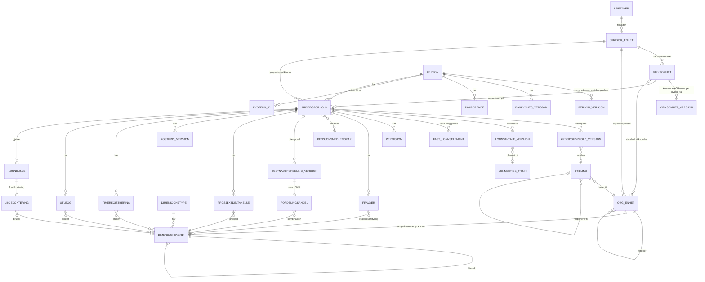

# R2 – Ansattdata i Tripletex og ReAi: person, arbeidsforhold og dimensjoner

**Dato:** 28. oktober 2026
**Til:** Gründerteamet for lønnssystemet «Brutto»
**Formål:** Kartlegge hva Tripletex og ReAi lagrer om hver ansatt, hvordan ansatte knyttes til avdelinger, prosjekter og andre dimensjoner, og hvordan timer, fravær og utlegg havner i lønn. Rapporten ender med et forslag til kanonisk datamodell for Brutto og en mappingtabell for import fra begge systemene.
**Bygger på:** C §6 og §11 (ansettelsesforhold og domenemodell), D §6 (organisasjonskompleksitet og kostnadsfordeling) og F §1.4 og §3 (bitemporale data og tenant-modell).

**Merking av påstander**
- **[API]** Sett i API eller skjema. Feltet eller endepunktet står i den offisielle OpenAPI-spesifikasjonen, og/eller er observert i lesekall mot brukerens egne systemer.
- **[DOK]** Sett i dokumentasjon. Beskrevet i beskrivelsestekstene i spesifikasjonen eller på hjelpesider, men ikke bekreftet i data.
- **[ANT]** Antatt. Min tolkning eller vurdering. Må verifiseres før det bygges inn.
- **Fyllingsgrad** «2/3» betyr at feltet hadde en verdi i 2 av 3 poster i utvalget. Ingen verdier fra ekte poster er notert, bare om feltet var fylt ut.

---

## 0. Hovedfunn

1. **Begge systemene skiller mellom ansatt og arbeidsforhold, og begge versjonerer innholdet i arbeidsforholdet med en fra-dato** [API].
   - Tripletex: `Employee` → `Employment` (start, slutt, underenhet, sluttårsak) → `EmploymentDetails` (gyldig fra `date`: stillingsprosent, STYRK, lønn, ansettelsesform m.m.).
   - ReAi: `Employee` → `employmentRelations` (start, slutt, underenhet) → `employmentLines` (gyldig fra `fromDate`).
   - Historikken gjelder bare *gyldighetstid*. Ingen av dem har registreringstid, så det finnes ingen bitemporalitet. Tripletex har et revisjonsspor (`changes`) som viser hvem og når, men ikke hva som ble endret.
2. **Avdeling ligger på den ansatte, ikke på arbeidsforholdet, og har ingen historikk** i noen av systemene (Tripletex `Employee.department`, ReAi `departmentId`) [API]. Et avdelingsbytte overskriver den gamle verdien. Tripletex fryser likevel avdelingen på lønnsslipp og lønnslinje, så historikken kan rekonstrueres derfra [API, observert].
3. **Ingen av API-ene har prosentvis kostnadsfordeling per ansatt** [API]. I Tripletex kan hver lønnslinje ha én avdeling og ett prosjekt. ReAi har ingen dimensjoner på lønnslinjer i det hele tatt.
4. **Underenhet (virksomhet) ligger på arbeidsforholdet i begge systemene** (Tripletex `Employment.division`, ReAi `enterpriseOrganizationNumber`) [API].
   - Tripletex modellerer kommune med AGA-sone (`Municipality.payrollTaxZone`) og lar kommunen overstyres per versjon av arbeidsforholdet.
   - ReAi har ikke noe felt for AGA-sone.
5. **Frie dimensjoner:**
   - Tripletex har tre frie dimensjoner. De finnes på bilagsposteringer og reiseregninger, og i beta på prosjekter, men **ikke på lønnslinjer** [API].
   - ReAi har ingen frie dimensjoner. Det nærmeste er «generelle underkonti» per hovedbokskonto [API].
6. **Timer til lønn:**
   - Tripletex har en hel kjede: timeføring → aktivitet → lønnsart → lønnslinje med prosjekt. I tillegg kommer månedsgodkjenning med «timer til utbetaling» og kostpris per ansatt med datohistorikk [API/DOK].
   - ReAi samler timene for timelønte i én `HOURLY_SALARY`-linje uten prosjekt [DOK].
7. **Utlegg og reise:**
   - Tripletex: reiseregningen har ansatt, prosjekt, avdeling, tre frie dimensjoner og en lenke til lønnsslippen den ble utbetalt på [API, observert].
   - ReAi: utlegget har ansatt og prosjekt på hodet, og importeres som lønnslinjer med referanse til kildeposteringen [API/DOK].
8. **Fravær:**
   - Begge eksponerer **permisjon og permittering** for a-meldingen, men ingen av dem har sykefravær i det offentlige API-et [API].
   - Tripletex har en fullstendig fraværsmodell i skjemaet (egenmelding, sykt barn, kvoter, godkjenning), men den har ingen offentlige endepunkter [API].
   - ReAi har ikke permittering som permisjonstype [API].
9. **Lønnsoppsettet per ansatt er tynt i begge** [API]. Det mangler tariff, lønnstrinn og ansiennitet, pensjonsmedlemskap per ansatt og faste tillegg med datoer. Skattekort kan leses i ReAi, men ikke i Tripletex sitt offentlige API.
10. **Konsekvens for Brutto:** Modellen må være rikere enn begge kildene. Importen må fylle hullene med eksplisitt «ukjent» og stoppe der det trengs, ikke gjette. Kapittel F foreslår modellen, arvereglene og mappingen.

---

## 1. Metode, kilder og begrensninger

| Kilde | Versjon / omfang | Brukt til |
|---|---|---|
| Tripletex OpenAPI, `https://tripletex.no/v2/openapi.json` | OpenAPI 3.0.1, API 2.75.20, 560 stier, 3005 skjema, hentet 28.10.2026 | Feltlister, enum-verdier, endepunkter |
| ReAi OpenAPI, `https://app.reai.no/openapi/public` | v1, 718 stier, 1091 skjema, hentet 28.10.2026 med brukerens token | Feltlister, enum-verdier, beskrivelsestekster |
| ReAi, lesekall | Bekreftet ReAi via `GET /api/me` (to selskaper). Hentet alle tre ansattposter i de to selskapene (maksgrensen er tre), med arbeidsforholdsrapportering, feriepengeordning og faste trekk. Hentet også innstillinger, roller, avdelinger, prosjekter og aktiviteter | Fyllingsgrad og faktisk struktur |
| Tripletex, lesekall (`ttx request GET`, regnskapsførertoken med 17 klienter) | Kodelister fra eget selskap. Hos én klient (den med flest ansatte): struktur for 3 ansattposter med arbeidsforhold, versjoner, permisjoner, kost- og timepriser, lønnsslipper og reiseregninger, pluss telling av avdelinger, virksomheter, dimensjoner, aktiviteter, lønnsarter og prosjekter | Fyllingsgrad og faktisk struktur |
| Tripletex hjelpesenter (søk) | Artikkel om lønnsart for timelønn på prosjektaktiviteter. Direkte henting ga HTTP 403, så bare søkesammendrag er brukt | [DOK] om timer til lønn |

**Personvern og sikkerhet**
- Bare GET-kall er brukt. Ingen opprettelse, endring, innsending eller godkjenning.
- Alle svar gikk gjennom et filter som bare skrev ut feltnavn, datatype og fylt/ikke fylt. Midlertidige filer med råsvar er slettet.
- Rapporten inneholder ingen navn, identifikatorer, beløp, adresser, kontonumre, skattekort eller fraværsopplysninger fra ekte poster.

**Begrensninger**
- ReAi-selskapene hadde ingen lønnskjøringer, avdelinger, utlegg eller timer i den sjekkede uken. Derfor kunne jeg ikke observere hvordan dimensjoner arves til lønnsbilag i ReAi.
- Tripletex-utvalget er 3 ansatte hos én klient. Fyllingsgradene illustrerer bruken, men er ikke statistikk.

---

## A. Felt per system

### A1 Tripletex

#### A1.1 Ansatt (`Employee`)

| Felt | Type / gyldige verdier | Merknad | Fylt | Kilde |
|---|---|---|---|---|
| `firstName`, `lastName`, `displayName` | string | Fornavn og etternavn i egne felt | 3/3 | [API] |
| `employeeNumber` | string | Ansattnummer, fritt format | 0/3 | [API] |
| `dateOfBirth` | dato | Eget felt | 3/3 | [API] |
| `email` | string | Er også brukernavn. Kan bare settes når den ansatte mangler både e-post og tilgang | 3/3 | [API/DOK] |
| `phoneNumberMobile`, `-Home`, `-Work`, `phoneNumberMobileCountry` | string / Country | Tre telefonnumre | 2/3, 0/3, 0/3 | [API] |
| `nationalIdentityNumber` | string | Fødselsnummer | 3/3 | [API] |
| `dnumber` | string | D-nummer i eget felt | 0/3 | [API] |
| `internationalId` | `{intAmeldingType, country, number}`. Typer: `PASSPORT_NO`, `NATIONAL_INSURANCE_NO`, `TAX_IDENTIFICATION_NO`, `VALUE_ADDED_TAX_IDENTIFICATION_NO` | For utenlandske uten norsk ID (a-melding) | 0/3 | [API] |
| `address` | `addressLine1/2`, `postalCode`, `city`, `country`, matrikkel (`knr`, `gnr`, `bnr`, `fnr`, `snr`, `unitNumber`) | Én adresse uten historikk | 2/3 | [API] |
| `bankAccountNumber`, `iban`, `bic`, `creditorBankCountryId`, `usesAbroadPayment` | string / int / bool | Én konto uten historikk. Utenlandsbetaling krever Autopay | 2/3, 0/3, 0/3, 0/3, 3/3 | [API/DOK] |
| `userType` | `STANDARD`, `EXTENDED`, `NO_ACCESS` | Tilgangsnivå i Tripletex | 3/3 | [API] |
| `allowInformationRegistration` | bool (skrivebeskyttet) | Om den ansatte kan registrere timer, reise og utlegg, og velges som prosjektdeltaker | 3/3 | [API/DOK] |
| `isContact`, `isProxy` | bool | Ekstern kontakt / byråbruker | 3/3 | [API] |
| `comments` | string | Fritekst | 0/3 | [API] |
| `department` | Department | **Én avdeling, uten historikk** | 3/3 | [API] |
| `employeeCategory` | EmployeeCategory | Én kategori | 0/3 | [API] |
| `employments` | liste med Employment | 1 arbeidsforhold per ansatt i utvalget | 3/3 | [API] |
| `holidayAllowanceEarned` | `{year, amount, basis, amountExtraHolidayWeek}` | Opptjente feriepenger (lesefelt) | 0/3 | [API] |
| `changes` | liste med `{employeeId, timestamp, changeType}`. `changeType`: `CREATE`, `UPDATE`, `DELETE`, `LOCKED`, `REOPENED`, `DO_NOT_SHOW` | Revisjonsspor på alle objekter: hvem og når, ikke hva | – | [API] |

#### A1.2 Arbeidsforhold (`Employment`) og versjoner (`EmploymentDetails`)

**`Employment`: én post per arbeidsforhold**

| Felt | Type / gyldige verdier | Merknad | Fylt | Kilde |
|---|---|---|---|---|
| `employmentId` | string | «Existing employment ID used by the current accounting system» (migrering) | 0/3 | [API/DOK] |
| `startDate`, `endDate` | dato | | 3/3, 1/3 | [API] |
| `employmentEndReason` | `EMPLOYMENT_END_EXPIRED`, `_EMPLOYEE`, `_EMPLOYER`, `_WRONGLY_REPORTED`, `_SYSTEM_OR_ACCOUNTANT_CHANGE`, `_INTERNAL_CHANGE` | Sluttårsak. Kodelisten kom i live-oppslag med norske navn (se F5) | 0/3 | [API] |
| `division` | Division | **Underenhet per arbeidsforhold** | 3/3 | [API] |
| `lastSalaryChangeDate` | dato | Ligger på arbeidsforholdet, ikke på versjonen | 0/3 | [API] |
| `noEmploymentRelationship` | bool | «Pensjon og andre ytelser uten arbeidsforhold» | 3/3 | [API/DOK] |
| `isMainEmployer` | bool | Påvirker standard trekkode | 3/3 | [API/DOK] |
| `taxDeductionCode` | `loennFraHovedarbeidsgiver`, `loennFraBiarbeidsgiver`, `pensjon`, `loennTilUtenrikstjenestemann`, `loennKunTrygdeavgiftTilUtenlandskBorger`, `…SomGrensegjenger`, `introduksjonsstoenad`, `ufoereytelserFraAndre` | Trekkode mot skattekortet | 3/3 | [API] |
| `isRemoveAccessAtEmploymentEnded` | bool | Gjelder hele den ansatte, ikke bare dette arbeidsforholdet | 3/3 | [API/DOK] |
| `employmentDetails`, `latestSalary` | liste / ref | Versjoner, og peker til siste versjon | 3/3 | [API] |

**`EmploymentDetails`: versjon gyldig fra `date`**

I utvalget var det **15 versjoner fordelt på 3 arbeidsforhold**, altså i snitt 5. Historikken brukes altså i praksis [API, observert].

| Felt | Type / gyldige verdier | Fylt | Kilde |
|---|---|---|---|
| `date` | dato (gyldig fra) | 15/15 | [API] |
| `employmentType` | `ORDINARY`, `MARITIME`, `FREELANCE`, `NOT_CHOSEN`. Kodelisten har også «Pensjon og andre ytelser uten arbeidsforhold» | 15/15 | [API] |
| `employmentForm` | `PERMANENT`, `TEMPORARY`, `PERMANENT_AND_HIRED_OUT`, `TEMPORARY_AND_HIRED_OUT`, `TEMPORARY_ON_CALL`, `NOT_CHOSEN` | 15/15 | [API] |
| `remunerationType` | `MONTHLY_WAGE`, `HOURLY_WAGE`, `COMMISION_PERCENTAGE`, `FEE`, `PIECEWORK_WAGE`, `NOT_CHOSEN` | 15/15 | [API] |
| `workingHoursScheme` + `shiftDurationHours` | `NOT_SHIFT`, `ROUND_THE_CLOCK`, `SHIFT_365`, `OFFSHORE_336`, `CONTINUOUS`, `OTHER_SHIFT`, `NOT_CHOSEN`. Skiftlengden er påkrevd ved skift | 15/15, 0/15 | [API/DOK] |
| `occupationCode` | `{id, code, nameNO}` (STYRK-08, oppslag via `/employee/employment/occupationCode`) | 15/15 | [API] |
| `percentageOfFullTimeEquivalent` | tall | 15/15 | [API] |
| `annualSalary`, `hourlyWage`, `monthlySalary` | tall. `monthlySalary` er skrivebeskyttet og beregnet | 15/15 | [API] |
| `payrollTaxMunicipalityId` | Municipality | 3/15 | [API]. Overstyrer AGA-kommunen per versjon [ANT] |
| `maritimeEmployment` | `fartoeyId`, `paamoenstringsdato`, `avmoenstringsdato`, `antallTimerPerYrkeskodePerMoenstring`, `shipRegister` (`NIS`/`NOR`/`FOREIGN`), `shipType` (`OTHER`/`DRILLING_PLATFORM`/`TOURIST`), `tradeArea` (`DOMESTIC`/`FOREIGN`) | ikke i utvalget | [API] |

**Verdt å merke seg**
- `employmentType` ligger på *versjonen*. Typen kan dermed endres innenfor samme arbeidsforhold. I a-meldingen er type en egenskap ved selve arbeidsforholdet [ANT].
- **«Timer per uke i full stilling» finnes ikke på `EmploymentDetails`.** Det nærmeste er `StandardTime` (`fromDate`, `hoursPerDay`) per ansatt og `CompanyStandardTime` per selskap [API]. Antakelig regner Tripletex om timer per dag til timer per uke [ANT]. Ingen av de 3 i utvalget hadde egen `StandardTime`, så selskapets standard gjelder.
- «Siste dato for endret stillingsprosent» har heller ikke eget felt. Tripletex utleder den antakelig fra versjonene [ANT].

#### A1.3 Permisjon og permittering (`LeaveOfAbsence`)

| Felt | Type / gyldige verdier | Fylt | Kilde |
|---|---|---|---|
| `employment` | ref | 1/1 | [API] |
| `importedLeaveOfAbsenceId` | string. Permisjons-ID fra tidligere system | 0/1 | [API/DOK] |
| `startDate`, `endDate` | dato | 1/1, 0/1 | [API] |
| `percentage` | tall | 1/1 | [API] |
| `isWageDeduction` | bool. Om permisjonen gir lønnstrekk [ANT] | 1/1 | [API] |
| `type` | `LEAVE_OF_ABSENCE`, `FURLOUGH`, `PARENTAL_BENEFITS`, `MILITARY_SERVICE`, `EDUCATIONAL`, `COMPASSIONATE`, `OTHER_NOT_STATUTORILY_REQUIRED`, `OTHER_STATUTORILY_REQUIRED`, `EDUCATIONAL_NOT_STATUTORILY_REQUIRED`, `EDUCATIONAL_STATUTORILY_REQUIRED` | 1/1 | [API] |

Kodelisten fra live-oppslaget inneholder både «Permisjon», «Velferdspermisjon» og «Utdanningspermisjon» og de nyere oppsplittede kodene (lovfestet / ikke lovfestet). Antakelig er de tre første utfasede a-meldingskoder som ligger igjen [ANT].

#### A1.4 Lønnsoppsett

| Tema | Hvordan det er modellert | Kilde |
|---|---|---|
| **Lønnsarter** (`SalaryType`) | Ligger på firmanivå, ikke per ansatt. Felt: `number`, `name`, `description`, `showInTimesheet`, `isSickPayable`, `isVacationPayable`, `isTaxable`, `isPayrollTaxable`, `payStatementCodeCode`, `ameldingWageCode`, `accountNumberDebit`, `accountNumberCredit`. API-et kan bare lese dem. Hos klienten i utvalget: 164 lønnsarter, `ameldingWageCode` 153/164, debetkonto 162/164, kreditkonto 36/164 | [API, observert] |
| **Lønn per ansatt** | `annualSalary`, `hourlyWage` og `percentageOfFullTimeEquivalent` per versjon (A1.2) | [API] |
| **Faste lønnslinjer** (faste tillegg og trekk per ansatt) | **Har ikke funnet noe offentlig endepunkt.** Lønn kjøres som `SalaryTransaction` → `Payslip` → `SalarySpecification`. `:createSalaryRun` (beta) lager Tripletex sine automatisk beregnede linjer | [API/DOK] |
| **Lønnslinje** (`SalarySpecification`) | `rate`, `count`, `amount`, `salaryType`, `project`, `department`, `description`, `year`/`month`, `refYear` (opptjeningsår for feriepenger), `specificationSupplement` (`carRegNumber`, `carListPrice` for bilfordel). Aktivitet lagres på linjen, men vises ikke i skjemaet (jf. beskrivelsen av filteret `activityId` på `/salary/payslip`) | [API/DOK] |
| **Skattekort** | **Ikke i det offentlige API-et.** Skjemaet `ResponseWrapperCanFetchTaxCardsStatus` finnes, men uten sti. Bare `taxDeductionCode` og `isMainEmployer` ligger på arbeidsforholdet | [API] |
| **Feriepenger** | På firmanivå: `CompanyHoliday` per år (`days`, `vacationPayPercentage1`, `vacationPayPercentage2`, `isMaxPercentage2Amount6G`). Tolkning: ordinær sats og 60+-tillegg med 6G-tak [ANT]. Ingen sats per ansatt i API-et | [API] |
| **Pensjon** | På firmanivå: `PensionScheme` (`pensionSchemeId`, `number`, `startDate`, `endDate`) og en global leverandørliste (`/pension`). **Ingen medlemskap eller sats per ansatt** | [API] |
| **AGA-metode** | `SalarySettings.payrollTaxCalcMethod`: `AA`, `BB`, `CC`, `C2`, `DD`, `EE`, `GG`, `JJ`, pluss `municipality` | [API] |
| **Trekk** (utleggstrekk, fagforening) | Ingen endepunkter. Skjemaet `UnionDetails` finnes, men uten sti | [API] |
| **Kost- og timepris per ansatt** | `HourlyCostAndRate` (`date`, `rate`, `budgetRate`, `hourCostRate`) med datohistorikk. Alle 3 hadde en rad, men alle verdiene var tomme | [API, observert] |
| **Normalarbeidstid** | `StandardTime` (`fromDate`, `hoursPerDay`) per ansatt (0/3) og `CompanyStandardTime` per selskap | [API] |
| **Historisk lønn** | `SalaryTransaction.isHistorical`: lønnsbilag datert før åpningsbalansen | [API/DOK] |

#### A1.5 Bank
Én konto per ansatt (`bankAccountNumber` eller `iban` + `bic` + `creditorBankCountryId`), uten historikk eller gyldighetsdato [API]. Endringer vises bare i `changes` (hvem og når).

#### A1.6 Pårørende (`NextOfKin`)
Felt: `name`, `phoneNumber`, `address` (fritekst) og `typeOfRelationship` (`SPOUSE`, `PARTNER`, `PARENT`, `CHILD`, `SIBLING`) [API]. Ingen av de 3 i utvalget hadde pårørende registrert.

#### A1.7 Kategori, roller og tilganger
- `EmployeeCategory` har `name`, `number` og `description`, og hver ansatt kan ha én [API]. Klienten i utvalget hadde ingen kategorier definert.
- `userType` (`STANDARD`, `EXTENDED`, `NO_ACCESS`), `Entitlement` (`entitlementId`, `name`, `customer` for byråtilgang til klienter) og tildeling via maler (`:grantEntitlementsByTemplate`) [API].
- Prosjekttilgang: `ProjectParticipant.adminAccess` og `Project.accessType` (`NONE`, `READ`, `WRITE`) [API].
- Lederrelasjoner finnes bare som `Department.departmentManager` og `Project.projectManager`. Det finnes ikke noe felt for nærmeste leder på den ansatte [API].

#### A1.8 Virksomhet (underenhet) og AGA-sone
- `Division`: `name`, `organizationNumber`, `startDate`, `endDate`, `municipality`, `municipalityDate`. `municipalityDate` er datoen kommunen gjelder fra, så kommunebytte har en enkel form for historikk [API].
- `Municipality`: `number`, `name`, `county`, `payrollTaxZone` [API].
- Koblingene: `Employment.division` (én per arbeidsforhold), `EmploymentDetails.payrollTaxMunicipalityId` (overstyring per versjon) og `SalarySettings.municipality` (hovedkommune) [API].
- Hos klienten i utvalget: én virksomhet, satt på 3/3 arbeidsforhold. `payrollTaxZone` kom ikke ut i feltvalget mitt, så verdien er ikke verifisert.

### A2 ReAi

#### A2.1 Ansatt (`EmployeeRes`)

| Felt | Type | Merknad | Fylt | Kilde |
|---|---|---|---|---|
| `id`, `tenantId` | int | | 3/3 | [API] |
| `personId` | int | Kobler den ansatte til en person eller bruker på tvers av selskaper [ANT] | 3/3 | [API] |
| `name` | string | **Ett navnefelt**, ikke fornavn og etternavn hver for seg | 3/3 | [API] |
| `email` | string | Påkrevd for aktive ansatte. Brukes til å sende lønnsslipp | 3/3 | [API/DOK] |
| `phone` | string | | 0/3 | [API] |
| `nationalIdentityNumber` | string | Fødselsnummer. D-nummer ligger trolig i samme felt (skattekortstatusen `expired_d_number` tyder på det) [ANT] | 1/3 | [API] |
| `address` | `addressPart1/2`, `postalCode`, `city`, `province`, `countryCode` | | 1/3 | [API] |
| `bankAccount` | `accountNumber`, `iban`, `bankCode`, `countryCode`, `currency` | Én konto uten historikk | 1/3 | [API] |
| `departmentId` | int | **Én avdeling, uten historikk** | 0/3 | [API] |
| `dateOfEmployment`, `endDateOfEmployment` | dato | Utledes fra det siste arbeidsforholdet | 3/3, 0/3 | [API/DOK] |
| `mainEmployer` | bool | Avgjør om tabelltrekk er tillatt | 3/3 | [API/DOK] |
| `previousSystemYtdSalary`, `previousSystemYtdHolidayPayBasis`, `previousSystemHolidayPayBasis` | tall | Migreringsfelt: hittil i år og feriepengegrunnlag fra tidligere system | 1/3, 1/3, 0/3 | [API/DOK] |

**Finnes ikke:** ansattnummer, fødselsdato i eget felt, fornavn og etternavn hver for seg, internasjonal ID, kategori og pårørende [API].

#### A2.2 Arbeidsforhold (`employmentRelations`) og linjer (`employmentLines`)

**Arbeidsforhold**
- `id`, `startDate`, `endDate`, `enterpriseOrganizationNumber` (orgnr for underenheten, som tekst) og `employmentLines[]` [API].
- Rapporteringsendepunktet (`/employment-reporting`) legger til:
  - `employmentId`: arbeidsforhold-ID-en i a-meldingen. Er den `null`, lager ReAi ID-en ut fra virksomhet og relasjons-ID.
  - `endReason`: `employee_resigned`, `employer_dismissed`, `contract_expired`, `never_reported`, `organization_change`, `payroll_system_change`.
  - `leaves[]` (A2.3).

  [API/DOK]
- Flere samtidige arbeidsforhold er tillatt (`POST /employment-relations`) [API/DOK].

**Linje (versjon gyldig fra `fromDate`)**

| Felt | Gyldige verdier / regel | Fylt | Kilde |
|---|---|---|---|
| `employmentType` | `ordinary`, `freelancer` | 3/3 | [API] |
| `formOfEmployment` | `permanent`, `temporary`, `permanent_hired_out`, `temporary_hired_out`, `temporary_on_call`. Gjelder bare ordinære arbeidsforhold | 3/3 | [API/DOK] |
| `remunerationType` | `fixed_salary`, `hourly_wage`, `commission`, `bonus`, `other` | 2/3 | [API] |
| `workingHoursScheme` | `not_shift`, `shift_365`, `round_the_clock_shift_and_rotation_355`, `fully_continuous_shift_and_other_arrangements_336`, `offshore_336`, `other_shift` | 3/3 | [API] |
| `occupationCode` | string (STYRK) | 2/3 | [API] |
| `percentage` | 0–100. `null` betyr 100 | 2/3 | [API/DOK] |
| `fullTimeHoursPerWeek` | > 0 og ≤ 168. Standard 37,5 | 3/3 | [API/DOK] |
| `annualSalary`, `hourlyWage` | Årslønn ved 100 %. Månedslønn = årslønn × prosent / 1200. Oppgis bare én av dem, avledes den andre via `fullTimeHoursPerWeek × 52` | 2/3, 0/3 | [DOK] |
| `municipality` | string, ingen beskrivelse. Antakelig arbeidskommune eller AGA-kommune [ANT] | 2/3 | [API] |
| `lastSalaryChangeDate`, `lastPositionPercentageChangeDate` | dato. Er feltet `null`, bruker a-meldingen `fromDate` | 0/3, 0/3 | [API/DOK] |

**Verdt å merke seg** [DOK]
- `PATCH /employees/{id}` med `employmentLines` **erstatter hele linjelisten i det siste arbeidsforholdet**. Eldre arbeidsforhold kan ikke endres via PATCH.
- En endret type eller ansettelsesform retter ikke allerede innsendte a-meldinger.
- I utvalget hadde hver ansatt ett arbeidsforhold med én linje.
- ReAi mangler arbeidsforholdstypene maritimt og pensjon/ytelse, skiftlengde, maritime felt, lønnsansiennitet og lønnstrinn.

#### A2.3 Permisjon (`leaves`)
- Felt: `leaveId` (tekst, kan bevares fra tidligere system), `percentage`, `startDate`, `endDate` og `paid` (bool eller `null`) [API].
- `type`: `parental`, `military`, `education_statutory`, `education_non_statutory`, `other_statutory`, `other_non_statutory`.
- **Permittering finnes ikke som type** [API].
- En lagret permisjon gir ikke lønnstrekk av seg selv [DOK].
- Ingen av de 3 i utvalget hadde permisjon registrert.

#### A2.4 Lønnsoppsett

| Tema | Hvordan det er modellert | Kilde |
|---|---|---|
| **Lønnsarter** | Fast liste i `specificationCode` med 30 koder, blant annet `FIXED_SALARY`, `HOURLY_SALARY`, `OVERTIME_SALARY`, `OVERTIME_PREMIUM`, `COMMISSION`, `TIPS`, `HOLIDAY_ALLOWANCE`, `VACATION_DEDUCTION`, `NONPROFIT_SALARY`, `TAX_FREE_*` (diett, kjøring), `DRIVING_LOG_*`, `EMPLOYEES_TRAVEL_EXPENSE` og `POST_TAX_DEDUCTION`. **Kunden kan ikke lage egne lønnsarter i API-et** | [API] |
| **Lønnslinje** (`SalaryWageSpecRes`) | `specificationCode`, `quantity`, `rate`, `amount`, `comment`, `holidayAllowanceEarningYear`, `deductionAccountNumber`, `deductionAgreementReference`, `postingId` (kildepostering for utlegg). **Ingen avdeling og intet prosjekt** | [API] |
| **Feriepenger** | Selskapet velger `minimum_vacation` eller `five_week_vacation`. Den ansatte kan få en overstyring (`schemeOverride`, med `source` = `company` eller `employee`). Overstyring 0/3 | [API, observert] |
| **Pensjon** | Firmanivå: `pensionProviderPeriods` med leverandør (6 i enum-listen) og start/slutt. Ikke noe per ansatt. 0 perioder i begge selskapene | [API, observert] |
| **Faste trekk etter skatt** | `recurring-post-tax-deductions`: `description`, `monthlyAmount`, `agreementReference`, `counterAccountNumber`, `active`. **Ingen fra/til-dato, saldo eller prioritet.** 0 i utvalget | [API, observert] |
| **Skattekort** | Per inntektsår: `status` (`available`, `missing_national_identity_number`, `not_fetched`, `no_tax_card`, `not_subject_to_deduction`, `invalid_personal_number`, `invalid_organization_number`, `expired_d_number`), `issuedDate`, `manualPercentageRate` og `withholdings[]` med `deductionCode` (11 verdier), `tableNumber`, `percentageRate`, `freeCardAmount` og `monthsForDeduction` | [API] |
| **Utbetalingsdag** | `payoutDayOfMonth`. Verdien 31 betyr siste virkedag | [API/DOK] |
| **Arbeidsavtale** | `agreements/employee-contract` lager et avtaledokument med `jobTitle`, `workplace`, `noticePeriodMonths`, `salaryType`, `salaryAmount`, `workingHoursPercent`, `otpEnabled`, `otpPensionProvider` og mer. **Dokumentet er ikke koblet til `employeeId`**, så stillingstittel og OTP lagres ikke på den ansatte | [API] |
| **Lønnshistorikk** | `POST /salary-payments/import`: uforanderlig historikk per kjøring og ansatt (brutto, trekk, netto, feriepengegrunnlag, feriepenger, kildelinjer og balanserte posteringer) | [API/DOK] |

#### A2.5 Bank
Én konto uten historikk (`bankAccount`) [API].

#### A2.6 Pårørende
Finnes ikke [API].

#### A2.7 Roller og tilganger
- Rollene gjelder brukere, ikke ansatte: `ROLE_OWNER`, `ROLE_TENANT_ADMIN`, `ROLE_ACCOUNTANT`, `ROLE_EMPLOYEE`, `ROLE_AUDITOR` [API, observert].
- Rollene har tillatelser som `tenant:employee:read/write`, `self:employee:read/write`, `tenant:timesheet:approve`, `tenant:timesheet:approve-project` og `tenant:expense:approve`.
- Det finnes ingen ansattkategori, ingen lederrelasjon og ingen tilgang per felt (for eksempel lønn kontra kontaktinfo).
- Brukeren kobles til den ansatte via `personId` [ANT].

#### A2.8 Virksomhet og AGA-sone
- Underenheten lagres bare som orgnr-tekst (`enterpriseOrganizationNumber`) på arbeidsforholdet. API-et har ingen egen entitet for virksomhet [API].
- Selskapet har `municipalityCode` [API]. Det finnes ikke noe sonefelt. Antakelig utleder ReAi sonen fra kommunen til virksomheten eller selskapet [ANT].
- Avstemmingen mot a-meldingen leser AGA-data per virksomhet fra a-ordningen (`employerContributionFields`) [API].

---

## B. Dimensjoner

### B1 Hvordan hver dimensjon er modellert

| Dimensjon | Tripletex | ReAi |
|---|---|---|
| **Avdeling** | `Department`: `name`, `departmentNumber`, `departmentManager`, `isInactive`, `businessActivityTypeId` (næringstype for mva ved flere næringer). Flat, uten hierarki. Finnes på: Employee (1), Project (1), Payslip, SalarySpecification, TravelExpense, Posting. Klienten i utvalget hadde 1 avdeling [API] | `DepartmentRes`: `name`, `archived`. Flat. Finnes på: Employee (`departmentId`), Posting, kostnadslinjer på leverandørfaktura, manuelle bilag. **Ikke på lønnslinjer, timer eller utlegg.** Begge selskapene hadde 0 avdelinger [API] |
| **Prosjekt** | `Project` med `mainProject` (delprosjekter), `department`, `projectManager`, `participants`, timepriser, `projectActivities`, start/slutt, `isInternal`, `isClosed`, `accountingDimensionValues` (beta). Finnes på: SalarySpecification, TimesheetEntry, TimesheetAllocated, TravelExpense, Posting. 7 prosjekter i utvalget, alle med avdeling og deltakere [API] | `ProjectRes`: `parentId` (delprosjekter), `customerId`, `invoiceCustomerId`, `responsibleEmployeeId`, `hourlyRate`, `isBillable`, `activityIds`, `archived`, `externalId`/`externalSource`. Finnes på: Timesheet, Expense (hodet), DrivingLog-tur, Posting, ordre og faktura. **Ikke på lønnslinjer** [API] |
| **Divisjon / underenhet** | `Division` er underenheten med orgnr og kommune. Den er en juridisk og AGA-relatert størrelse, ikke en analysedimensjon. Ligger på `Employment` [API] | Bare orgnr-tekst på arbeidsforholdet [API] |
| **Kostnadssted** | Ingen egen type. Kundene bruker avdeling eller en fri dimensjon [ANT] | Ingen egen type [API] |
| **Aktivitet** | `Activity`: `activityType` (`GENERAL_ACTIVITY`, `PROJECT_GENERAL_ACTIVITY`, `PROJECT_SPECIFIC_ACTIVITY`, `TASK`), `rate`, `costPercentage`, `isChargeable`. Brukes på timer og prosjekttimepriser, og lagres på lønnslinjer. Er ikke en posteringsdimensjon [API/DOK] | 20 faste globale koder (`development`, `design`, `testing`, …, `administration`, `travel`, `other`), som velges per prosjekt. Bare på timer [API, observert] |
| **Produkt** | `Product` på Posting. Ikke på lønn [API] | Ikke på lønn eller postering i lønnssammenheng [API] |
| **Frie dimensjoner** | `AccountingDimensionName` (`dimensionIndex` 1–3, `active`) og `AccountingDimensionValue` (`number`, `displayName`, `active`, `position`, `showInVoucherRegistration`). Finnes på: Posting (`freeAccountingDimension1–3`), TravelExpense (`freeDimension1–3`), Project (beta). **Ikke på lønnslinjer, timer eller ansatt.** Klienten i utvalget hadde 0 definert [API] | Finnes ikke. Det nærmeste er **generelle underkonti** (`GeneralSubAccount`: `accountNumber`, `name`) per hovedbokskonto, som brukes på postering og importerte lønnsposteringer [API] |

### B2 Ansatt og dimensjoner: antall, prosent og historikk

| Spørsmål | Tripletex | ReAi | Kilde |
|---|---|---|---|
| Hvor mange avdelinger kan en ansatt ha? | Én | Null eller én | [API] |
| Kan avdeling settes per arbeidsforhold? | Nei | Nei | [API] |
| Har avdelingen historikk med gyldighetsdato? | Nei. Avdelingen fryses på lønnsslipp og lønnslinje | Nei | [API, observert] |
| Kan kostnadene fordeles i prosent? | Nei. Kan bare splittes manuelt ved å legge lønnslinjer på ulike avdelinger eller prosjekter | Nei | [API] |
| Har fordelingen gyldig fra/til? | Nei | Nei | [API] |
| Kan underenhet settes per arbeidsforhold? | Ja, uten historikk innenfor arbeidsforholdet. AGA-kommunen kan overstyres per versjon | Ja (som tekst), uten historikk | [API] |
| Finnes prosjektdeltakelse? | Ja (`ProjectParticipant`), men uten dato, rolle eller prosent | Nei. Bare prosjektansvarlig og planlagt arbeid (`ProjectWork.employeeIds`) | [API] |

### B3 Hvordan dimensjoner arves til lønn, timer og utlegg

**Tripletex**
- **Lønnsslipp:** `Payslip.department` var satt på 3/3 lønnsslipper, og `SalarySpecification.department` på 12 av 15 linjer [API, observert].
  - Linjene uten avdeling er antakelig beregnede linjer, for eksempel forskuddstrekk [ANT].
  - Antakelig hentes avdelingen fra den ansattes avdeling når lønnsslippen lages, og kan overstyres per linje [ANT].
- **Prosjekt på lønnslinje:** Settes manuelt, eller kommer fra timelisten via `TimesheetProjectSalaryTypeSpecification` (se C1). Ingen av de 15 linjene i utvalget hadde prosjekt [API, observert].
- **Postering:** Lønnsbilagets posteringer har feltene `department`, `project` og `employee`. Frie dimensjoner finnes på posteringen, men lønnslinjen har ikke noe felt for dem, så de kan ikke komme fra lønn [API/ANT].
- **AGA, feriepenger og pensjon:** Hvordan disse fordeles på avdeling og prosjekt i lønnsbilaget, er ikke verifisert [ANT].
- **Timer:** `TimesheetEntry` lagrer `hourlyRate`, `hourlyCost` og `hourlyCostPercentage` som et øyeblikksbilde, hentet fra `HourlyCostAndRate`, aktiviteten og prosjektets timeprismodell [API].
- **Reiseregning:** Avdeling, prosjekt og frie dimensjoner ligger på *hodet*, ikke per kostnad [API]. I utvalget var avdeling satt på 4/5 og frie dimensjoner på 0/5.

**ReAi**
- **Lønnslinjer har ingen dimensjoner** [API].
- Lønnsbilaget kunne ikke observeres fordi selskapene ikke har lønnskjøringer. Antakelig posteres det uten avdeling og prosjekt, eller med den ansattes avdeling [ANT, må testes i et testselskap].
- **Utlegg:** Prosjektet ligger på utlegget. Når utlegget importeres til lønn, beholdes `postingId` til kildeposteringen [API/DOK].
- **Import av lønnshistorikk:** Posteringene har konto, beløp, ansatt og underkonto, men ikke avdeling eller prosjekt [API].

### B4 Prosjektdeltakere og timepriser

**Tripletex: tre lag med priser** [API]

| Lag | Objekt | Felt | Historikk |
|---|---|---|---|
| Ansatt | `HourlyCostAndRate` | `rate` (timepris), `budgetRate`, `hourCostRate` (kostpris) | Ja, med `date` |
| Aktivitet | `Activity` | `rate`, `costPercentage`, `isChargeable` | Nei |
| Prosjekt | `ProjectHourlyRate` | `startDate` og `hourlyRateModel`: `TYPE_PREDEFINED_HOURLY_RATES`, `TYPE_PROJECT_SPECIFIC_HOURLY_RATES` (`ProjectSpecificRate`: `hourlyRate` og `hourlyCostPercentage` per ansatt og/eller aktivitet) eller `TYPE_FIXED_HOURLY_RATE` (`fixedRate`) | Ja, med `startDate` |

- **Deltakere:** `ProjectParticipant` har `project`, `employee` og `adminAccess`. Med `Project.forParticipantsOnly` kan bare deltakere føre på prosjektet.
- **Kontroll:** `project/{id}/actionList/employeesWithMissingHourlyRate` lister deltakere som mangler timepris.
- **Ressursplan:** `TimesheetAllocated` (`employee`, `project`, `activity`, `date`, `hours`, `isApproved`) viser planlagte timer per dag, ikke prosent.
- **Utvalget:** Alle 7 prosjekter hadde fast timepris (`TYPE_FIXED_HOURLY_RATE`) og deltakere.

**ReAi** [API/DOK]
- Timeprisen settes bare per prosjekt (`hourlyRate`) eller som selskapets standard (`project-settings`). Den brukes bare til fakturagrunnlag.
- Det finnes ingen kostpris per ansatt og ingen deltakerliste. Prosjektet har en ansvarlig, og planlagt arbeid (`ProjectWork`) har `employeeIds`, `startsAt`/`endsAt` og `status`.

---

## C. Timer, fravær og utlegg på vei inn i lønn

### C1 Tripletex

```
TimesheetEntry (ansatt, dato, prosjekt, aktivitet, timer, fakturerbar, godkjent per time, låst, timepris/kostpris-snapshot)
   │  uke/måned fullført og godkjent → MonthlyStatus (approved, approvedUntilDate, hoursPayout, vacationPayout, flex- og feriesaldo)
   ▼
Aktivitetens «Lønnsart timelønn» (per prosjekt eller global aktivitet)  [DOK]
   ▼
TimesheetProjectSalaryTypeSpecification (ansatt, prosjekt, aktivitet, lønnsart, dato, antall, wagePayment → lønnsslipp)
   ▼
SalarySpecification på lønnsslippen (lønnsart, antall, sats, prosjekt, avdeling)
```

- **Timer** [API/DOK]:
  - Tillegg kan registreres direkte i timelisten som `TimesheetSalaryTypeSpecification` (ansatt, lønnsart, dato, antall). Høyst én registrering per ansatt, dato og lønnsart er tillatt.
  - Lønnsarten har flagget `showInTimesheet` [API].
  - Ifølge hjelpesenteret virker koblingen mellom aktivitet og lønnsart bare for lønnsarter med a-meldingskode for timer, som timelønn og overtid. Fastlønn fordeles på prosjekt gjennom en egen funksjon som jeg ikke har verifisert [DOK].
  - I utvalgsmåneden hadde de 3 ansatte ingen timer og ingen lønnsartregistreringer i timelisten.
- **Fravær:**
  - `LeaveOfAbsence` går til a-meldingen som permisjon eller permittering, med `isWageDeduction` [API].
  - Sykefravær (egenmelding, sykt barn) finnes i skjemaet `Absence`. Det inneholder type, periode, status, kvoter for egenmeldingsperioder og -dager, arbeidsgiverperiode, godkjenning, automatisk føring av timer, arbeidsrelatert og IA-bedrift. **Skjemaet har ingen offentlige stier** [API].
  - Ferie følges opp via feriesaldo i timelisten (`vacationBalance`, `VacationSummary`) og selskapets feriedager [API].
- **Reise og utlegg:**
  - `TravelExpense` inneholder ansatt, prosjekt, avdeling, frie dimensjoner 1–3, kostnader (kategori, betalingstype, `isPaidByEmployee`), diett, kjøregodtgjørelse, overnatting og attestering.
  - Flyten er godkjenning → `:createVouchers` → status `SALARY_PAID` med lenke `payslip` når beløpet er utbetalt via lønn [API].
  - I utvalget var 4 av 4 godkjente reiseregninger lenket til både lønnsslipp og bilag.
  - Diett og kjøregodtgjørelse blir egne lønnsarter i a-meldingen [ANT].

### C2 ReAi

- **Timer:**
  - `TimesheetEntry` har ansatt, dato, timer, prosjekt, aktivitet, kommentar, `approvalLocked` og `billingOrderId`. Timene godkjennes per måned og prosjekt (`TimesheetApprovalGroup`, med status `not_submitted` → `submitted` → `approved`/`returned`/`resubmission_required`) [API].
  - `fetch-salary-rows` erstatter `HOURLY_SALARY` med periodens timer minus overtidstimene som allerede ligger i kjøringen. Den legger også til `FIXED_SALARY` og feriepenger der de mangler [DOK].
  - **Resultatet er én linje uten prosjekt.** Overtid legges inn manuelt som `OVERTIME_SALARY` eller `OVERTIME_PREMIUM` [DOK].
- **Arbeidsplan:** `work-schedules` og `work-schedule-groups` er bare planlegging. De er uavhengige av avdeling, prosjekt, fravær og lønn [DOK].
- **Fravær:**
  - Bare `leaves` på arbeidsforholdet, til bruk i a-meldingen. Gir ikke lønnstrekk [DOK].
  - Det finnes ikke sykefravær, egenmelding eller feriesaldo i API-et. `holiday` i arbeidsplanen er planlagt ferie [API].
- **Utlegg:**
  - `Expense` har ansatt, prosjekt, formål, kostnadslinjer (kategori fra en fast liste, mva, beløp, valuta), diett (`perDiems`), kjøregodtgjørelse (`mileageAllowances`), status (`open` → `for_approval` → `approved`) og bilag [API].
  - `import-expenses` legger ubetalte utlegg og reiseutgifter inn i lønnskjøringen som lønnslinjer med `postingId` til kilden. Utlegg som alt er utbetalt, hoppes over, så det blir ikke dobbel utbetaling [DOK].
- **Kjørebok:** `DrivingLogTrip` har ansatt, kjøretøy, prosjekt, km, passasjerer, utstyr, bom og skattepliktig del. Turene blir `DRIVING_LOG_*`-lønnslinjer [ANT, ut fra kodene].

---

## D. Sammenligning felt for felt

«–» betyr at feltet ikke finnes i API-et. A-meldingsnavnene følger meldingsstrukturen slik jeg kjenner den. Kodenavn merket [ANT] må sjekkes mot Skatteetatens gjeldende kodeliste.

| # | Brutto-begrep | Tripletex | ReAi | A-meldingsfelt | Merknad |
|---|---|---|---|---|---|
| 1 | Navn | `firstName`, `lastName` | `name` (ett felt) | (navn bare for mottaker uten norsk ID) [ANT] | ReAi-navn må deles opp ved import |
| 2 | Fødselsnummer | `nationalIdentityNumber` | `nationalIdentityNumber` | `inntektsmottaker/norskIdentifikator` | |
| 3 | D-nummer | `dnumber` | samme felt som fnr [ANT] | `norskIdentifikator` | |
| 4 | Internasjonal ID | `internationalId{type, country, number}` | – | `internasjonalIdentifikator` (identifikator, type, utstedelsesland) | |
| 5 | Fødselsdato | `dateOfBirth` | – (utledes fra fnr) | `foedselsdato` (bare uten norsk ID) [ANT] | |
| 6 | Ansattnummer | `employeeNumber` | – | – | |
| 7 | E-post / telefon | `email`, tre telefonfelt | `email`, `phone` | – | |
| 8 | Adresse | `address` (+ matrikkel) | `address` (+ `province`) | – [ANT] | |
| 9 | Bankkonto | `bankAccountNumber`, `iban`, `bic`, `creditorBankCountryId` | `bankAccount{…}` | – | Ingen av dem har historikk |
| 10 | Pårørende | `NextOfKin` | – | – | |
| 11 | Kategori | `employeeCategory` | – | – | |
| 12 | Tilgang | `userType`, `Entitlement` | Brukerrolle (`ROLE_*`) | – | |
| 13 | Arbeidsforhold-ID | `Employment.employmentId` (importert) | `employmentId` (overstyring, ellers generert) | `arbeidsforholdId` | Må bevares ved migrering |
| 14 | Type arbeidsforhold | `employmentType` på versjonen | `employmentType` (`ordinary`/`freelancer`) | `typeArbeidsforhold` | ReAi mangler maritimt og pensjon |
| 15 | Start / slutt | `startDate`, `endDate` | relasjonens `startDate`, `endDate` | `startdato`, `sluttdato` | |
| 16 | Sluttårsak | `employmentEndReason` (6) | `endReason` (6) | sluttårsak [ANT: elementnavn] | Kodene tilsvarer hverandre én til én (F5) |
| 17 | Underenhet | `Employment.division` | `enterpriseOrganizationNumber` | `virksomhet/norskIdentifikator` | |
| 18 | AGA-kommune / -sone | `Division.municipality` (`payrollTaxZone`), `payrollTaxMunicipalityId` på versjon | `municipality` (ingen beskrivelse) [ANT] | `arbeidsgiveravgift` per sone og virksomhet | |
| 19 | Hovedarbeidsgiver / trekkode | `isMainEmployer`, `taxDeductionCode` | `mainEmployer`, skattekortets `deductionCode` | (skattekortforespørsel) [ANT] | |
| 20 | Ansettelsesform | `employmentForm` (5 + `NOT_CHOSEN`) | `formOfEmployment` (5) | `ansettelsesform` | Samme fem verdier i begge |
| 21 | Avlønningstype | `remunerationType` (fastlønn, timelønn, provisjon, honorar, akkord) | `remunerationType` (`fixed_salary`, `hourly_wage`, `commission`, `bonus`, `other`) | `avloenningstype` | ReAi sine `bonus` og `other` har ingen sikker motpart [ANT] |
| 22 | Arbeidstidsordning | `workingHoursScheme` (6) + skiftlengde | `workingHoursScheme` (6) | `arbeidstidsordning` | |
| 23 | Yrkeskode | `occupationCode.code` | `occupationCode` | `yrke` (STYRK-08) | |
| 24 | Stillingsprosent | `percentageOfFullTimeEquivalent` | `percentage` | `stillingsprosent` | |
| 25 | Timer per uke i full stilling | – (`StandardTime` timer per dag) [ANT] | `fullTimeHoursPerWeek` | `antallTimerPerUkeSomEnFullStillingTilsvarer` | Tripletex mangler eksplisitt felt |
| 26 | Årslønn | `annualSalary` | `annualSalary` (ved 100 %) | – | |
| 27 | Timelønn | `hourlyWage` | `hourlyWage` | – (timeantall på inntekt) | |
| 28 | Siste lønnsendring | `Employment.lastSalaryChangeDate` | `lastSalaryChangeDate` (på linjen) | `sisteLoennsendringsdato` | |
| 29 | Siste endring av stillingsprosent | – (utledes) [ANT] | `lastPositionPercentageChangeDate` | `sisteDatoForStillingsprosentendring` | |
| 30 | Gyldig fra (versjon) | `EmploymentDetails.date` | `employmentLine.fromDate` | (månedlig øyeblikksbilde) | Ingen registreringstid i noen av dem |
| 31 | Lønnsansiennitet / lønnstrinn | – | – (leses bare i avstemmingen) | `loennsansiennitet`, `loennstrinn` | Hull i begge |
| 32 | Maritime opplysninger | `maritimeEmployment{…}` | – | `fartoey` (`skipsregister`, `skipstype`, `fartsomraade`) | |
| 33 | Permisjon / permittering | `LeaveOfAbsence` (10 typer, prosent, lønnstrekk, importert ID) | `leaves` (6 typer, prosent, betalt, `leaveId`) | `permisjon` (`permisjonId`, `startdato`, `sluttdato`, `permisjonsprosent`, `beskrivelse`) | ReAi mangler permittering |
| 34 | Sykefravær | (skjema uten endepunkt) | – | – (går til NAV via inntektsmelding) | |
| 35 | Skattekort | – (ikke offentlig) | `tax-cards/{år}` | (forskuddstrekk som beløp) | |
| 36 | Feriepengesats | firmanivå (`CompanyHoliday`) | firmanivå + overstyring per ansatt | – | |
| 37 | Feriepengegrunnlag fra tidligere system | `holidayAllowanceEarned` (lesefelt) | `previousSystem*` | – | |
| 38 | Pensjon | firmanivå (`PensionScheme`) | firmanivå (`pensionProviderPeriods`) | (rapporteres via pensjonsleverandør) [ANT] | Ikke per ansatt i noen av dem |
| 39 | Faste trekk | – | `recurring-post-tax-deductions` | – | |
| 40 | Avdeling | `Employee.department`; Payslip / SalarySpecification `.department` | `Employee.departmentId` | – | |
| 41 | Prosjekt på lønnslinje | `SalarySpecification.project` | – | – | |
| 42 | Frie dimensjoner | Posting, TravelExpense (1–3) | – | – | |
| 43 | Kost- og timepris | `HourlyCostAndRate` | – | – | |
| 44 | Lønnsart | `SalaryType` (egendefinert, `ameldingWageCode`, flagg, konti) | `specificationCode` (fast liste med 30) | `inntekt/beskrivelse`, `fordel`, trekk- og AGA-flagg | |
| 45 | Antall og sats på lønnslinje | `count`, `rate` | `quantity`, `rate` | `inntekt/antall` (for timelønn m.fl.) | |
| 46 | Opptjeningsperiode | `year`/`month` på linjen | `periodYear`/`periodMonth` på kjøringen | `opptjeningsperiode` | |
| 47 | Opptjeningsår for feriepenger | `refYear` | `holidayAllowanceEarningYear` | – | |
| 48 | Revisjonsspor | `changes[]` (hvem og når) | – (ikke i API) | – | |

---

## E. Svakheter og hull sett fra en virksomhet med 100–1000 ansatte

| # | Hull | Tripletex | ReAi | Viktighet |
|---|---|---|---|---|
| 1 | **Ingen bitemporalitet.** Det er umulig å svare på «slik vi visste det da lønnsslippen ble laget» (F §1.4). Retroendringer overskriver | Bare `changes` (hvem og når) | Ingenting | Høy |
| 2 | **Avdelingen har ingen historikk og ligger ikke på arbeidsforholdet.** Omorganiseringer ødelegger rapporter bakover i tid | Kan rekonstrueres fra lønnsslipper | Kan ikke rekonstrueres | Høy |
| 3 | **Ingen prosentvis kostnadsfordeling med gyldighetsdatoer og ingen retroaktiv omfordeling** (D §6.3). Viktig for prosjektlønn og tilskudd (D §6.4) | Bare manuell splitting av lønnslinjer | Ingenting | Høy |
| 4 | **Frie dimensjoner når ikke frem til lønn.** Maks tre, uten hierarki | Gjelder | Har ingen frie dimensjoner | Høy |
| 5 | **Timer → prosjektlønn.** Det går ikke an å lage en prosjektlønnsrapport per finansiør | Mulig for timelønn med lønnsartkobling. Fastlønn er usikkert [DOK] | Timene havner i én linje uten prosjekt | Høy |
| 6 | **Pensjon bare på firmanivå.** Det mangler medlemskap, innmeldingsdato, sats og ordning per gruppe | Gjelder | Gjelder | Høy |
| 7 | **Sykefravær, arbeidsgiverperiode og refusjon mangler i API-et** | Finnes i skjema, men skjult | Mangler | Høy |
| 8 | **Ingen tariffavtale, lønnsstige, lønnstrinn eller ansiennitet.** Masseoppdatering ved lønnsoppgjør blir manuell (D §2.2) | Mangler | Mangler | Høy for offentlig og ideell sektor |
| 9 | **Lederlinje og attestasjonshierarki** for godkjenning av timer, fravær og utlegg | Bare avdelingsleder og prosjektleder | Mangler | Middels–høy |
| 10 | **Faste tillegg og trekk mangler fra/til-dato, saldo og prioritet** | Ikke i API | Bare månedsbeløp og aktiv/inaktiv | Middels–høy |
| 11 | **Ingen stillings- eller posisjonsmodell.** Det går ikke an å ha en ledig stilling, budsjettert FTE eller rapportere til en stilling (D §6.5) | Mangler | Mangler | Middels |
| 12 | **Bytte av underenhet.** Krever nytt arbeidsforhold (sluttårsaken «endring i organisasjonsstruktur» finnes), men ingen av dem har en egen flytteoperasjon [ANT] | Manuelt | Manuelt | Middels |
| 13 | **Flere arbeidsforhold er støttet, men dårlig håndtert** | Typen kan endres per versjon | PATCH virker bare på det siste arbeidsforholdet | Middels |
| 14 | **AGA-sone.** Ansatte som jobber i flere soner, og 50 %-regelen for arbeid i utlandet, er ikke modellert | Kommune per virksomhet med dato, og overstyring per versjon | Ikke noe sonefelt | Middels |
| 15 | **Feriepenger per ansatt:** 60+, individuelle avtaler, feriesaldo per ferieår | Firmanivå og saldo i timelisten | Firmanivå med overstyring for 4 eller 5 uker | Middels |
| 16 | **Masterdata for større kunder:** ett navnefelt, intet ansattnummer, ingen fødselsdato, ingen internasjonal ID, ingen pårørende eller kategori, faste lønnsarter | – | Gjelder | Høy (ReAi) |
| 17 | **Prosjektdeltakelse mangler periode, rolle og prosent** | Gjelder | Har ingen deltakelse | Middels |
| 18 | **Fordeling av AGA, feriepenger og OTP i lønnsbilaget er uklar** | Ikke verifisert | Ikke observerbar | Middels |
| 19 | **Tilgang per felt** (lønn kontra kontaktinfo) og tilgang per org-enhet | Grove rettigheter | Bare roller | Middels |
| 20 | **Bankkonto uten historikk eller ekstra kontroll ved endring.** Svindelrisiko (D §3.2) | Gjelder | Gjelder | Middels |

---

## F. Forslag til Brutto sin kanoniske modell

### F1 Prinsipper

1. **Person, Arbeidsforhold, Stilling og Lønnsavtale er fire forskjellige ting** (jf. C §11). Personen er felles for hele leietakeren. Arbeidsforholdet hører til én juridisk enhet.
2. **Alt som påvirker beregning, rapportering eller kostnadsføring er bitemporalt**, det vil si har både gyldighetstid og registreringstid (F §1.4). Ren kontaktinfo får vanlig revisjonslogg.
3. **Dimensjoner er data, ikke kolonner.** Modellen består av DimensjonsType, DimensjonsVerdi og Kostnadsfordeling med gyldighet og prosent.
4. **Juridisk struktur holdes adskilt fra analytisk struktur.** Juridisk enhet → virksomhet styrer a-melding og AGA. Avdeling, prosjekt og kostnadssted styrer kontering. En organisasjonsenhet kan peke på en standard virksomhet.
5. **Arv følger en fast og dokumentert rekkefølge, og resultatet fryses på hver linje.**
6. **Kilde-ID-er lagres** (EksternID), slik at importen kan kjøres på nytt (idempotent) og spores.

### F2 Entiteter og relasjoner



### F3 Nøkkelattributter og invarianter

| Entitet | Nøkkelattributter | Invarianter og begrunnelse |
|---|---|---|
| **Person** | `person_id`, fnr/dnr (kryptert), internasjonale ID-er (type, land, nummer), fornavn, mellomnavn, etternavn, fødselsdato, statsborgerskap, ansattnummer (unikt i leietakeren), foretrukket språk, kontakt (privat og jobb), dødsdato, trygdetilhørighet/A1 (versjonert) | Fnr er unikt per leietaker. Navnet lagres i deler, siden Tripletex har det delt og a-meldingen kan trenge det. Ansattnummeret følger personen på tvers av arbeidsforhold [ANT: alternativt per juridisk enhet, og da som lokal overstyring] |
| **Bankkonto-versjon** | konto eller IBAN/BIC/land, gyldig fra, registrert av, verifisert (J/N), kilde | Endring krever en ekstra kontroll (fire øyne eller BankID) og gir varsel til den ansatte. Ingen av kildene har historikk, så importen lager én versjon gyldig fra importdato |
| **Pårørende** | navn, relasjon (enum som Tripletex), telefon, adresse | Bare synlig for HR-rollen |
| **Arbeidsforhold** (stabilt) | `id`, **arbeidsforholdId (a-melding, aldri gjenbrukt)**, person, juridisk enhet, **virksomhet**, type (ordinær, maritim, frilanser/oppdragstaker/honorar, pensjon/ytelse uten arbeidsforhold), start, slutt, sluttårsak, oppsigelsesdato, hovedarbeidsgiver (J/N), forrige arbeidsforhold (ved intern flytting), eksterne ID-er | **Virksomhet og type ligger på det stabile arbeidsforholdet.** Bytte av underenhet gjøres som en «flytting»: det gamle arbeidsforholdet avsluttes med sluttårsak «endring i organisasjonsstruktur», og et nytt opprettes med lenke til det forrige [ANT, sterkt indisert av kodelisten for sluttårsak. Avviker fra C §11, der virksomhet lå på versjonen] |
| **Arbeidsforholdsversjon** (bitemporal) | gyldig fra/til, registrert fra/til, stillingsprosent, timer per uke i full stilling, arbeidstidsordning, skiftlengde, ansettelsesform, avlønningstype, STYRK-08, stilling, tariffavtale, lønnsansiennitetsdato, AGA-kommune (overstyring), arbeidssted, maritime felt, endringsgrunn | Versjonene overlapper ikke. «Siste lønnsendring» og «siste endring av stillingsprosent» **utledes** fra versjonene, men kan overstyres ved import (begge kildene lagrer dem) |
| **Stilling** (valgfri) | `id`, tittel, org-enhet, standard STYRK, budsjettert FTE, rapporterer til stilling, standard kostnadsfordeling, gyldig fra/til | Kunden kan droppe stillinger. Lederlinjen kan da angis direkte på org-enheten |
| **Lønnsavtale-versjon** (bitemporal) | grunnlag (måned, år, time, akkord, provisjon, honorar), beløp eller (lønnsstige + trinn), garantilønn, feriepengeordning (4 eller 5 uker, sats, 60+-regel), overtidsregelsett, metode for forholdsmessig lønn, nettolønnsavtale (J/N), utbetalingsfrekvens, endringsgrunn (oppgjør, opprykk, individuelt) | Effektiv lønn er minst lik garantilønnen. Lønnsoppgjør skaper nye versjoner med virkningsdato (C §5.4) |
| **Fast lønnselement** | lønnsart, sats, antall eller beløp, gyldig fra/til, kontering (overstyring), avtalereferanse, saldo og prioritet (for trekk) | Erstatter ReAi sine faste trekk og de faste postene Tripletex mangler |
| **Permisjon** | permisjonId (a-melding, bevares fra kilden), type (a-meldingskodelisten, **inkludert permittering**), prosent, fra/til, lønnstrekk-regel, betalt (J/N) | Det samme permisjonsforholdet overlapper ikke seg selv. Typen styrer både a-melding og lønnstrekk |
| **Fravær** | type (egenmelding, sykmelding, sykt barn, ferie, avspasering, velferd …), fra/til, grad, AGP-id, refusjon, kilde, godkjenning, valgfri kontering | Egen entitet, adskilt fra Permisjon. Fravær rapporteres ikke som permisjon i a-meldingen |
| **Organisasjonsenhet** | kode, navn, forelder, nivå (divisjon, avdeling, seksjon, team), leder (person eller stilling), standard virksomhet, gyldig fra/til | **Er samtidig en DimensjonsVerdi av typen AVD.** Da trengs det ikke to trær |
| **DimensjonsType** | kode (`AVD`, `PRO`, `KST`, `AKT`, `PRD`, egendefinerte), navn, hierarkisk (J/N), påkrevd for (lønnsarter/kontoklasser), gyldige kontoer, eksport-mapping per regnskapssystem | Tripletex: `department`, `project`, `product`, `freeDimension1–3`. ReAi: `department`, `project`, `subAccount` |
| **DimensjonsVerdi** | type, kode, navn, forelder, gyldig fra/til, status (aktiv, stengt for nye føringer, arkivert), ansvarlig, attributter (prosjekt: kunde, finansiør, tilskuddsnummer, stengt etter) | Det går ikke an å føre på en verdi etter sluttdatoen. Historiske linjer beholder verdien |
| **Kostnadsfordeling-versjon** (bitemporal, per arbeidsforhold) | gyldig fra/til, registrert, profil (fast, timebasert, lønnsart-spesifikk), kilde, andeler `[{prosent, {AVD, PRO, KST, AKT, …}}]` | **Summen er 100,00 % per dag.** Hver andel er en *kombinasjon* av dimensjonsverdier, ikke én dimensjon om gangen, fordi prosjekter kan tilhøre andre avdelinger enn den ansattes |
| **Prosjektdeltakelse** | arbeidsforhold, prosjekt, rolle, fra/til, planlagt prosent eller timer, overstyring av timepris og kostpris | Gir tilgang til å føre timer og danner grunnlaget for en timebasert fordelingsprofil |
| **Kostpris-versjon** | arbeidsforhold (eller stilling), gyldig fra, kostpris (beregnet fra lønn × påslag, eller manuell), intern og ekstern timepris | Tilsvarer Tripletex `HourlyCostAndRate`. ReAi har ingenting tilsvarende |
| **Timeregistrering** | arbeidsforhold, dato, timer, tidstype eller lønnsart, prosjekt, aktivitet, eventuell avdeling, godkjenningsstatus, låst, kilde | Godkjente og låste timer er grunnlaget for lønn. Endringer etter lønnskjøring gir korreksjon |
| **Utlegg** | arbeidsforhold, linjer (kategori, beløp, mva, dato), diett, kjøring, kontering per linje, status, bilag, utbetalt i kjøring | Det utbetales aldri to ganger (som ReAi sin `postingId`-sperre) |
| **Lønnslinje / Linjekontering** | lønnslinje → n konteringsandeler (prosent, beløp, dimensjonskombinasjon, kilde for regelen) | Andelene summeres til linjebeløpet på øret («største rest»-avrunding). Den frosne konteringen endres aldri etter godkjenning. Endringer skjer med omfordelingsbilag |

### F4 Hvordan dimensjoner arves til lønnslinjer, timer, fravær og utlegg

**Rekkefølge for kontering av en lønnslinje.** For hver dimensjonstype vinner den første regelen i listen som gir en verdi:

1. **Eksplisitt på linjen:** manuell overstyring, eller kontering som følger med fra kilden (timeregistrering eller utleggslinje).
2. **Kilderegistreringen:**
   - timer gir prosjekt, aktivitet og eventuell avdeling;
   - utlegg gir kontering per kostnadslinje;
   - fravær arver arbeidsforholdets fordeling for fraværsdagene, med mindre fraværet har en egen kontering.
3. **Lønnsartens regel,** for eksempel «AVD fra arbeidssted», «ikke fordel» (balansekontoer) eller «prosjekt påkrevd».
4. **Arbeidsforholdets kostnadsfordeling på opptjeningsdatoen.** Endres fordelingen midt i perioden, deles linjen opp etter datoene, på samme måte som ved forholdsmessig lønn (C §2.2).
5. **Standard for stilling eller organisasjonsenhet.**
6. **Den juridiske enhetens standard,** eventuelt «ufordelt», som gir en advarsel.

**Avledede linjer.** AGA, feriepengeavsetning, OTP og forsikring fordeles proporsjonalt med konteringen på grunnlagslinjene (C §11). Når ferie utbetales, brukes konteringen fra opptjeningsåret [ANT, må avgjøres som et konfigurasjonsvalg].

**Timebasert fordeling av fastlønn** (profiltypen «timebasert»). Fastlønnen fordeles etter de godkjente timene per prosjekt i perioden. Resten går til standardfordelingen. Tak og minimum styres per profil. Det er dette som gjør en prosjektlønnsrapport per finansiør mulig (D §6.4).

**Retroaktiv omfordeling.** Får fordelingen en ny versjon med tilbakevirkende kraft, lager systemet et **omfordelingsbilag** med differansen per periode. Lønnskjøringen kjøres ikke på nytt, og lønnsslippen er uendret (D §6.3, punkt 4).

**Timer, fravær og utlegg selv**

| Kilde | Kontering |
|---|---|
| Timer | Får prosjekt og aktivitet fra registreringen. Mangler avdeling, brukes avdelingen fra fordelingen som gjelder på dagen |
| Fravær | Arver fordelingen. Kan overstyres, for eksempel slik at sykefravær føres på drift |
| Utlegg | Kostnaden konteres per linje. Refusjonslinjen i lønn går mot gjeld og trenger ikke kontering |

### F5 Mapping for import

**Hovedmapping**

| Brutto-felt | Tripletex-kilde | ReAi-kilde | Transformasjon / merknad |
|---|---|---|---|
| Person.fornavn/etternavn | `Employee.firstName/lastName` | `Employee.name` | ReAi: del på siste mellomrom og flagg for manuell kontroll |
| Person.fnr/dnr | `nationalIdentityNumber` / `dnumber` | `nationalIdentityNumber` | Skill fnr fra dnr på første siffer (D-nummer har 4–7). Valider kontrollsiffer |
| Person.fødselsdato | `dateOfBirth` | Utledes fra fnr/dnr | |
| Person.internasjonal ID | `internationalId` | – | |
| Person.adresse/kontakt | `address`, `email`, telefonene | `address`, `email`, `phone` | |
| Bankkonto-versjon | `bankAccountNumber`, `iban`, `bic`, `creditorBankCountryId` | `bankAccount.*` | Gyldig fra importdato, kilde = migrering |
| Pårørende | `/employee/nextOfKin` | – | |
| EksternID | `Employee.id` + klient-ID | `Employee.id`, `personId` + tenant-ID | Gjør importen idempotent |
| Person.ansattnummer | `employeeNumber` | – (genereres) | Konflikt på tvers av selskaper legges i EksternID |
| Arbeidsforhold | `Employment` | `employmentRelations[]` | Ett til ett |
| Arbeidsforhold.arbeidsforholdId | `employmentId`. Er den tom, må ID-en hentes fra a-ordningen [ANT] | `employment-reporting.employmentId`. Er den `null`, er den generert av ReAi, og den faktiske ID-en hentes fra a-ordningen | **Kritisk.** Feil ID gir nye arbeidsforhold i a-ordningen |
| Arbeidsforhold.juridisk enhet | Klientselskapet | Tenant | |
| Arbeidsforhold.virksomhet | `Employment.division.organizationNumber` | `enterpriseOrganizationNumber` | Slå opp i Enhetsregisteret. Mangler verdien, bruk hovedvirksomheten og flagg |
| Arbeidsforhold.start/slutt/sluttårsak | `startDate`, `endDate`, `employmentEndReason` | relasjonens `startDate`, `endDate`, `endReason` | Enum: se under |
| Arbeidsforhold.hovedarbeidsgiver | `isMainEmployer` | `mainEmployer` | |
| Arbeidsforhold.type | `EmploymentDetails.employmentType` (siste versjon) og `noEmploymentRelationship` | `employmentType` | Varierer typen mellom Tripletex-versjonene, splittes arbeidsforholdet [ANT] |
| ArbeidsforholdVersjon | Én per `EmploymentDetails` | Én per `employmentLine` | `gyldig_fra` = `date` / `fromDate`. `registrert_fra` = importtidspunktet |
| Versjon.stillingsprosent | `percentageOfFullTimeEquivalent` | `percentage` (`null` → 100) | |
| Versjon.timer i full stilling | `StandardTime` / `CompanyStandardTime` × arbeidsdager per uke [ANT] | `fullTimeHoursPerWeek` | |
| Versjon.ansettelsesform / avlønning / arbeidstid | `employmentForm`, `remunerationType`, `workingHoursScheme` (+ `shiftDurationHours`) | `formOfEmployment`, `remunerationType`, `workingHoursScheme` | `NOT_CHOSEN` eller `null` blir «ukjent» og blokkerer a-meldingen |
| Versjon.STYRK | `occupationCode.code` | `occupationCode` | Valider 7 siffer |
| Versjon.AGA-kommune | `payrollTaxMunicipalityId`, ellers `Division.municipality` | `municipality` (hvis det er kommunenummer), ellers virksomhetens kommune | |
| Versjon.maritime felt | `maritimeEmployment.*` | – | |
| Versjon.siste lønnsendring / stillingsprosentendring | `Employment.lastSalaryChangeDate` / utledes | `lastSalaryChangeDate` / `lastPositionPercentageChangeDate` | Lagres som overstyring hvis det avviker fra utledet verdi |
| Lønnsavtale-versjon | `annualSalary`/`hourlyWage` per detaljversjon | `annualSalary`/`hourlyWage` per linje | Grunnlag fra avlønningstypen |
| Lønnsavtale.feriepengeordning | `CompanyHoliday` (firma) | `effectiveScheme` | |
| Pensjonsmedlemskap | `PensionScheme` (firma). Opprett medlemskap for alle aktive og flagg for kontroll [ANT] | `pensionProviderPeriods` (firma) | Satser må legges inn manuelt eller hentes fra leverandøren |
| Permisjon | `LeaveOfAbsence` (`importedLeaveOfAbsenceId`, ellers Tripletex-ID som `permisjonId`) [ANT] | `leaves` (`leaveId`) | Enum: se under |
| Fast lønnselement | – (ikke i API, må tas fra eksport eller legges inn manuelt) | `recurring-post-tax-deductions` → Avtalt trekk, gyldig fra importdato | |
| Skattekort | – | `tax-cards/{år}` | **Hentes på nytt fra Skatteetaten** for begge. ReAi sin `manualPercentageRate` blir manuell overstyring med logg |
| Akkumulatorer og lønnshistorikk | `Payslip` / `SalarySpecification` (med avdeling og prosjekt) → migrerte linjer | `salary-payments` (+ `/import`), `previousSystem*` → startverdier for akkumulatorene | Se C §4.2 |
| DimensjonsVerdi AVD / OrgEnhet | `Department` (`departmentNumber` → kode, `departmentManager` → leder) | `DepartmentRes` | |
| DimensjonsVerdi PRO | `Project` (+ `mainProject` → forelder, `department` → attributt) | `ProjectRes` (+ `parentId`) | |
| Virksomhet | `Division` (+ `municipality`, `municipalityDate` → versjon) | Distinkte `enterpriseOrganizationNumber` + Enhetsregisteret | Er ikke en dimensjon |
| DimensjonsVerdi AKT | `Activity` | `projects/activities` (20 koder) | |
| DimensjonsVerdi PRD | `Product` (bare til regnskapsmapping) | – | |
| Egendefinerte dimensjoner | `AccountingDimensionName/Value` 1–3 | `general-sub-accounts` → typen «underkonto» knyttet til konto | |
| Kostnadsfordeling-versjon | `Employee.department` → 100 % AVD fra start eller importdato. **Historikken rekonstrueres** fra `Payslip.department` per måned, og like perioder slås sammen | `departmentId` → 100 % AVD fra importdato. Historikk er ikke mulig | |
| Prosjektdeltakelse | `ProjectParticipant` (uten periode, så fra/til = prosjektets) | – (`responsibleEmployeeId` → prosjektleder) | |
| Kostpris-versjon | `HourlyCostAndRate` | – | |
| Timeregistrering (valgfritt) | `TimesheetEntry` (+ øyeblikksbilde av timepris og kostpris) | `timesheets` | |
| Utlegg (valgfritt) | `TravelExpense` + kostnader, lenke til `payslip` → «utbetalt i kjøring» | `expenses` (+ `includedInPayslip`, `salaryPaymentId`) | |

**Enum-mapping**

| Brutto-verdi | Tripletex | ReAi |
|---|---|---|
| *Type arbeidsforhold* | | |
| Ordinært | `ORDINARY` | `ordinary` |
| Maritimt | `MARITIME` | – |
| Frilanser, oppdragstaker, honorar | `FREELANCE` | `freelancer` |
| Pensjon og ytelser uten arbeidsforhold | kodeliste / `noEmploymentRelationship` [ANT] | – |
| Ukjent (blokkerer) | `NOT_CHOSEN` | `null` |
| *Ansettelsesform* | | |
| Fast | `PERMANENT` | `permanent` |
| Midlertidig | `TEMPORARY` | `temporary` |
| Fast og utleid | `PERMANENT_AND_HIRED_OUT` | `permanent_hired_out` |
| Midlertidig og utleid | `TEMPORARY_AND_HIRED_OUT` | `temporary_hired_out` |
| Tilkallingsvikar | `TEMPORARY_ON_CALL` | `temporary_on_call` |
| *Avlønningstype* | | |
| Fastlønn | `MONTHLY_WAGE` | `fixed_salary` |
| Timelønn | `HOURLY_WAGE` | `hourly_wage` |
| Provisjon | `COMMISION_PERCENTAGE` | `commission` |
| Honorar | `FEE` | – |
| Akkord | `PIECEWORK_WAGE` | – |
| Manuell avklaring | – | `bonus`, `other` |
| *Arbeidstidsordning* [ANT: Tripletex-tilordningen bygger på rekkefølgen i kodelisten] | | |
| Ikke skift | `NOT_SHIFT` | `not_shift` |
| Døgnkontinuerlig skift og turnus (35,5 t) | `ROUND_THE_CLOCK` | `round_the_clock_shift_and_rotation_355` |
| Helkontinuerlig skift og andre ordninger (33,6 t) | `CONTINUOUS` | `fully_continuous_shift_and_other_arrangements_336` |
| Skift 365 | `SHIFT_365` | `shift_365` |
| Offshore 336 | `OFFSHORE_336` | `offshore_336` |
| Andre skiftordninger | `OTHER_SHIFT` | `other_shift` |
| *Sluttårsak* (Tripletex-kodelisten med norske navn) | | |
| Arbeidstaker har sagt opp selv | `EMPLOYMENT_END_EMPLOYEE` | `employee_resigned` |
| Arbeidsgiver har sagt opp arbeidstaker | `EMPLOYMENT_END_EMPLOYER` | `employer_dismissed` |
| Kontrakt, engasjement eller vikariat er utløpt | `EMPLOYMENT_END_EXPIRED` | `contract_expired` |
| Arbeidsforholdet skulle aldri vært rapportert | `EMPLOYMENT_END_WRONGLY_REPORTED` | `never_reported` |
| Endring i organisasjonsstruktur eller byttet jobb internt | `EMPLOYMENT_END_INTERNAL_CHANGE` | `organization_change` |
| Byttet lønnssystem eller regnskapsfører | `EMPLOYMENT_END_SYSTEM_OR_ACCOUNTANT_CHANGE` | `payroll_system_change` |
| *Permisjon* | | |
| Permisjon med foreldrepenger | `PARENTAL_BENEFITS` | `parental` |
| Permisjon ved militærtjeneste | `MILITARY_SERVICE` | `military` |
| Utdanningspermisjon, lovfestet | `EDUCATIONAL_STATUTORILY_REQUIRED` | `education_statutory` |
| Utdanningspermisjon, ikke lovfestet | `EDUCATIONAL_NOT_STATUTORILY_REQUIRED` | `education_non_statutory` |
| Andre lovfestede permisjoner | `OTHER_STATUTORILY_REQUIRED` | `other_statutory` |
| Andre ikke lovfestede permisjoner | `OTHER_NOT_STATUTORILY_REQUIRED` | `other_non_statutory` |
| Permittering | `FURLOUGH` | – |
| Krever avklaring (antatt utfasede koder) | `LEAVE_OF_ABSENCE`, `EDUCATIONAL`, `COMPASSIONATE` | – |
| *Trekkode* | | |
| Lønn fra hovedarbeidsgiver | `loennFraHovedarbeidsgiver` | `salary_from_main_employer` |
| Lønn fra biarbeidsgiver | `loennFraBiarbeidsgiver` | `salary_from_secondary_employer` |
| Pensjon | `pensjon` | `pension` |
| Lønn til utenrikstjenestemann | `loennTilUtenrikstjenestemann` | `salary_for_foreign_service` |
| Kun trygdeavgift, utenlandsk borger | `loennKunTrygdeavgiftTilUtenlandskBorger` | `social_tax_for_foreign_citizen` |
| Som over, grensegjenger | `…SomGrensegjenger` | `social_tax_for_foreign_cross_border_worker` |
| Introduksjonsstønad | `introduksjonsstoenad` | `introduction_benefit` |
| Uføreytelser fra andre | `ufoereytelserFraAndre` | `disability_from_others` |
| Ikke relevant for arbeidsgiver | – | `salary_from_nav`, `pension_from_nav`, `disability_from_nav` |

**Importregler**
1. **Importer hele historikken for arbeidsforholdet**, altså alle versjoner, ikke bare den siste. Utvalget i Tripletex hadde i snitt 5 versjoner per arbeidsforhold.
2. **«Ukjent» er en egen verdi.** `NOT_CHOSEN`, `null` og 0 skal ikke bli til standardverdier. De blokkerer a-meldingen for arbeidsforholdet til noen har avklart dem.
3. **Valider:** stillingsprosent 0–100 (advarsel over 100), STYRK med 7 siffer, start ≤ slutt, at orgnr finnes i Enhetsregisteret, og at fordelingen summerer til 100 %.
4. **Avstem mot a-ordningen** (A07 / avstemmingsdata) før første a-melding fra Brutto. Det gjelder arbeidsforholdId, virksomhet, start, stillingsprosent og yrke. ReAi viser selv at dette er mulig gjennom avstemmings-API-et sitt, som leser lønnsansiennitet, lønnstrinn og sluttårsak fra a-ordningen.
5. **Registreringstid:** alt som importeres får `registrert_fra` = importtidspunktet og kilde = migrering. Den historiske gyldighetstiden bevares.

---

## G. Åpne spørsmål og neste steg

1. **Tripletex, faste poster og fordeling av fastlønn:** Har Tripletex faste lønnsposter per ansatt og fordeling av fastlønn på prosjekt i brukergrensesnittet, og er de tilgjengelige i noe API? Hjelpesenteret omtaler en egen artikkel om å fordele fastlønn, men den kunne ikke leses.
2. **ReAi, dimensjoner i lønnsbilaget:** Får lønnsbilaget den ansattes avdeling? Dette krever en testkjøring i et testselskap, som ikke var lov i denne runden.
3. **A-meldingens kodelister:** Elementnavnet for sluttårsak og de fem verdiene for ansettelsesform må bekreftes mot Skatteetatens gjeldende kodeliste.
4. **Bytte av virksomhet:** Krever et bytte av virksomhet innenfor samme juridiske enhet alltid nytt arbeidsforhold? Det påvirker om virksomhet skal ligge på arbeidsforholdet eller på versjonen (F3).
5. **Arbeidsforhold-ID i Tripletex:** Hvilken ID sender Tripletex i a-meldingen når `employmentId` er tom? Importen trenger den.
6. **Sykefravær i Tripletex:** Blir `Absence`-modellen eksponert i det offentlige API-et? Den ser ny ut (pilot) [ANT].

---

## Kilder

- Tripletex API v2, OpenAPI-spesifikasjon: <https://tripletex.no/v2/openapi.json> (hentet 28.10.2026, API 2.75.20)
- Tripletex API-dokumentasjon: <https://tripletex.no/v2-docs/>
- ReAi API, OpenAPI-spesifikasjon: <https://app.reai.no/openapi/public> (hentet 28.10.2026, v1). Interaktiv dokumentasjon: <https://app.reai.no/swagger-ui/index.html>
- Tripletex hjelpesenter, «Prosjektaktiviteter – lønnsart for timelønn»: <https://hjelp.tripletex.no/hc/no/articles/4406369537169-Prosjektaktiviteter-L%C3%B8nnsart-for-timel%C3%B8nn> (bare søkesammendrag, siden direkte henting ga 403)
- Tripletex hjelpesenter, «Hva er lønnsrapporten?»: <https://hjelp.tripletex.no/hc/no/articles/45913122043537>
- Tripletex hjelpesenter, historikk for godkjenning av timer: <https://hjelp.tripletex.no/hc/no/articles/47983460202257-Hvordan-finner-jeg-historikk-p%C3%A5-godkjenning-av-timer>
- Drifti, integrasjon mot Tripletex (aktiviteter og lønnsarter): <https://intercom.help/drifti/nb/articles/8698294>
- Interne rapporter: C-beregning.md §6 og §11, D-praksis.md §6, F-arkitektur.md §1.4 og §3
