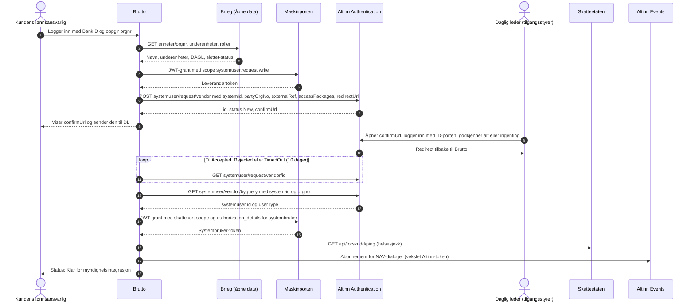
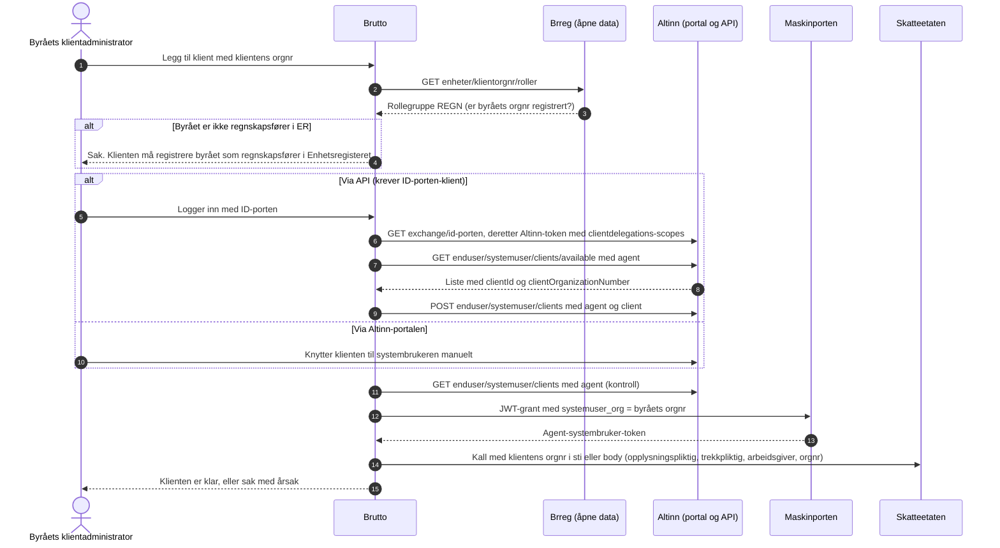

# R2 – Myndighetsintegrasjoner for Brutto: implementeringsklar teknisk spesifikasjon

**Dato:** 28.10.2026. **Spor:** «Myndigheter» (E3.x). **Produkt:** Brutto, SaaS-lønn for 10–1000 ansatte, også lisensiert til regnskapsbyråer som sender for mange klienter via systembruker for klientsystem.

**Grunnlag:** B-myndigheter.md (oversikt, gjentas ikke), S-avklaringer-fra-sally.md §3–5, E-byra.md §3. Dette dokumentet går i dybden der B stopper.

**Hva er lest i primærkilde i denne runden (28.10.2026):**
- Skatteetatens API-dokumentasjon i kildeform (repo `Skatteetaten/api-dokumentasjon`, siste commit 23.10.2026).
- OpenAPI-spesifikasjonene på SwaggerHub, hentet maskinelt via `api.swaggerhub.com`:
  - skattekort-til-arbeidsgiver 3.0.1 (opprettet 26.10.2026)
  - trekkpaalegg-app 1.5.1 (publisert) og 1.5.2 (upublisert utkast)
  - innrapportering-amelding-api 0.1.2
  - innrapportering-amelding-filopplasting-api 1.0.1
  - amelding-tilbakemelding-api 0.1.0
  - avstemmingsrapport-amelding-api 1.0.2
  - krav-og-betalinger-api 1.5.0
- Digdirs dokumentasjon i kildeform (`felleslosninger/docs`, commit 28.10.2026).
- Altinn-dokumentasjonen i kildeform (`Altinn/altinn-studio-docs`, commit 28.10.2026).
- Tilgangsreglene (policy) i Altinns ressursregister, hentet live for hver ressurs.
- NAVs wikier og OpenAPI: sokos-oppgjorsrapporter, sykepenger-im-lps-api, fp- og k9-inntektsmelding-api, aareg.
- Brønnøysundregistrenes åpne API, testet live.
- Skatteetatens trekkrutine-repo og nyhetssider for sluttbrukersystemer (SBS) til og med 22.10.2026.

**Merking**
- **[V]** = verifisert mot primærkilde. URL eller kildefil står ved siden av.
- **[S]** = sekundærkilde eller søkeutdrag.
- **[U]** = usikker eller egen vurdering. Må bekreftes.
- «Ikke funnet» betyr at det er lett etter uten resultat.
- Ingen endepunkter eller scopes er konstruert. Det som ikke står i en kilde, er merket.

---

## 0. Sammendrag

1. **«K27» er NAVs oppgjørsrapport for refusjoner til arbeidsgiver** («Oppgjørsrapport arbeidsgiver – refusjoner fra Nav», ny kode `ref-arbg`) [V]. Den kommer ikke fra Skatteetaten. Fra 15.06.2026 hentes den bare via NAVs Oppgjørsrapporter-API (scope `nav:utbetaling/oppgjorsrapporter`) eller manuelt på nav.no og i Altinn. Se kap. 1.

2. **ID-porten er ikke riktig innlogging for Brutto-brukere.** ID-porten er i hovedsak for offentlige virksomheter, og private bare ved offentlig myndighetsutøvelse [S]. Ansattportal og lønnsbrukere bør logge inn med BankID (OIDC) [S]. ID-porten brukes av *kundens* daglig leder i Altinn når systembruker godkjennes, og eventuelt av byråets klientadministrator for klientdelegering via API [V]. Se kap. 2.

3. **Én pakke dekker byrået.** `regnskapsforer-lonn` gir tilgang til alle disse [V, Altinn-policy]:
   - a-melding og avstemming
   - skattekort og trekkpålegg
   - K27
   - NAVs inntektsmeldinger (sykepenger, foreldre-/svangerskapspenger, sykdom i familien)

   Pakken gir *ikke* Krav og betalinger.

   **Direktekunde trenger tre pakker:** `a-ordning`, `lonn` og `lonn-personopplysninger-saerlig-kategori` [V].

4. **Korrigeringer av B:**
   - A-meldings-API-ene tar **JSON etter OpenAPI-skjemaet**, ikke XML i JSON-innpakning. Feilkode `AMLD_1047` avviser alt som ikke er JSON. XML trengs bare til reserveløsningen med manuell opplasting [V].
   - Skattekort-API 3.0.1 har tre ting B ikke nevner: en tredje bestillingstype, idempotensnøkkel og flere trekkoder [V].
   - Trekkpålegg-API 1.5.x har egne endepunkter med `{trekkpliktig}` i stien, for systembrukere som henter for flere virksomheter [V].
   - Tilbakemeldingen på a-meldingen gir **KID og kontonummer** for forskuddstrekk, AGA, finansskatt og utleggstrekk [V].

5. **Trekkpålegg-API krever at leverandøren først er i produksjon med A-melding-API-et,** og at kunden har sendt minst én a-melding gjennom systemet. I tillegg kreves testoppsummering og signert avtale [V].

6. **Bidragstrekk:** Innkrevingssentralen for bidrag (tidligere Nav Innkreving) er fra 01.01.2026 slått sammen med Skatteetatens innkreving til én Innkrevingsmyndighet [V]. Hvilke bidragstrekk som kommer i Trekkpålegg-API-et som samordnet trekk, og hvilke som fortsatt kommer som brev, er **ikke avklart** [U]. Det må bygges manuell registrering.

7. **Fra 15.12.2026 hentes skattekort bare ved polling.** To nye resultatverdier kommer samtidig [V]. Endringer må hentes **per arbeidsgiver** (`FOR_004`).

8. **Varslet, men ikke ferdig:** Altinn har dokumentert (27.10.2026) en utvidet systembrukermodell med én systembruker for egen virksomhet og klienter (`clientAccessPackages`, `clientRights`, `ownerControlledAccess`). Den er «under utvikling og ikke tilgjengelig ennå» [V]. Arkitekturen bør tåle begge modellene.

9. **Agenter** får bare lese metadata og statuskoder. De kan ikke bestille skattekort, sende inn, betale, opprette fullmakter eller klientdelegere (S §3). Dette håndheves i integrasjonsgatewayen, ikke bare i brukergrensesnittet (kap. 6).

---

## 1. Hva er «K27»?

### 1.1 Funn

| Kandidat | Søk | Resultat |
|---|---|---|
| **NAV-kode for oppgjørsrapport** | NAVs wiki, OpenAPI og nav.no | **Treff.** «Oppgjørsrapport arbeidsgiver – refusjoner fra Nav» har gammel kode **K27** og ny kode **`ref-arbg`**. API-et godtar «inntil videre» `K27` som alias. Søsterrapportene er T14, som nå heter `trekk-kred` («Trekkoppgjør kreditor»), og T12, som nå heter `trekk-hend` («Trekkhendelser») [V] https://github.com/navikt/sokos-oppgjorsrapporter/blob/main/src/main/resources/openapi/rapport-v1.yaml |
| Kravtype eller KID-type for innbetaling | Skatteetatens KID-struktur | Kravtypene er 03 (utleggstrekk), 05 (forskuddstrekk), 06 (AGA) og 09 (finansskatt lønn). Ingen «27» eller «K27» [V] https://www.skatteetaten.no/samarbeidspartnere/sluttbrukersystemer/sbs-nyheter/forskuddstrekk-betalingsoppdrag-og-kid/ |
| Skjema- eller meldingskode i innkrevingsløsningen | Skatteetatens API-dokumentasjon (hele repoet) og trekkpålegg-sidene | Ikke funnet. Søket på «K27» i hele repoet ga bare en tilfeldig hash i `package-lock.json` [V] |
| Kode i trekkpålegg | Trekkpålegg-OpenAPI 1.5.x | Ikke funnet [V] |
| A-skjema (A01–A07) | B §1.4 | A-tjenestene heter A01–A07. Ingen K27 [V via B] |
| A-meldingskode | A-melding-OpenAPI 0.1.2 | Ikke funnet [V] |

**Konklusjon:** Gründeren mener med stor sikkerhet **NAVs refusjonsrapport (K27)**, nå `ref-arbg`.

Rapporten lister refusjonene NAV har utbetalt til arbeidsgiverens konto:
- sykepenger
- foreldrepenger
- svangerskapspenger
- pleie-, opplærings- og omsorgspenger
- feriepenger av disse, i junirapporten

Rapporten kommer 1–2 virkedager etter utbetaling, og de fleste rett etter månedsskiftet [V] https://www.nav.no/arbeidsgiver/oppgjorsrapport.

Gründeren har satt den i samme liste som skattekort og trekk fordi det er et dokument lønnssystemet tradisjonelt hentet maskinelt fra Altinn. Gammel løsning sendte K27 i Altinn II siste gang **15.06.2026 kl. 12.00** [V] https://github.com/navikt/sokos-oppgjorsrapporter/wiki/Fremdriftsplan.

### 1.2 Hva K27 inneholder (CSV, ISO-8859-1, semikolon) [V]

Kilde: https://github.com/navikt/sokos-oppgjorsrapporter/wiki/CSV%E2%80%90format

Én rad per transaksjon med disse feltene:
1. NAV-enhet (4 siffer)
2. Organisasjonsnummer for hovedenhet (9)
3. Bedriftsnummer for underenhet (9)
4. **Ytelseskode** (1 tegn)
5. Fødselsnummer (11)
6. Fra-dato (ÅÅÅÅMMDD)
7. Bankkonto (11)
8. Navn (25)
9. Til-dato
10. Beløp i øre (10 siffer + fortegnstegn, «-» for kredit)
11. Reservert felt
12. Maks-dato

**Ytelseskoder** [V] https://www.nav.no/arbeidsgiver/oppgjorsrapport

| Kode | Ytelse |
|---|---|
| 1 | Foreldrepenger adopsjon |
| 2 | Foreldrepenger fødsel |
| 3 | Svangerskapspenger |
| 4 | Sykepenger |
| 5 | Forsikret i arbeidsgiverperioden |
| 6 | Stort sykefravær |
| 7 | Gravide |
| 8 | Reisetilskudd |
| 9 | Pleiepenger |
| A | Trekk/tilbakebetaling |
| Y | Opplæringspenger |
| Z | Omsorgspenger |
| E–K og M | Feriepenger, ytelse for ytelse |

### 1.3 Konsekvenser for Brutto

- Rapporten er **regnskapsdokumentasjon for refusjonen**. Den brukes til å avstemme forskuttert sykelønn og foreldrepenger per ansatt, ytelse og periode, og til å bokføre innbetalingen fra NAV.
- Den kan påvirke AGA-grunnlaget når arbeidsgiveren velger å trekke refusjonen fra når den mottas (C-beregning steg 13).
- Rapporten inneholder fødselsnummer og ytelseskode og avslører dermed helseopplysninger. Den må håndteres som særlig kategori, og 5800-serien skjermes (S §2.8). Tilgangspakken heter derfor `lonn-personopplysninger-saerlig-kategori` [V].
- T14 og T12 gjelder **kreditorer og namsmenn** når NAV trekker i *ytelser*. De er ikke arbeidsgiverrapporter og er utenfor scope for Brutto [V].

**Slik kan gründeren bekrefte:** Vis ham CSV-eksempelet over, eller PDF-en «Oppgjørsrapport arbeidsgiver – refusjoner fra Nav» i Altinn-innboksen, og spør: «Er det denne rapporten om refusjoner fra NAV du mener?» Er svaret nei, er de to neste kandidatene:
- tilbakemeldingen på a-meldingen, tidligere A03, med KID og beløp
- avstemmingsinformasjonen, tidligere A07

---

## 2. Identitet og tilgang: hvem logger inn hvor, med hvilken token og til hvilket formål

### 2.1 Aktører og mekanismer

| Aktør | Logger inn i | Mekanisme og token | Nivå | Formål | Avtale og pris |
|---|---|---|---|---|---|
| **Ansatt** i ansattportalen | Brutto | OIDC authorization code + PKCE mot **BankID** (direkte eller via mellomledd). Brutto lager egen sesjon. Passkey til daglig, BankID ved første gangs aktivering og kritiske endringer (R2-ansatt-org) | BankID: `urn:bankid:bid` (LoA 4, «høy») eller `urn:bankid:bis` (biometri, LoA 3) [S] https://developer.bankid.no/bankid-oidc-provider/core-concepts/identity-providers/ | Lønnsslipper, skattekortinfo, endring av kontonummer med step-up | Avtale med BankID eller mellomledd (Signicat, Criipto/Idura o.l.). **Pris ikke funnet** |
| **Leder** (godkjenner fravær og timer) | Brutto | Som ansatt | Som ansatt | Godkjenninger | Som over |
| **Lønnsansvarlig, byråmedarbeider eller oppdragsansvarlig** | Brutto | Som ansatt + rolle. **Step-up med BankID høy** før godkjenning av innsending eller betalingsfil | LoA 4 ved godkjenning [U, egen anbefaling] | Kjøre lønn, godkjenne innsending (navngitt godkjenner, S §3 #14) | – |
| **Daglig leder eller annen tilgangsstyrer** hos kunden | **Altinn** (via `confirmUrl`) | ID-porten. Innloggingen er Altinns ansvar, ikke Bruttos | Altinns krav | Godkjenne systembruker-forespørsel og endringsforespørsel. Slette systembruker. Må være **tilgangsstyrer** og ha myndighet til å gi hver tilgangspakke [V] https://docs.altinn.studio/nb/authorization/guides/system-vendor/system-user/endringer-for-leverandorer/ | Gratis for kunden |
| **Byråets klientadministrator** | Altinn-portalen, **eller** Brutto via klientdelegerings-API | API: ID-porten-token vekslet til Altinn-token (`/authentication/api/v1/exchange/id-porten`) med scopene `altinn:clientdelegations.read` og `altinn:clientdelegations.write` [V] https://docs.altinn.studio/nb/api/authentication/systemuserapi/clientdelegation/ | ID-porten | Knytte og fjerne klienter på byråets agent-systembruker | Krever at Brutto har en ID-porten-integrasjon. **Om en privat leverandør får det for dette formålet, er ikke avklart** [U]. Altinn-portalen er alltid reserveløsning |
| **Brutto som system** | Maskinporten → Skatteetaten, NAV, Altinn | JWT-grant (RFC 7523) signert med egen nøkkel (`kid`) eller virksomhetssertifikat (`x5c`). RS256, RS384 eller RS512. `aud` er `https://maskinporten.no/` (test: `https://test.maskinporten.no/`) [V] https://docs.digdir.no/docs/Maskinporten/maskinporten_protocol_jwtgrant. Mot kundedata brukes **systembruker-token**: `authorization_details` med `type: urn:altinn:systemuser` og `systemuser_org` (ISO 6523, `0192:<orgnr>`), og eventuelt `externalRef` [V] https://docs.digdir.no/docs/Maskinporten/maskinporten_func_systembruker | – | Alle maskin-til-maskin-kall | Digdirs bruksvilkår for private virksomheter (Maskinporten) og bruksvilkår for SBS-leverandører i Altinn [V, lenket fra Skatteetaten] https://www.skatteetaten.no/samarbeidspartnere/reetablering-altinn/systemleverandor/oppkobling/. **Pris for Maskinporten ikke funnet** |
| **Kunden i reserveløsning** | skatteetaten.no (skattekort-XML, a-melding-XML) og nav.no/Altinn | ID-porten | – | Når API eller systembruker feiler | – |

**Hvorfor ikke ID-porten i ansattportalen:**
- Digdir oppgir «offentlig virksomhet som har akseptert bruksvilkår» som kunde [V] https://docs.digdir.no/docs/idporten/idporten/idporten_overordnet.
- Private kan bare bruke ID-porten ved offentlig myndighetsutøvelse [S, Digdir-svar via søk].
- Ansattporten er også for offentlige virksomheter [S].
- Til orientering koster ID-porten 0,36 kr eks. mva per autentisering over 200 000 per år (perioden 01.10.2024–30.09.2025) [V] https://samarbeid.digdir.no/id-porten/kostnadsmodell-id-porten/66.

**Gründerens formulering «ID-porten/Skatteetaten for å hente skattekort» er dermed teknisk feil.** Henting skjer med Maskinporten og systembruker, ikke ID-porten.

### 2.2 Tokentyper og regler (Brutto som system)

| Token | Hentes slik | Brukes mot | Regler |
|---|---|---|---|
| Leverandørtoken | JWT-grant med scope `altinn:authentication/systemuser.request.write` (og flere) | Altinn Authentication: systemregister, systembruker-forespørsel | Noen Altinn-operasjoner krever at tokenet veksles til Altinn-token via `GET https://platform.altinn.no/authentication/api/v1/exchange/maskinporten` (TT02: `platform.tt02.altinn.no`) [V, NAV-wiki] https://github.com/navikt/sokos-oppgjorsrapporter/wiki/Autentisering-og-autorisasjon |
| Systembruker-token | JWT-grant med etatsscope og `authorization_details` | Skatteetaten og NAV | Én kunde per token, og alltid minst ett scope [V]. **For agent-systembruker settes `systemuser_org` til byråets orgnr, aldri klientens** [V] https://docs.altinn.studio/nb/authorization/guides/system-vendor/system-user/troubleshooting/ |
| Systembruker-token vekslet til Altinn-token | Som over, deretter veksling | Altinn Events (`altinn:events.subscribe`) | [V, NAV-wiki 7] |
| Skatteetaten-token | Systembruker-token **uten** `resource` | Skatteetaten | «Resource er valgfri og skal ikke settes for Skatteetatens API». `aud` blir da «unspecified» [V] https://skatteetaten.github.io/api-dokumentasjon/om/sikkerhet |
| NAV-token | Systembruker-token, **ikke vekslet** | NAV | Oppgjørsrapporter godtar **bare** tokens med nøyaktig scopet `nav:utbetaling/oppgjorsrapporter`. Ett scope per token [V] |

**Felles grenser for Maskinporten** [V] https://docs.digdir.no/docs/Maskinporten/maskinporten_protocol_jwtgrant
- `iat` får avvike høyst ±10 s fra Maskinportens klokke.
- `exp − iat` er høyst 180 s ifølge protokollsiden og høyst 120 s ifølge konsumentguiden. **Bruk 120 s.**
- `jti` kan ikke gjenbrukes.
- Ukjente claims gir `400 Invalid assertion`.

**Levetid for tilgangstoken:** Eksempelet viser `expires_in: 599`. Skatteetaten skriver «som oftest 2 min» for systembruker-token [V]. Cache tokenet i minnet til `expires_in − 30 s`, med nøkkelen (scope, systemuser_org, externalRef).

**Feil ved henting av token:** `invalid_altinn_customer_configuration (MP-303)` betyr at systembrukeren mangler eller ikke stemmer. Typiske årsaker [V]:
- `clientId` mangler på systemet
- `externalRef` brukt ved opprettelse, men ikke i grant
- feil `systemuser_org`

### 2.3 Tilgangspakker og ressurser

Tabellen er hentet live fra Altinns policyregler, `https://platform.altinn.no/resourceregistry/api/v1/resource/{id}/policy/rules` [V, 28.10.2026].

| Tjeneste | Altinn-ressurs | Pakker som gir tilgang | Direktekunde | Byrå (agent) |
|---|---|---|---|---|
| A-melding: innsending og tilbakemelding | `ske-innrapportering-amelding` | a-ordning, regnskapsforer-lonn, regnskapsforer-med-/uten-signeringsrettighet, ansvarlig-revisor, revisormedarbeider | `a-ordning` | `regnskapsforer-lonn` |
| Avstemmingsrapport | `ske-avstemmingsinformasjon-amelding` | Som over | `a-ordning` | `regnskapsforer-lonn` |
| Skattekort | `ske-skattekort-til-arbeidsgiver` | lonn, skatt-naering, innbygger-arbeidsliv, regnskapsforer ×3, revisor ×2 | `lonn` | `regnskapsforer-lonn` |
| Trekkpålegg | `ske-informasjon-om-trekkpaalegg` | **lonn, regnskapsforer-lonn** (bare disse) | `lonn` | `regnskapsforer-lonn` |
| Krav og betalinger | `ske-krav-og-betalinger` | krav-og-utlegg, regnskapsforer-med-/uten-signeringsrettighet, revisor ×2 | `krav-og-utlegg` | **Ikke** `regnskapsforer-lonn` |
| K27 (`ref-arbg`) | `nav_utbetaling_oppgjorsrapport-refusjon-arbeidsgiver` | lonn-personopplysninger-saerlig-kategori, regnskapsforer ×3, revisor ×2 | `lonn-personopplysninger-saerlig-kategori` | `regnskapsforer-lonn` |
| NAV inntektsmelding: sykepenger, foreldrepenger/svangerskapspenger, sykdom i familien | `nav_sykepenger_inntektsmelding`, `nav_foreldrepenger_inntektsmelding`, `nav_sykdom-i-familien_inntektsmelding`, `nav_sykepenger_dialog` | lonn-personopplysninger-saerlig-kategori, regnskapsforer ×3 | `lonn-personopplysninger-saerlig-kategori` | `regnskapsforer-lonn` |

**Konsekvens:**
- **Direktekunde:** standard systembruker med `accessPackages = [a-ordning, lonn, lonn-personopplysninger-saerlig-kategori]`. Legg til `krav-og-utlegg` hvis Krav og betalinger skal brukes.
  - S #16 sier at lønns- og NAV-pakkene legges til ved første planlagte utbetaling. Det gjøres med **endringsforespørsel** (`/systemuser/changerequest/vendor`), som kunden må godkjenne [V] https://docs.altinn.studio/nb/authorization/guides/system-vendor/system-user/changerequest/.
- **Byrå:** agent-systembruker med `[regnskapsforer-lonn]`.
  - Krav og betalinger krever i tillegg `regnskapsforer-med-` eller `-uten-signeringsrettighet`.
  - Pakkene får byrået bare når klienten har registrert det som regnskapsfører i Enhetsregisteret (E-byra §3.1).

### 2.4 Sekvens: oppkobling av ny direktekunde

**Merknader:**
- Forespørselen utløper etter **10 dager** (`TimedOut`) [V] https://docs.altinn.studio/nb/authorization/guides/system-vendor/system-user/systemuserrequest/.
- Ved gjentatt kall mangler `confirmUrl` i responsen. Hent den igjen med `GET .../request/vendor/{requestId}` [V, NAV-wiki].
- Et AS som allerede er slettet i Enhetsregisteret, kan ikke få systembruker [V] https://www.skatteetaten.no/samarbeidspartnere/sluttbrukersystemer/sbs-nyheter/bruk-av-systembruker-ved-rapportering-for-as-som-er-slettet-i-enhetsregisteret/.

### 2.5 Sekvens: oppkobling av ny byråklient

**Engangsoppsett per byrå:** `POST /authentication/api/v1/systemuser/request/vendor/agent` med `accessPackages: [regnskapsforer-lonn]`. `rights` må være tom. Byråets tilgangsstyrer godkjenner [V].

**Merknader:**
- Klientdelegerings-API-et har **ikke paginering ennå** [V].
- Når klientforholdet opphører, faller delegeringen bort automatisk (E-byra §3.3).
- NAVs oppgjørsrapport-API **må** få `orgnr` i body ved agent-systembruker. NAV kan ikke skille agent fra standard systembruker ut fra tokenet [V] https://github.com/navikt/sokos-oppgjorsrapporter/blob/main/src/main/resources/openapi/rapport-v1.yaml.

---

## 3. Spesifikasjonsblokker per API

Felles for Skatteetaten:
- Maks **5 samtidige kall** per API per virksomhet [V] https://skatteetaten.github.io/api-dokumentasjon/om/bruk.
- Brannmur åpnes på **vertsnavn**, ikke IP. IP-adresser kan endres uten varsel ved overgang til skyplattform [V] https://skatteetaten.github.io/api-dokumentasjon/om/sikkerhet.
- `korrelasjonsid` skal være unik per kall [V] https://skatteetaten.github.io/api-dokumentasjon/om/feil.
- Bruk tolerant parsing. Skatteetaten fraråder å validere respons mot XSD fordi nye felt kan komme uten varsel [V] https://skatteetaten.github.io/api-dokumentasjon/om/versjoner.
- Grensene i bruksvilkårene (5 forespørsler/s, 10 000 per time for delings-API) og varselfristen på 4 måneder er dokumentert i B §2.9 [V via B].

### 3.1 Maskinporten (Digdir)

| Felt | Spesifikasjon |
|---|---|
| Eier | Digitaliseringsdirektoratet |
| Formål | Autentisere Brutto som system og utstede systembruker-tokens |
| Miljøer og base-URL | Test: `https://test.maskinporten.no/` (`/token`, `/.well-known/oauth-authorization-server`). Prod: `https://maskinporten.no/` [V] https://docs.digdir.no/docs/Maskinporten/maskinporten_func_wellknown. Selvbetjening i test: `https://sjolvbetjening.test.samarbeid.digdir.no` [V, NAV-wiki]. Selvbetjening i prod: Samarbeidsportalen [S] |
| Autentisering | `private_key_jwt`. Digdir anbefaler leverandører **asymmetrisk nøkkel** framfor virksomhetssertifikat, og at leverandøren ikke forvalter kundenes sertifikater [V] https://docs.digdir.no/docs/Maskinporten/maskinporten_autentisering |
| Operasjoner | `POST /token` med `grant_type=urn:ietf:params:oauth:grant-type:jwt-bearer&assertion=<JWT>` [V] https://docs.digdir.no/docs/Maskinporten/maskinporten_protocol_token. Nøkkelregistrering: `POST /clients/{id}/jwks` i selvbetjenings-API-et. Det krever en administrasjonsklient **med virksomhetssertifikat** [V] https://docs.digdir.no/docs/Maskinporten/maskinporten_sjolvbetjening_api |
| Viktige felter | Grant: `aud`, `iss` (client_id), `iat`, `exp`, `jti`, `scope`, `authorization_details`. Respons: `access_token`, `expires_in`, `scope` |
| Feilkoder | `400 Invalid assertion`. MP-303 `invalid_altinn_customer_configuration` [V] |
| Grenser | Nøkkel høyst **1 år** fra den legges inn. Virksomhetssertifikat 3 år. Testmiljø godtar ikke produksjonssertifikater [V]. Rate limit: **ikke funnet** |
| Polling eller push | Ikke aktuelt |
| Idempotens | `jti` er engangs |
| Krav før produksjon | Signerte bruksvilkår (gir test og prod). Norsk orgnr [V] |
| Endringer 2026–2028 | `iss_onbehalfof` er utfaset og skal fjernes [V] |

### 3.2 Altinn: systemregister, systembruker og klientdelegering

| Felt | Spesifikasjon |
|---|---|
| Eier | Digdir (Altinn) |
| Formål | Registrere Brutto som system og få kundens fullmakt |
| Miljøer | TT02: `https://platform.tt02.altinn.no/authentication/api/v1/...`. Prod: `https://platform.altinn.no/authentication/api/v1/...` [V] |
| Autentisering | Maskinporten-scopes: `altinn:authentication/systemregister.write`, `altinn:authentication/systemuser.request.write`, `altinn:authentication/systemuser.request.read`. Klientdelegering: `altinn:clientdelegations.read` og `altinn:clientdelegations.write` (ID-porten-token vekslet) [V] https://docs.altinn.studio/nb/api/authentication/systemuserapi/scopes/ |
| Operasjoner: systemregister | `POST`, `GET` og `PUT .../systemregister/vendor[/{systemId}]`. Separate `PUT` for `/rights` og `/accesspackages`. `GET .../{systemId}/changelog`. `GET systemuser/vendor/bysystem/{systemId}` lister alle systembrukere (krever `systemregister.write`) [V] |
| Operasjoner: systembruker | `POST systemuser/request/vendor` (standard) og `.../vendor/agent` (klient). `GET` status per id, per `byexternalref` eller per system. `DELETE` forespørsel. `GET systemuser/vendor/byquery?system-id=&orgno=[&external-ref=]` krever skrivescopet [V] |
| Operasjoner: endring | `POST systemuser/changerequest/vendor?correlation-id={uuid}&system-user-id={uuid}` med `requiredRights`, `requiredAccessPackages` og liknende, pluss valgfri `redirectUrl` [V] |
| Operasjoner: klientdelegering | `GET enduser/systemuser/agents?party=`, `GET enduser/systemuser/clients/available?agent=`, `GET enduser/systemuser/clients/?agent=`, `POST` og `DELETE enduser/systemuser/clients/?agent=&client=` [V] |
| Viktige felter: system | `id` (`<orgnr>_<navn>`), `vendor.ID` (`0192:<orgnr>`), `name`, `description`, `accessPackages[]`, `rights[]`, **`clientId[]`** (påkrevd for Maskinporten), `isVisible`, `allowedRedirectUrls[]` [V] https://skatteetaten.github.io/api-dokumentasjon/om/systembruker |
| Viktige felter: forespørsel | `systemId`, `partyOrgNo`, `externalRef`, `integrationTitle`, `accessPackages`, `rights`, `redirectUrl`. Svar: `id`, `status` (New, Accepted, Rejected, TimedOut, Denied (ikke i bruk)), `confirmUrl` [V] |
| Feilkoder | Altinn bruker ProblemDetails. Den komplette kodelisten for systembruker-API-et er **ikke funnet**. MP-303 ved token [V] |
| Grenser | Forespørsel utløper etter 10 dager. Klientlisten har ingen paginering [V]. Rate limit: **ikke funnet** |
| Polling eller push | Polling. Altinn-hendelse når systembruker slettes: **ikke funnet**. Bruk daglig `bysystem` og MP-303 som signal |
| Idempotens | `externalRef` (unik per kunde og formål). `correlation-id` på endringsforespørsel [V] |
| Sletting | Bare kunden kan slette, og bare i Altinn-portalen. Leverandøren kan ikke [V] https://docs.altinn.studio/nb/authorization/guides/system-vendor/system-user/deleterequest/ |
| Krav før produksjon | Bruksvilkår for SBS-leverandører i Altinn og registreringsskjema for Altinn-scopes [V] https://www.skatteetaten.no/samarbeidspartnere/reetablering-altinn/systemleverandor/oppkobling/ |
| Endringer 2026–2028 | Altinn II-roller gir ikke a-melding eller skattekort etter 17.11.2026, NAV-tjenester mister rollene 01.12.2026, og alle roller opphører 31.12.2026 [V via B]. **Utvidet modell** (én systembruker for egen virksomhet og klienter, `clientAccessPackages`, `clientRights`, `ownerControlledAccess`) er under utvikling, uten dato. Eksisterende integrasjoner skal virke uendret [V] https://docs.altinn.studio/nb/authorization/guides/system-vendor/system-user/endringer-for-leverandorer/. Paginering av klientlisten er planlagt [V] |

### 3.3 Dialogporten og Altinn Events (felles varslingskanal)

| Felt | Spesifikasjon |
|---|---|
| Eier | Digdir |
| Formål | Fange opp at a-meldingstilbakemelding, NAV-forespørsler, sykmeldinger og oppgjørsrapporter er klare |
| Base-URL | Dialogporten: `https://platform.altinn.no/dialogporten/api/v1/enduser/dialogs` (søk), `.../dialogs/{id}` (detaljer), og GraphQL `https://platform.altinn.no/dialogporten/graphql`. TT02 tilsvarende [V, kildefiler i altinn-studio-docs]. Events i TT02: `https://platform.tt02.altinn.no/events/api/v1/subscriptions` [V, NAV-wiki]. Events i prod: tilsvarende på `platform.altinn.no` [U] |
| Autentisering | `digdir:dialogporten` (systembruker-token). `altinn:events.subscribe` med systembruker-token **vekslet** til Altinn-token [V] |
| Operasjoner | Abonnement: `POST subscriptions` med `endPoint` (webhook), `resourceFilter` (`urn:altinn:resource:<id>`) og `subjectFilter` (`urn:altinn:organization:identifier-no:<orgnr>`) [V, NAV-wiki 7]. Søk krever `party` eller `serviceResource` og pagineres med `continuationToken` [V] |
| Hendelser | `dialogporten.dialog.created.v1`, `.updated.v1`, `.deleted.v1`, `.transmission.created.v1` og andre. Formatet er CloudEvents [V] https://docs.altinn.studio/nb/dialogporten/reference/events/ |
| Grenser | Søk er rate-begrenset og gir inntil 1000 dialoger per kall [V] https://samarbeid.digdir.no/altinn/hvordan-hente-meldinger-gjennom-dialogporten/2869 |
| Polling eller push | **Push via webhook anbefales.** Dialogporten returnerer bare dialoger systembrukeren har rettigheter til, ellers en tom liste [V] |
| Idempotens | Hendelses-`id` er unik. Mottak må dedupliseres |
| A-melding | Bruk forsendelsens URL med `consumerType: Api`, ikke `Gui` [V] https://skatteetaten.github.io/api-dokumentasjon/api/innrapportering-amelding |
| Usikkert | Riktig `resourceFilter` for a-meldingstilbakemelding (antatt `urn:altinn:resource:ske-innrapportering-amelding`) [U]. Test i TT02 |

### 3.4 Skattekort til arbeidsgiver (Skatteetaten)

| Felt | Spesifikasjon |
|---|---|
| Eier | Skatteetaten |
| Formål | Hente trekkinstrukser (skattekort) for arbeidstakere, for inntektsåret og ved endringer |
| Miljøer | Test: `https://api-test.sits.no`. Prod: `https://api.skatteetaten.no`. OpenAPI 3.0.1 lister også `idporten-api-test.sits.no` («Idporten ekstern innsending»), som ikke er relevant for Brutto [V] https://app.swaggerhub.com/apis/skatteetaten/skattekort-til-arbeidsgiver/3.0.1 |
| Autentisering | Scope `skatteetaten:skattekorttilarbeidsgiver`. Ressurs `ske-skattekort-til-arbeidsgiver`. Pakker: se §2.3 [V] |
| Operasjoner | `POST /api/forskudd/bestillSkattekort` (query `idempotensid`, valgfri UUID v4) → `{bestillingsreferanse "BR…", dialogreferanse}`. `GET /api/forskudd/skattekortTilArbeidsgiver/svar/{bestillingsid}` → 200 eller **204 (ikke klar)**. `GET /api/forskudd/skattekortTilArbeidsgiver/bestilling/{bestillingsid}` (opprinnelig bestilling). `GET /api/forskudd/ping` [V] |
| Forespørsel | `inntektsaar` (påkrevd). `bestillingstype` (påkrevd): `HENT_ALLE_OPPGITTE`, **`HENT_ALLE_OPPGITTE_OG_ENDRINGER`** eller `HENT_KUN_ENDRING`. `kontaktinformasjon` (påkrevd, `epostadresse` eller `mobiltelefonummer`). `varslingstype`: `VARSEL_VED_FOERSTE_ENDRING` eller `INGEN_VARSEL` (semantikk [U]). **`endringFraDato`**. `forespoerselOmSkattekortTilArbeidsgiver.arbeidsgiver[]` med `arbeidsgiveridentifikator.organisasjonsnummer` og `arbeidstakeridentifikator[]` (11 siffer) [V] |
| Svar | `status`: `FORESPOERSEL_OK`, `UGYLDIG_INNTEKTSAAR`, `UGYLDIG_FORESPOERSEL`, `INGEN_ENDRINGER` eller `ENDRINGSFORESPOERSEL_UTEN_TIDLIGERE_BESTILLING`. Per arbeidstaker: `resultatForSkattekort` (se under), `skattekort.utstedtDato`, `skattekort.skattekortidentifikator` (int64), `forskuddstrekk[]` og `tilleggsopplysning[]` [V] |
| `resultatForSkattekort` | `skattekortopplysningerOK`, `ikkeSkattekort`, `ikkeTrekkplikt`, `ugyldigOrganisasjonsnummer`, `ugyldigFoedselsEllerDnummer`, `utgaattDnummerSkattekortForFoedselsnummerErLevert` og, fra 15.12.2026, **`registrertSomDoed`** og **`trekkEtterReglerOmKildeskattPaaPensjon15Prosent`**. Begge de nye ble tidligere vist som `ikkeSkattekort` [V] https://www.skatteetaten.no/samarbeidspartnere/sluttbrukersystemer/sbs-nyheter/to-nye-responsverdier-i-resultatforskattekort/ |
| Trekkode | `loennFraHovedarbeidsgiver`, `loennFraBiarbeidsgiver`, `loennFraNAV`, `pensjon`, `pensjonFraNAV`, `loennTilUtenrikstjenestemann`, `loennKunTrygdeavgiftTilUtenlandskBorger`, `loennKunTrygdeavgiftTilUtenlandskBorgerSomGrensegjenger`, `ufoeretrygdFraNAV`, `ufoereytelserFraAndre`, `introduksjonsstoenad` [V, OpenAPI 3.0.1]. **Skrivemåten er inkonsekvent:** dokumentasjonseksemplene bruker `LOENN_FRA_HOVEDARBEIDSGIVER` [V]. Normaliser uten hensyn til store og små bokstaver, og kontrakttest i TT [U] |
| Trekkform | Nøyaktig én av disse per trekkode [V]: `trekktabell{tabellnummer, prosentsats (marginal), antallMaanederForTrekk ∈ 10.5\|11\|12}`, `trekkprosent{prosentsats (kan ha desimal for kildeskatt), antallMaanederForTrekk}` eller `frikort{frikortbeloep}` (fribeløp tildelt *denne* arbeidsgiveren) |
| Kildeskatt (PAYE) | `tilleggsopplysning` inneholder `kildeskattPaaLoenn`, og trekket kommer som `trekkprosent` med `antallMaanederForTrekk: 12` [V, eksempel og B §3.2]. Kildeskattepensjonist: `kildeskattPaaPensjon` eller ny resultatverdi. Nyheten nevner tilleggsopplysningen «kildeskattepensjonist», men den **finnes ikke i enum** [U] |
| Svalbard | `tilleggsopplysning: oppholdPaaSvalbard` [V]. Gir egne Svalbard-regler for trekk og egen a-meldingskode (`skatteOgAvgiftsregel: svalbard`) [V, a-meldingseksempel] |
| Tiltakssonen | `tilleggsopplysning: oppholdITiltakssone` [V]. Finnmarkstabeller 6300–6700 i trekkrutinen [V] https://github.com/Skatteetaten/trekktabell |
| Sjøfolk | **Ingen egen sjømarkør i API-et** (ikke funnet). Sjøtabeller er `0100` og `0101` (`Tabelltype.SJØ`) i trekkrutine 2026. Standardfradragstabeller er 7300–7700, og spesialtabeller 7150–7170 [V, `Tabellnummer.java`] |
| Feilkoder | 400 `FOR_001` (payload validerer ikke), `FOR_002` (parser ikke), `FOR_003` (ugyldig `BR`-referanse), **`FOR_004`** (arbeidsgiver må angis ved endringsbestilling når systembrukeren henter for flere arbeidsgivere). 403 ved for mange fødselsnumre eller manglende systembruker. 500 [V] |
| Grenser | Høyst **1000 fødselsnumre per bestilling, på tvers av arbeidsgivere**. Endringsbestillinger gir alle endringer selv om det er flere enn 1000. Poll svaret med **minst 2 s** mellom kallene [V, OpenAPI] |
| Polling eller push | **Bare polling fra 15.12.2026.** Ingen dialoger eller forsendelser i Dialogporten [V] https://www.skatteetaten.no/samarbeidspartnere/sluttbrukersystemer/sbs-nyheter/endret-bruksmonster-for-henting-av-skattekort/. **Anbefalt frekvens** [U]: `HENT_KUN_ENDRING` **per arbeidsgiver** én gang i døgnet, pluss rett før beregning og før godkjenning av hver lønnskjøring. Poll svaret 2, 4, 8 … s opp til 30 s, og opprett sak etter 15 min |
| Idempotens | `idempotensid` gir samme bestillingsreferanse og ett svar. Lagre `skattekortidentifikator` og `utstedtDato` som versjon |
| Personvern | Den skattepliktige **varsles** når en ny arbeidsgiver henter. Hent bare for aktive og ansatte som er i ferd med å starte (B §3.1). Ikke hent for `registrertSomDoed`, fordi oppslag varsler de etterlatte [V] |
| Krav før produksjon | Bruksvilkår for SBS, scope bestilt via brukerstøtte, test i delt testmiljø. Ingen sertifisering [V via B §2.9]. Testpersoner med skattekort 2026 finnes som regneark. Testkortene oppdateres daglig kl. 06, men ikke frikort med beløpsgrense [V] https://skatteetaten.github.io/api-dokumentasjon/api/skattekorttilarbeidsgiver |
| Kjente endringer | 15.12.2026: bare polling og to nye verdier [V]. Testmiljøet for 2027 åpner med egen nyhet, dato ikke oppgitt [V]. Skattekort for 2027 hentes i desember. Feilen 16.–23.06.2026 med manglende endringer kan rettes med `endringFraDato` [V] https://www.skatteetaten.no/samarbeidspartnere/sluttbrukersystemer/sbs-nyheter/henting-av-skattekortendringer--mulig-manglende-endringer/. Reserveløsning: portal med RF-1211-XML via ID-porten, høyst 1 MB [V] |

### 3.5 Trekkpålegg og samordnet utleggstrekk (Skatteetaten)

| Felt | Spesifikasjon |
|---|---|
| Eier | Skatteetaten (Innkrevingsmyndigheten) |
| Formål | Hente pålegg om utleggstrekk etter **nytt regelverk** (samordnet trekk). Dekker trekkpålegg fra **innkrevingsmyndigheten og alminnelig namsmann** [V] https://www.skatteetaten.no/samarbeidspartnere/sluttbrukersystemer/trekkpalegg-sbs/. Kommuner sender sine trekk inn til samordningen via eget API [V] https://skatteetaten.github.io/api-dokumentasjon/api/utleggstrekkfrakommune |
| Miljøer | Test: `https://api-test.sits.no`. Prod: `https://api.skatteetaten.no` (sti `/api/trekkpaalegg/v1`) [V] https://app.swaggerhub.com/apis/skatteetaten/trekkpaalegg-app/1.5.1 og sjekklisten på https://skatteetaten.github.io/api-dokumentasjon/api/trekkpaalegg |
| Autentisering | Scope `skatteetaten:trekkpaalegg`. Ressurs `ske-informasjon-om-trekkpaalegg`. Pakker `lonn` eller `regnskapsforer-lonn` [V] |
| Operasjoner | `GET /api/trekkpaalegg/v1` (egen organisasjon). **`GET /api/trekkpaalegg/v1/{trekkpliktig}`** («krever at trekkpliktig organisasjon har gitt systembruker autorisasjon i Altinn»). `GET /api/trekkpaalegg/v1/{trekkid}/{trekkversjon}`. **`GET /api/trekkpaalegg/v1/{trekkpliktig}/{trekkid}/{trekkversjon}`** med påkrevde headere `Klientid`, `Korrelasjonsid` (UUID) og `Meldingsid` (UUID). Query: `fraSekvensnummer` (≥ 0) og `maksAntall` (≥ 1), alltid sammen [V, 1.5.1]. **Anbefaling** [U]: bruk alltid `{trekkpliktig}`-variantene med systembruker, og test begge i TT02 |
| Felter | `trekkid`, `trekkversjon` (stigende), **`sekvensnummer`** (globalt og stigende, brukes som vannmerke), `opprettet`, `saksnummer`, `trekkpliktig`, `skyldner` (fnr eller d-nr), `trekkstatus` (`aktiv` eller `avsluttet`), `trekkstoerrelseForPeriode[]` med `startdato`, `sluttdato` og enten `trekkbeloep.trekkbeloep` eller `trekkprosent.trekkprosent`, samt `betalingsinformasjon{betalingsmottaker, kidnummer (≤ 25), kontonummer}` [V] |
| Regler | Ved flere lønnsutbetalinger i måneden skal hele **beløpet** trekkes i løpet av måneden, ved minst én utbetaling. **Prosent** trekkes av brutto ved hver utbetaling. Riktig periode velges etter **lønnsutbetalingsdato**. Ny periode kan tidligst starte i morgen. Sluttdato i dag kan bety at trekket avsluttes nå. KID er uendret mellom versjoner av samme `trekkid`. Kontonummeret er felles for alle samordnede trekk [V, feltforklaringer] |
| Start, endring og stans | Modellert som nye **versjoner** av samme `trekkid`. Start = versjon 1 med `startdato`. Endring = ny periode. Stans = `sluttdato` og deretter `trekkstatus: avsluttet` [V, eksempler] |
| Forholdet til gamle trekk | Når en ansatt får et samordnet trekk, **skal alle andre trekk avsluttes** [V] https://www.skatteetaten.no/bedrift-og-organisasjon/betaling-og-innkreving/tema/trekk-i-lonn-hos-ansatte/om/. Gamle trekk løper til perioden er over eller stoppmelding kommer, i en overgang 2026–2029. De kommer fortsatt i posten eller i Altinn, ikke via API-et [V]. A-meldingskoder: `utleggstrekkSamordnet` (nytt) og `utleggstrekkSkatt` (gammelt, skatt). De skal ikke blandes og betales til hver sin konto [V] |
| Feilkoder | Siden lister `KB-001`–`KB-009` (500, 401, 403, 400, 404, 406). Prefikset tyder på at listen er kopiert fra Krav og betalinger [U]. OpenAPI: 400, 401, 403, 404, 500 med `Feil{kode, melding, korrelasjonsid}` [V] |
| Grenser | Bruk `maksAntall`-paginering ved mange pålegg. Ellers som Skatteetaten generelt |
| Polling eller push | **Polling i dag.** Varsling via Dialogporten er «valgfri» eller kommer «etter hvert» [V]. **Frekvens** [U]: én gang i døgnet per trekkpliktig, pluss før beregning og før godkjenning. Pålegget kommer også som brev i Altinn til overordnet orgnr [S] |
| Idempotens | Nøkkel (`trekkid`, `trekkversjon`). Vannmerket er høyeste `sekvensnummer` per trekkpliktig |
| Krav før produksjon | **Strengest av alle API-ene** [V]: (1) leverandøren må være integrert med **Innrapportering A-melding API**, og kunden må ha sendt a-melding gjennom systemet minst én gang; (2) testscope bestilles på e-post til fremtidensinnkreving@skatteetaten.no med ekte orgnr; (3) Skatteetaten lager testdata på valgte Tenor-virksomheter; (4) **testoppsummering**: «Du får ikke tilgang til produksjonsmiljø før dette er gjennomført»; (5) signert avtale og tjenestebeskrivelse ved prodtilgang. Leverandøren er databehandler |
| Endringer 2026–2028 | Hendelsesvarsling planlagt, uten dato. Versjon 1.5.2 (06.05.2026) er upublisert utkast [V]. Overgangen til samordnet trekk pågår 2026–2029 [V] |

### 3.6 Andre lønnstrekk: bidrag og andre påleggsgivere

| Trekk | Påleggsgiver i 2026 | Elektronisk kanal | Status |
|---|---|---|---|
| Samordnet utleggstrekk | Innkrevingsmyndigheten, namsmann og kommuner (via samordning) | **Trekkpålegg-API** og brev i Altinn | [V] |
| Utleggstrekk skatt, gammelt regelverk | Innkrevingsmyndigheten | Brev (post eller Altinn). Betales til felles konto med KID kravtype 03 | [V] |
| Andre gamle utleggstrekk (namsmann, Statens innkrevingssentral-krav, avgifter) | Som angitt i brevet | Brev. KID og konto står i brevet. Avgiftskrav (mva, særavgift, toll) rapporteres **ikke** i a-meldingen | [V] https://www.skatteetaten.no/bedrift-og-organisasjon/betaling-og-innkreving/tema/trekk-i-lonn-hos-ansatte/betale/ |
| **Bidragstrekk** (barnebidrag) | Innkrevingsmyndigheten i Skatteetaten. Innkrevingssentralen for bidrag og tilbakebetalingskrav er slått sammen med Statens innkrevingssentral og skatteinnkrevingen fra 01.01.2026 | Om bidrag kommer i Trekkpålegg-API-et som del av samordnet trekk, eller fortsatt som eget brev etter bidragsinnkrevingsloven, er **ikke avklart** | [V for sammenslåingen] https://www.skatteetaten.no/nn/om-skatteetaten/om-oss/myndighetsomrader-i-skatteetaten/om-innkrevjingsmyndigheita/. Kanal [U] |
| NAV T14 (`trekk-kred`) og T12 (`trekk-hend`) | NAV | Oppgjørsrapport-API | Gjelder kreditorer og namsmenn ved trekk i **NAV-ytelser**, ikke arbeidsgivere [V] |
| Trekk som ikke kan gjennomføres (lav lønn, sluttet, permittert, sykmeldt) | – | **Ikke funnet elektronisk kanal.** Arbeidsgiveren må kontakte Innkrevingsmyndigheten og oppgi beløp og årsak, med mindre årsaken fremgår av a-meldingen | [V] https://www.skatteetaten.no/bedrift-og-organisasjon/betaling-og-innkreving/tema/trekk-i-lonn-hos-ansatte/om/ |

**Konsekvens:** Brutto trenger tre ting i tillegg til API-integrasjonen:
- en **manuell trekkmodell**: registrering av brev med pålegg, prioritet og vernet beløp (C §2.3), KID og konto
- konto 2620 for bidrag (S #27)
- ekstra kontroll for at gamle trekk avsluttes når et samordnet trekk starter

### 3.7 A-melding: innsending via REST og filopplasting (Skatteetaten)

| Felt | Spesifikasjon |
|---|---|
| Eier | Skatteetaten (a-ordningen) |
| Formål | Månedlig rapportering, i v2.3 |
| Miljøer: REST | Test: `https://innrapporteringamelding.api.skatteetaten-test.no`. Prod: `https://innrapporteringamelding.api.skatteetaten.no` [V] https://app.swaggerhub.com/apis/skatteetaten/innrapportering-amelding-api/0.1.2 |
| Miljøer: fil | Test: `https://innrapporteringameldingfilopplasting.api.skatteetaten-test.no/v1`. Prod: `https://innrapporteringameldingfilopplasting.api.skatteetaten.no/v1` [V] https://app.swaggerhub.com/apis/skatteetaten/innrapportering-amelding-filopplasting-api/1.0.1 |
| Autentisering | Scope `skatteetaten:innrapporteringamelding` (også for tilbakemelding og avstemming). Ressurs `ske-innrapportering-amelding`. Pakker: se §2.3 [V] |
| Operasjoner: REST | `POST /v1/innsending/{periode}/{opplysningspliktig}`. `periode` er `YYYY-MM`. Opplysningspliktig er **hovedenhet** (orgnr, fnr eller d-nr). Header **`idempotencyKey` (UUID, påkrevd)**. Body `application/json` (`Amelding`). Svar 200 `Leveransebekreftelse{dialogId, forsendelseId, meldingsId}` [V] |
| Operasjoner: fil | `POST /opplastinger` → `{id, status}`. `GET /opplastinger/{id}`, med status `LASTER_OPP`, `TIL_VALIDERING`, `VALIDERING_FEILET` (med `feilliste`) eller `KLAR_TIL_INNSENDING`. `PUT /innsending` med `{id}` → `Leveransebekreftelse`. `DELETE /opplastinger/{id}` [V] |
| Format | **JSON etter OpenAPI-skjemaet**, med samme payload for REST og fil. Bare `application/json` godtas (`AMLD_1047`, `AMLD_1030`) [V]. **Dette retter B §2.1:** XML (v2.3-XSD) trengs bare til manuell reserveopplasting [V] |
| Viktige felter | `leveranse`: `leveringstidspunkt`, `kalendermaaned`, `kildesystem`, `meldingsId`, **`erstatterMeldingsId`**, `opplysningspliktig`, `spraakForTilbakemelding`, `oppgave`. `oppgave.betalingsinformasjon`: `sumForskuddstrekk`, **`sumForskuddstrekkPerLoennsutbetalingsdato[]{loennsutbetalingsdato, beloep}`**, `sumUtleggstrekk`, `sumArbeidsgiveravgift` og `sumFinansskattLoenn`. `oppgave.virksomhet[]` med `inntektsmottaker[]`, som har `arbeidsforhold`, `inntekt`, `forskuddstrekk`, `fradrag`, `utleggstrekk[]{beskrivelse, beloep, datoForUtleggstrekk}` og `oppholdPaaSvalbardJanMayenOgBilandene`. I tillegg `pensjonsinnretning[]` [V] |
| Erstatningsmelding | Flere a-meldinger per måned er mulig. En melding med `erstatterMeldingsId` erstatter den angitte meldingen i sin helhet. Tilbakemeldingen viser `mottakstatus: erstattet` [V for felt og status, S for semantikk, B §2.4] |
| Feilkoder | `AMLD_001`/`017`/`023` (500), `AMLD_004` (401), `AMLD_005` (403), `AMLD_006`/`008`/`010`/`011` (400), **`AMLD_019` (409, idempotensnøkkel brukt før)**, `AMLD_021` (404), `AMLD_022` (405). Spesifiseringskoder: `AMLD_1008` (ugyldig token), `1015` (ikke autorisert for dialogen), `1022`, `1027` (inntektsår ikke støttet), `1028`, `1030`, `1032`, `1047`, `1051`/`1052` (sti og innhold stemmer ikke), `1053`, `1061`, **`1062`** (ikke hovedenhet), **`1063`** (token mangler systembruker). Feil returneres som `Feil{kode, melding, korrelasjonsid, spesifisering[{kode, melding, sti, angittVerdi}]}` [V] |
| Grenser | REST under **10 000 000 byte**. Filopplasting brukes for større meldinger [V] |
| Polling eller push | Innsending er synkron. Filopplasting polles til `KLAR_TIL_INNSENDING`. Tilbakemeldingen varsles via Dialogporten (§3.8) |
| Idempotens | Samme `idempotencyKey` og samme body gir samme respons, og bare første kall behandles. **Nytt innhold krever ny nøkkel** [V]. Brutto bruker nøkkelen = hash av (melding-id, forsøk på samme payload-hash) |
| Krav før produksjon | Bruksvilkår, scope via brukerstøtte, test i delt testmiljø og TT02, bare syntetiske data. Ingen sertifisering [V via B]. Systemet skal også kunne **eksportere gyldig XML** som reserve [V via B] |
| Endringer 2026–2028 | Forretningsregel F532 (sum forskuddstrekk per lønnsutbetalingsdato kan ikke være negativ, nivå «øyeblikkelig») og F530 fra 2027-01. **v2.4** fra 2028-01 med spesifikasjon senest 01.05.2027 og test 15.09.2027 [V via B]. Innholdet i 2.4 er «ikke endelig avklart» per 22.10.2026 [V] https://www.skatteetaten.no/contentassets/f66b7dc9564d432ea34b162bc0d2f49d/2026-10-sporsmal-og-svar---informasjonsmote-22-10.pdf |

### 3.8 A-melding: tilbakemelding (Skatteetaten og Dialogporten)

| Felt | Spesifikasjon |
|---|---|
| Miljøer | Test: `https://ameldingtilbakemelding.api.skatteetaten-test.no/v1`. Prod: `https://ameldingtilbakemelding.api.skatteetaten.no/v1` [V] https://app.swaggerhub.com/apis/skatteetaten/amelding-tilbakemelding-api/0.1.0 |
| Operasjon | `GET /forsendelser/{forsendelseId}`. `forsendelseId` er id-en til forsendelsen (transmission) som **bekrefter at tilbakemeldingen er klar**. Den finnes i Dialogporten-dialogen fra `Leveransebekreftelse.dialogId` [V] |
| Flyt | (1) Abonner på hendelser for kundens org. (2) Ved `transmission.created` eller `dialog.updated` hentes dialogen. (3) Velg forsendelsens URL med `consumerType: Api`. (4) Kall `GET`. Reserve: les dialogen direkte med `dialogId` ved behov [U, ikke spesifisert av Skatteetaten] |
| Svarfelter | `mottak[]`: `kalendermaaned`, `tilbakemeldingEtterMottakAvMeldingsId`, **`innbetalingsinformasjon{kontonummer, kidForArbeidsgiveravgift, kidForForskuddstrekk, kidForFinansskattLoenn, kidForUtleggstrekk, forfallsdato}`**, `mottattLeveranse[]{meldingsId, erstatterMeldingsId, mottakstatus (mottatt, avvist, erstattet), avvik[], mottattAvgiftOgTrekkTotalt, antallInntektsmottakere, kildesystem}` og `mottattPeriode`. `avvik{id, navn, alvorlighetsgrad (avvisning, oeyeblikkelig, retningslinje), detaljer}` finnes også på arbeidsforhold-, inntekts- og trekknivå [V] |
| Feilkoder | Som §3.7 |
| Kjente endringer | JSON-feil i tilbakemeldingen ble meldt 05.06.2026. URL-modellen for forsendelser ble endret i mai 2026 [V via B] |

### 3.9 Avstemmingsrapport (tidligere A06/A07)

| Felt | Spesifikasjon |
|---|---|
| Miljøer | Test: `https://ameldingavstemmingsrapport.api.skatteetaten-test.no/v1`. Prod: `https://ameldingavstemmingsrapport.api.skatteetaten.no/v1` [V] https://app.swaggerhub.com/apis/skatteetaten/avstemmingsrapport-amelding-api/1.0.2 |
| Autentisering | Scope `skatteetaten:innrapporteringamelding`. **Ressurs `ske-avstemmingsinformasjon-amelding`**, som ble endret fra den opprinnelige ressursen [V] https://skatteetaten.github.io/api-dokumentasjon/api/avstemmingsrapport-amelding |
| Operasjoner | `POST /bestillinger` med `{opplysningspliktig, oensketInntektsaar, oensketPeriodeFra, oensketPeriodeTil, utenInntektsmottakere}` → 201 `{id, status}`. `GET /bestillinger/{id}` med status `OPPRETTES`, `KLAR`, `INGEN_DATA` eller `FEILET`. `GET /rapporter/{id}` → 200, eller 204 ved `FEILET` eller `INGEN_DATA` [V] |
| Svar | `A07AOrdningenAvstemmingsinformasjon.mottatt{avstemmingstidspunkt, fomKalendermaaned, tomKalendermaaned, opplysningspliktig, oppgave}` per virksomhet og inntektsmottaker, med `sumInntekterMedFeil` [V]. Bare JSON [V] |
| Grenser | **429** ved for mange samtidige bestillinger for samme opplysningspliktig [V] |
| Idempotens | `idempotencyKey` er **ikke** påkrevd (rettet 02.06.2026) [V] |
| Kjente endringer | Fra 12.10.2026 utelates **felt med null-verdi**, og date-time får **tidssone** [V] https://www.skatteetaten.no/samarbeidspartnere/sluttbrukersystemer/sbs-nyheter/ny-versjon-av-avstemmingsrapport-api/ |
| Bruk i Brutto | Etter hver tilbakemelding og månedlig: avstem a-ordningen mot lønnsregnskapet. Det er forutsetning for «AGA legges til betaling når lønn er avstemt» (S #22) |

### 3.10 Innbetaling: forskuddstrekk, AGA og utleggstrekk

| Felt | Spesifikasjon |
|---|---|
| Kanal | Bankbetaling (pain.001-fil). Kunden signerer i nettbanken, og Brutto flytter aldri penger (S #23) |
| Konto | **7694 05 24802** for forskuddstrekk, AGA og utleggstrekk (skatt). Kontoeier er Innkrevingsmyndigheten – Skatteinnkreving, orgnr 924616733. IBAN NO4276940524802, BIC DNBANOKKXXX [V] https://www.skatteetaten.no/kontonummer/. Samordnet utleggstrekk betales til konto og KID **fra pålegget** [V]. Finansskatt: kontonummer ikke funnet på siden. Bruk `innbetalingsinformasjon.kontonummer` fra tilbakemeldingen [U] |
| KID-struktur | 19 siffer, satt sammen slik [V] https://www.skatteetaten.no/samarbeidspartnere/sluttbrukersystemer/sbs-nyheter/forskuddstrekk-betalingsoppdrag-og-kid/ og figuren https://www.skatteetaten.no/contentassets/fe20c121b2fd4dfb8063c2429221cbdb/2026-1-kid-struktur.png: • pos. 1–11: `00` + orgnr • pos. 12–13: kravtype (05 = forskuddstrekk, 06 = AGA, 03 = utleggstrekk, 09 = finansskatt lønn) • pos. 14–15: inntektsår • pos. 16–17: termin, som er **måned** for forskuddstrekk fra 01.01.2026 • pos. 18–19: «buffer og kontrollsiffer» **Algoritmen for kontrollsifferet er ikke funnet** [U]. Terminkoden for AGA (antatt 01–06) er ikke bekreftet [U] |
| KID-strategi | (1) **Forskuddstrekk:** forfaller før a-meldingen er levert, så Brutto må lage KID selv. Valider mot Skatteetatens KID-generator i test, og sammenlign med `kidForForskuddstrekk` når tilbakemeldingen kommer. Avvik gir sak. (2) **AGA og finansskatt:** bruk KID fra tilbakemeldingen, siden den kommer før forfall den 15. (3) **Samordnet utleggstrekk:** KID per trekk fra pålegget. (4) **Gamle trekk:** KID fra brevet |
| Tidspunkt | Forskuddstrekk og utleggstrekk betales **senest første virkedag etter lønnsutbetaling** [V] https://www.skatteetaten.no/bedrift-og-organisasjon/arbeidsgiver/arbeidsgiveravgift/betaling-av-forskuddstrekk-og-arbeidsgiveravgift/. Noen sider sier «dagen etter lønnsutbetaling» for samordnet trekk [V]. **Brutto legger trekkbetalingene i samme betalingsfil som lønnen, med samme eller neste virkedag som dato** [U]. AGA og finansskatt betales 15. jan, mar, mai, jul, sep og nov [V] |
| Betalingsform | Forskuddstrekk sendes som **eget betalingsoppdrag** og ikke merket «Lønn»/«SALARY», ellers kan KID falle bort [V] |
| Grenser | Minstebeløp 100 kr per termin [V via B] |
| Avstemming | Krav og betalinger-API (§3.11), eller bankavstemming |

### 3.11 Krav og betalinger og Frister (valgfritt, avstemming)

| Felt | Spesifikasjon |
|---|---|
| Miljøer | Test: `https://kravogbetalinger.api.skatteetaten-test.no/v1`. Prod: `https://kravogbetalinger.api.skatteetaten.no/v1` [V, OpenAPI 1.5.0] |
| Autentisering | Scope `skatteetaten:kravogbetalinger`. Rettighetspakke **`regnskapssystem`** krever systembruker. Pakker: `krav-og-utlegg`, regnskapsfører med eller uten signering, revisor [V] https://skatteetaten.github.io/api-dokumentasjon/api/kravogbetalinger |
| Operasjoner | `GET /{rettighetspakke}/{norskidentifikator}/aapnekrav`, `.../krav?fraOgMed=&tilOgMed=`, `.../innbetalinger` og `.../utbetalinger`, med tidsrom på høyst ett år. Header `Korrelasjonsid`. Tilsvarende finnes under `/person/...` [V] |
| Vilkår | Leverandøren må være integrert med minst ett innrapporterings-API, og kunden må ha rapportert minst én gang. Opplysningene kan bare brukes for kunden [V] |
| Frister | Scope `skatteetaten:frister`. Samme systembrukervilkår. Inneholder frister for mva-melding og skattemelding næring, **ikke a-melding** [V] https://skatteetaten.github.io/api-dokumentasjon/api/frister. Lav prioritet for lønn |
| Byrå | Fungerer **ikke** med bare `regnskapsforer-lonn` [V, policy] |

### 3.12 NAV Oppgjørsrapporter (K27 / `ref-arbg`)

| Felt | Spesifikasjon |
|---|---|
| Eier | NAV (Utbetaling) |
| Miljøer | Dev: `https://sokos-oppgjorsrapporter.ekstern.dev.nav.no/`. Prod: `https://sokos-oppgjorsrapporter.nav.no/`. OpenAPI 1.2.1 [V] |
| Autentisering | Scope **bare** `nav:utbetaling/oppgjorsrapporter`. Tokenet skal ikke veksles [V]. Ressurs `nav_utbetaling_oppgjorsrapport-refusjon-arbeidsgiver`, pakker i §2.3 |
| Operasjoner | `POST /api/rapport/v1` (søk) med `{orgnr, aar \| fraDato/tilDato \| etterId, rapportTyper[], inkluderArkiverte}`. `GET /api/rapport/v1/{id}` (metadata). **`GET /api/rapport/v1/{id}/innhold`** med `Accept: text/csv` (ISO-8859-1) eller `application/pdf`, ellers 406. `PUT /api/rapport/v1/{id}/arkiver?arkivert=true\|false` [V] |
| Svarfelter | `id` (int64), `orgnr`, `orgNavn`, `type` (`ref-arbg`, `trekk-kred` eller `trekk-hend`), `datoValutert`, `bankkonto`, **`belop` (streng med 2 desimaler)**, `opprettet` og `arkivert` [V] |
| Feilkoder | 400, 401 («Uautorisert tilgang»), 404, 406 [V] |
| Grenser | Uten `aar` eller `fraDato` gis bare inneværende år. `etterId` krever ett bestemt orgnr [V]. Rate limit: ikke funnet |
| Polling eller push | Poll med vannmerket `etterId` per orgnr. **Frekvens** [U]: daglig, og to ganger i døgnet de første fem virkedagene i måneden. NAV lager også dialoger i Dialogporten, og en URL-feil i API-handlingen ble rettet 08.05.2026 [V] |
| Idempotens | Rapport-`id` er nøkkel for deduplisering. **Ikke** bruk `arkiver` som «lest»-markør med mindre kunden vil det, fordi feltet er synlig for kunden [U] |
| Krav før produksjon | Bruksvilkår v1.0 (PDF). **Send kontaktinfo til nav.ur.og.os@nav.no**, ellers anses vilkårene som ikke oppfylt [V] https://github.com/navikt/sokos-oppgjorsrapporter/wiki/Vilk%C3%A5r-for-bruk-av-APIet |
| Endringer | Gamle typenavn (`K27`, `T12`, `T14`) godtas «inntil videre» [V] |

### 3.13 NAV Sykepenger-API (inntektsmelding, forespørsel, sykmelding, søknad)

| Felt | Spesifikasjon |
|---|---|
| Miljøer | Dev: `https://sykepenger-api.ekstern.dev.nav.no` (OpenAPI `/swagger/documentation.yaml`). Prod: `https://sykepenger-api.nav.no` (prod-OpenAPI svarte 200 den 28.10.2026) [V] |
| Autentisering | Scope `nav:helseytelser/sykepenger`. Ressurser `nav_sykepenger_sykmelding`, `_soeknad`, `_inntektsmelding` og `_dialog`. Pakke `lonn-personopplysninger-saerlig-kategori` [V] https://github.com/navikt/sykepenger-im-lps-api/wiki |
| Operasjoner | `POST /v1/forespoersler` (filter). `GET /v1/forespoersel/{navReferanseId}`. **`GET /v1/inntekt?navReferanseId=&inntektsdato=`** gir inntekt for tre måneder og gjennomsnitt etter ftrl. § 8-28. `POST /v1/inntektsmelding` → 201. `POST /v1/inntektsmeldinger` (søk). `GET /v1/inntektsmelding/{innsendingId}`. `POST /v1/sykmeldinger` og `GET /v1/sykmelding/{id}[/pdf]`. `POST /v1/sykepengesoeknader` og `GET /v1/sykepengesoeknad/{id}[/pdf]` [V] |
| Feilkoder | 400, 401, **403 («Inntektsmeldinger er ikke eksponert for virksomheten»)**, **409 (duplikat innsending)** og 500, med `ErrorResponse` [V] |
| Grenser | Høyst **1000 poster per listekall**. Header `X-Warning-limit-reached`. Paginering med `fraLoepenr` [V] |
| Polling eller push | Altinn Events med `resourceFilter urn:altinn:resource:nav_sykepenger_dialog` og `subjectFilter` per kunde [V]. Polling med `fraLoepenr` som reserve |
| Idempotens | 409 ved duplikat. Lagre `innsendingId` |
| Krav før produksjon | Bruksvilkår. Kontaktinfo til **nav.prosjekt.2.inntektsmelding@nav.no**. Testdata i **Dolly** (tilgang via dolly@nav.no) [V] |
| Status | Sykmelding, søknad, forespørsel, inntektsmelding, Dialogporten og PDF er i produksjon [V] |

### 3.14 NAV inntektsmelding for foreldre-/svangerskapspenger og sykdom i familien

| Felt | Spesifikasjon |
|---|---|
| Scope | `nav:inntektsmelding/foreldrepenger` (dekker også svangerskapspenger) og `nav:inntektsmelding/sif` (omsorgs-, opplærings- og pleiepenger, pluss refusjonskrav for omsorgspenger) [V] |
| Miljøer | Dev: `https://foreldrepenger-inntektsmelding-api.ekstern.dev.nav.no` og `https://k9-inntektsmelding-api.ekstern.dev.nav.no`. Prod for K9: `https://k9-inntektsmelding-api.nav.no` [V, wiki]. **Prod-URL for foreldrepenger er ikke funnet** i wikien [U] |
| Feilkoder | `MANGLER_TOKEN`, `UTGAATT_TOKEN`, `UGYLDIG_TOKEN`, `FEIL_SCOPE`, `IKKE_TILGANG_ALTINN` og `FEIL_OPPSLAG_ALTINN` [V] |
| Krav | Egne bruksvilkår (PDF i wikien). Kontakt nav.familie.inntektsmelding@nav.no [V] |
| **Motstrid** | nav.no (oppdatert 11.06.2026) sier at bare sykepenger kan sendes fra lønnssystem, og at resten «kan kun sendes inn manuelt» [V] https://www.nav.no/arbeidsgiver/sende-inntektsmelding. Wikiene beskriver API-ene uten å si at de er i produksjon [V]. **Bygg bak feature flag og bekreft med NAV** [U] |

### 3.15 Brønnøysundregistrene: Enhetsregisteret (åpne data)

| Felt | Spesifikasjon |
|---|---|
| Base-URL | `https://data.brreg.no/enhetsregisteret/api` [V, testet live 28.10.2026] |
| Autentisering | Ingen |
| Operasjoner | `GET /enheter/{orgnr}`, `GET /underenheter?overordnetEnhet={orgnr}`, `GET /enheter/{orgnr}/roller` (rollegrupper som DAGL og REGN), `GET /oppdateringer/enheter?dato=<ISO>` og `/oppdateringer/underenheter?dato=`, som gir `endringstype`, `oppdateringsid` og `organisasjonsnummer` med paginering [V] |
| Bruk | (1) Validere orgnr og hente navn, adresse og **kommunenummer** for AGA-sone per underenhet. (2) Lage virksomhetslisten til a-meldingen. (3) Bruke **DAGL** til å vise hvem som kan godkjenne systembruker. (4) Bruke **REGN** til å sjekke at byrået er regnskapsfører for klienten. (5) Fange opp at AS er slettet, fordi systembruker da ikke kan opprettes. (6) Kjøre nattlig synk med `oppdateringsid` som vannmerke |
| Grenser | Rate limit: **ikke funnet** |
| Krav | Ingen avtale [U, ikke sett vilkår] |

### 3.16 Folkeregisteret: har arbeidsgiveren hjemmel?

**Kort svar:** Arbeidsgivere har **ingen egen rettighetspakke** og ikke hjemmel for taushetsbelagte opplysninger [V] https://www.skatteetaten.no/nn/deling/folkeregisteret/intro/finne-data/rettighetspakker/.

En privat arbeidsgiver kan søke pakken **«Privat virksomhet»**. Den gir:
- ikke-taushetsbelagte opplysninger som navn, adresse og sivilstand
- krav om **entydig søk** (navngitte og identifiserbare personer)
- fødselsnummer bare ved **begrunnet behov**, med «lovpålagt rapportering» som eksempel
- **logging som den registrerte kan se**
- ingen adresser med adressebeskyttelse

Hver kunde må søke selv. Søknaden går via Altinn og krever begrenset signeringsrett [S]. Om en leverandør kan bruke tilgangen med systembruker eller delegering, er **ikke funnet** [U].

**Anbefaling:** Ikke ta Folkeregisteret med i første versjon. Bruk i stedet:
- BankID-verifisert identitet (R2-okosystem)
- resultatkoder fra skattekort-API-et (`ugyldigFoedselsEllerDnummer`, `utgaattDnummer…`, `registrertSomDoed`)
- avvik i tilbakemeldingen på a-meldingen

### 3.17 Aa-registeret: arbeidsforhold-API fra NAV

- API-et (`https://aareg-dist-api.nav.no/graphql`, scope `nav:aareg/v1/arbeidsforhold`) krever søknad med **hjemmel og formål**. Tilgang gis til «offentlige virksomheter og andre som trenger opplysninger … for å løse offentlige oppgaver» og til OTP-aktører [V] https://navikt.github.io/aareg/tjenester/integrasjon/api/ og https://www.nav.no/samarbeidspartner/tilgang-aa-registeret.
- **Ordinære arbeidsgivere og lønnssystemer får ikke API-tilgang** til egne ansattes arbeidsforhold (ikke funnet noen slik ordning). Arbeidsgiveren har bare web-innsyn på arbeidsgiver.nav.no/arbeidsforhold [V].
- **Brutto er selv master for arbeidsforhold.** Avstemmingsrapporten (§3.9) viser hva a-ordningen har registrert.

### 3.18 Reserveløsninger (manuelle)

| Behov | Reserve | Krav til Brutto |
|---|---|---|
| A-melding | Manuell opplasting av XML på skatteetaten.no (ID-porten). Test: https://ameldingfilopplasting.skatteetaten-test.no/web/amelding-filopplasting/ | Eksport av gyldig v2.3-XML og brukerveiledning [V via B] |
| Skattekort | Portal med RF-1211-XML (forespørsel v2.0, svar v3.0, høyst 1 MB) [V] | Eksport av forespørsel og import av svar |
| K27 | nav.no eller Altinn-innboksen (CSV eller PDF) [V] | Import av CSV i samme format |
| Trekkpålegg | Brev i Altinn | Manuell registrering |

---

## 4. Onboarding som leverandør: steg for steg

Tidsbruk er **ikke publisert** av Digdir, Skatteetaten eller NAV for noen av stegene (ikke funnet). Estimatene er egne [U]. Skatteetaten sier selv at steget «tilpasse systemet for kundene» tar lengst tid [V].

| # | Steg | Hvem og hvor | Resultat | Tid [U] |
|---|---|---|---|---|
| 1 | Organisatoriske forutsetninger: norsk orgnr, kontaktpersoner, **brukeradministrator for Skatteetatens brukerstøtte (eksternjira)** | Brutto AS | Tilgang til å bestille scopes og få support [V] https://www.skatteetaten.no/samarbeidspartnere/reetablering-altinn/systemleverandor/oppkobling/ | 1–2 uker |
| 2 | Signere **Digdirs bruksvilkår for private virksomheter** (Maskinporten) og få tilgang til Samarbeidsportalen. Det gir både test og prod [V] | Daglig leder hos Brutto | Selvbetjening | 1–2 uker |
| 3 | Signere **bruksvilkår for SBS-leverandører i Altinn** og sende **registreringsskjemaet** for scopene `altinn:authentication/systemregister.write`, `systemuser.request.read`, `systemuser.request.write`, `digdir:dialogporten`, `altinn:events.subscribe` og eventuelt `altinn:clientdelegations.*` [V] | Digdir/Altinn (servicedesk@altinn.no) | Scopes tildelt organisasjonen | 1–4 uker |
| 4 | **Maskinporten-klient i test** (`sjolvbetjening.test.samarbeid.digdir.no`). Registrer offentlig nøkkel. Legg på Altinn-, Skatteetaten- og NAV-scopes. NAV-scopes finnes under «Tilgjengelig for alle» [V] | Brutto | `client_id` (test) | 1 dag |
| 5 | **Registrere systemet i TT02-systemregisteret** (`POST /systemregister/vendor`) med `clientId`, `allowedRedirectUrls` og pakker og ressurser fra §2.3. Systemregistrering bør ligge som kode (as code) | Brutto | `systemId` = `<orgnr>_brutto` | 1 dag |
| 6 | **Bestille Skatteetaten-scopes i test:** `skatteetaten:innrapporteringamelding` og `skatteetaten:skattekorttilarbeidsgiver` via brukerstøtte, pluss aksept av SBS-bruksvilkår. **Trekkpålegg:** e-post til fremtidensinnkreving@skatteetaten.no med ekte orgnr. **Krav og betalinger:** egen henvendelse [V] | Brutto | Scopes i test | 1–3 uker |
| 7 | **Testdata:** syntetiske virksomheter og personer i **Tenor** (orgnr starter på 2 eller 3, fødselsdag +80 i måneden). Testpersoner med skattekort finnes som regneark. Logg inn i TT02 med TestID som daglig leder og godkjenn systembruker. Trenger Brutto et ekte orgnr i TT02, leser Altinn servicedesk det inn [V] https://skatteetaten.github.io/api-dokumentasjon/test/testmiljoe og https://skatteetaten.github.io/api-dokumentasjon/test/testfrasystemleverandor | Brutto | Testkunder og testbyrå (agent) | 1–2 uker |
| 8 | **NAV:** aksepter bruksvilkår per API. Send kontaktinfo til nav.prosjekt.2.inntektsmelding@nav.no (sykepenger), nav.familie.inntektsmelding@nav.no (FP og SIF) og nav.ur.og.os@nav.no (oppgjørsrapporter). Bestill Dolly via dolly@nav.no. Test mot `*.ekstern.dev.nav.no` med systembruker fra TT02 [V] | Brutto | NAV-test ok | 1–2 uker |
| 9 | **Integrasjonstest** av alle API-er. Dokumenter tester og resultater. Skatteetaten kan be om dokumentasjonen [V] | Brutto | Testrapport | 4–8 uker (utvikling) |
| 10 | **Testoppsummering for trekkpålegg** (hva som er testet, status, feil og mangler) sendes til Skatteetaten [V] | Brutto | Godkjent for produksjon | 1–3 uker behandling |
| 11 | **Produksjon:** opprett Maskinporten-klient og nøkler i prod. Registrer systemet i prod-systemregisteret. Bestill prod-scopes. **Signer avtale og tjenestebeskrivelse for trekkpålegg** [V] | Brutto | Prodtilgang | 1–3 uker |
| 12 | **Første kunde:** systembruker-forespørsel og godkjenning. Første a-melding via API. Deretter kan trekkpålegg aktiveres for kunden, fordi kunden må ha rapportert minst én gang [V] | Kunde og Brutto | I drift | Dager |
| 13 | **Abonnere på varsler:** Skatteetatens SBS-RSS (`https://www.skatteetaten.no/rss/sbs/alle/`), statusside, GitHub-atomfeed og Slack, NAVs Slack-kanal `#api-sykepenger-arbeidsgiver` og Altinn-nyheter. Brutto er pliktig å holde varslingsadressen oppdatert [V] | Brutto drift | Varsling | Løpende |

**Samlet kalendertid** før første kunde kan rapportere er anslått til **3–5 måneder** når steg 1–8 kjøres parallelt med utvikling [U]. Trekkpålegg kommer i tillegg (steg 10–12).

---

## 5. Feil- og driftsmodell

### 5.1 Prinsipper

- **Alle myndighetskall går gjennom én integrasjonsgateway.** Den tar seg av token, retry, idempotens, logging og feilklassifisering.
- **Feil blir saker etter faste regler** i kontrollkøen, med eier, frist og løsningsvilkår (S #17).
- Saken lukkes automatisk når vilkåret er oppfylt.
- **Tekniske feil** (5xx, tidsavbrudd) prøves på nytt automatisk, men bare for idempotente operasjoner.
- **Fagfeil** (avvisning, manglende skattekort) prøves aldri automatisk.
- **Fryseregel for lønnskjøring:** Skattekortversjon (`skattekortidentifikator` og `utstedtDato`) og trekkpåleggsversjon (`trekkid` og `trekkversjon`) lagres i beregningen. Rett før **godkjenning** hentes endringer på nytt:
  - **Før godkjenning:** Finnes en nyere versjon, blokkeres godkjenningen med en sak, og kjøringen beregnes på nytt.
  - **Etter godkjenning, men før utbetaling:** Varsle, og la lønnsansvarlig velge mellom ny beregning og å bruke endringen fra neste kjøring.
  - **Etter utbetaling:** Endringen gjelder fra neste kjøring.

  Regelen er en vurdering. Hjemmel for plikt til tilbakevirkende retting er ikke sjekket [U].

### 5.2 Feil til sak (kontrollkø)

| Kode | Utløser | Alvor | Eier | Varsel til | Automatisk lukking |
|---|---|---|---|---|---|
| MYN-01 Systembruker mangler | Kunden har ingen `Accepted`, eller `byquery` returnerer ingenting | Blokkerende | Kundens administrator eller byråets klientadministrator | Kunden og byrået, med `confirmUrl` | Når `byquery` finner systembrukeren |
| MYN-02 Forespørsel utløpt | Status `TimedOut` (10 dager) eller `Rejected` | Blokkerende | Som over | Som over, med tilbud om ny forespørsel | Når ny forespørsel er godkjent |
| MYN-03 Systembruker trukket tilbake eller slettet | MP-303 ved token, eller borte fra `bysystem` | Blokkerende | Som over | Umiddelbart, i appen og på e-post | Som over |
| MYN-04 Klient ikke delegert til byrået | 403 eller `AMLD_005`, `AMLD_1015`, `IKKE_TILGANG_ALTINN` for én klient når andre klienter fungerer | Blokkerende for klienten | Byråets klientadministrator | Byrået | Når klientdelegering er bekreftet |
| MYN-05 Manglende tilgangspakke | 403 mot ett API mens andre API-er for samme systembruker fungerer | Blokkerende for tjenesten | Kunden | Kunden, med endringsforespørsel | Når endringen er godkjent |
| MYN-06 Token eller autentisering | 401 (`AMLD_004`, `AMLD_1008`, `KB-004`, `UTGAATT_TOKEN`) | Teknisk | Brutto drift | Ikke kunden ved første forsøk. Ett nytt forsøk med nytt token, deretter alarm | Når neste kall lykkes |
| MYN-07 Feil konfigurasjon | `AMLD_1063`, `FEIL_SCOPE`, `400 Invalid assertion` | Kritisk (feil hos Brutto) | Brutto drift | Ikke kunden | Etter feilretting |
| MYN-08 A-melding avvist | `mottakstatus: avvist` eller avvik `avvisning` | Blokkerende, med frist den 5. | Lønnsansvarlig eller byråmedarbeider | Kunden eller byrået, med frist | Når ny melding er `mottatt` |
| MYN-09 Øyeblikkelig avvik | `alvorlighetsgrad: oeyeblikkelig` | Høy | Som over | Som over | Når avviket mangler i siste tilbakemelding |
| MYN-10 Retningslinjeavvik | `retningslinje` | Lav | Som over | Samlet i oppsummering | Manuell |
| MYN-11 Tilbakemelding uteblir | Ingen tilbakemeldingsforsendelse 2 timer etter innsending [U-terskel] | Middels | Brutto drift | Kunden etter 24 timer | Når tilbakemeldingen er hentet |
| MYN-12 Skattekort mangler | `ikkeSkattekort` | Middels | Lønnsansvarlig | **Den ansatte** i ansattportalen (50 % trekk) og lønnsansvarlig | Når et nytt kort finnes |
| MYN-13 Registrert som død | `registrertSomDoed` | Høy | Lønnsansvarlig | Lønnsansvarlig. Stopp videre henting, og bruk reglene for utbetaling etter dødsfall (Q&A 22.10) | Manuell |
| MYN-14 Ugyldig identitet | `ugyldigFoedselsEllerDnummer` eller `utgaattDnummer…` | Høy | Lønnsansvarlig | Lønnsansvarlig og den ansatte | Når identiteten er rettet |
| MYN-15 Nytt skattekort eller trekkpålegg etter beregning | Versjonen avviker ved godkjenning | Blokkerende for godkjenning | Lønnsansvarlig | I kjøringen | Når kjøringen er beregnet på nytt |
| MYN-16 Nytt eller avsluttet trekkpålegg | Ny `trekkversjon`, eller samordnet trekk for en ansatt med gamle trekk | Høy | Lønnsansvarlig | Lønnsansvarlig | Når gamle trekk er avsluttet i Brutto |
| MYN-17 Trekk kan ikke gjennomføres | Netto under vernet beløp, sluttet eller permittert | Høy | Lønnsansvarlig | Påminnelse om å kontakte Innkrevingsmyndigheten, siden ingen API finnes | Manuell |
| MYN-18 Forskuddstrekk ikke betalt | Ingen innbetaling registrert i Krav og betalinger eller banken på første virkedag + 1 | Høy | Kunden | Kunden og byrået | Når innbetalingen er sett |
| MYN-19 KID-avvik | Egenberegnet KID er ulik `kidForForskuddstrekk` | Høy | Brutto drift og lønnsansvarlig | Begge | Manuell |
| MYN-20 K27 stemmer ikke med forskuttert beløp | Refusjon avviker fra forskuttert per ansatt og ytelse | Middels | Lønnsansvarlig | Lønnsansvarlig, med tilgang til særlig kategori | Når differansen er forklart |
| MYN-21 Forespørsel om inntektsmelding åpen | NAV-forespørsel uten innsendt inntektsmelding etter X dager [U] | Middels | Lønnsansvarlig | Lønnsansvarlig | Ved 201 fra NAV |
| MYN-22 Myndighet nede | 5xx eller tidsavbrudd gjentatt, eller nedetid på statussiden | Teknisk | Brutto drift | Banner i appen | Når tjenesten svarer igjen |
| MYN-23 For mange kall | 429 (avstemming) eller struping | Teknisk | Brutto drift | Ingen | Ved neste vellykkede kall |

### 5.3 Regler for nye forsøk

| Operasjon | Idempotent? | Regel |
|---|---|---|
| A-melding `POST innsending` | Ja, med samme `idempotencyKey` og samme body | Ved 5xx eller tidsavbrudd: send på nytt med **samme** nøkkel (1, 2, 4, 8 … min, i høyst 6 timer). Ved `AMLD_019`: hent status, ikke send ny |
| Filopplasting `PUT innsending` | Ingen nøkkel er dokumentert | Hent `GET opplastinger/{id}` før et nytt forsøk [U] |
| Skattekort `bestillSkattekort` | Ja (`idempotensid`) | Nytt forsøk med samme id |
| Trekkpålegg og K27 (GET) | Ja | Fritt, med backoff |
| NAV `POST inntektsmelding` | Duplikat gir 409 | Nytt forsøk. 409 betyr at innsendingen allerede er mottatt, så hent `innsendingId` |
| Avstemming `POST bestillinger` | Nei | Ved tidsavbrudd: vent, og bestill på nytt bare ved 429 eller etter `FEILET` |

### 5.4 Hva kunden og byrået får varsel om

- **Kunden** (lønnsansvarlig eller administrator):
  - alle blokkerende saker (MYN-01–05, 08, 15, 18)
  - avvik i a-meldingen
  - nye trekkpålegg
  - manglende skattekort
  - forfall som nærmer seg
- **Byrået** (oppdragsansvarlig og klientadministrator): det samme for egne klienter, pluss MYN-04. Varslene samles i én porteføljeoversikt med frister (E-byra §3.4).
- **Den ansatte:** manglende skattekort (50 % trekk), nytt trekk (beløp og prosent), og bekreftelse på at inntektsmelding er sendt NAV. Diagnose og helsedetaljer vises aldri.
- **Brutto drift:** alle tekniske saker, nøkkelutløp (30 og 7 dager før), endringer i SBS-RSS og statusside, og nye OpenAPI-versjoner. Versjonene overvåkes ved å hente `api.swaggerhub.com/apis/skatteetaten/<api>` daglig og sammenligne.

---

## 6. Sikkerhet

### 6.1 Nøkkelhåndtering for Maskinporten

- **Nøkkeltype:** RSA (RS256), generert **i HSM** (for eksempel Azure Key Vault Premium eller Managed HSM, eller en tilsvarende KMS i norsk region, jf. B §10.3 og S §1). Nøkkelen er **ikke-eksporterbar**.
  - JWT-grantet signeres med HSM-ens sign-operasjon over SHA-256-digest.
  - Offentlig nøkkel registreres som JWK med unik `kid` [V for JWK og kid] https://docs.digdir.no/docs/Maskinporten/maskinporten_sjolvbetjening_api.
- **Egne klienter og nøkler per miljø.** Prod-nøkkelen brukes aldri i test. Testmiljøene godtar ikke produksjonssertifikater [V].
- **Rotasjon:** Levetiden er høyst ett år [V]. Rotér hver 6. måned:
  1. Legg inn ny nøkkel.
  2. Bytt `kid` i signeringen.
  3. Fjern den gamle etter 24 timer.

  Automatisk rotasjon via selvbetjenings-API-et krever en administrasjonsklient med **virksomhetssertifikat** [V]. I starten kan rotasjonen gjøres manuelt i Samarbeidsportalen, med alarm 30 og 7 dager før utløp.
- **Klientdesign:** Systemregisteret knytter systemet til `clientId[]` [V]. Bruk én Maskinporten-klient for «Brutto» per miljø. Digdir fraråder å dele klientregistrering på tvers av installasjoner [V].
- **Tokens:** lagres aldri persistent og logges aldri. De caches i minnet og eksponeres aldri for frontend, agenter eller kunder. NAV-kall får tokens med **bare ett scope**.
- **ID-porten- og BankID-klienter:** `private_key_jwt` med nøkkel i HSM. PKCE, `state` og `nonce` [V for ID-porten] https://docs.digdir.no/docs/idporten/oidc/oidc_func_clientreg.

### 6.2 Logging av alle kall

Alle myndighetskall logges i gatewayen med disse feltene:
- tidspunkt og `korrelasjonsid` (UUID, ny per kall)
- myndighet, API, versjon, metode, endepunkt (uten fødselsnummer i stien, som pseudonymiseres), HTTP-status, feilkode og varighet
- **opplysningspliktig** (orgnr), `systemuser_id`, byråets orgnr (ved agent)
- **utløsende person** (Brutto-bruker-id, eller byråansatt for GRFS-sporbarhet, E-byra §3.4)
- **godkjennings-id** og **SHA-256 av forespørsel og respons**

Loggene inneholder ikke fødselsnummer, kontonummer eller lønnsbeløp (S #6 og #10). Revisjonsloggen oppbevares like lenge som regnskapsmaterialet (S #3). Skatteetaten legger personlig sporbarhet på leverandøren («det offentlige vet ikke hvilken person som står bak en innsending», E-byra §3.4) [V via E].

### 6.3 Lagring av rå kvitteringer

- Følgende lagres **uendret** i uforanderlig lagring (WORM/object lock) i Norge, kryptert:
  - nyttelast slik den ble sendt
  - `Leveransebekreftelse`
  - JSON fra tilbakemeldingen
  - avstemmingsrapporter
  - skattekortsvar
  - hver trekkpåleggsversjon
  - K27 som CSV og PDF
  - NAV-kvitteringer
- Hver post lagres med hash, en kjede til forrige post, og referanse til innsendingsloggen (S #18).
- **Oppbevaring:**
  - **5 år** for regnskapsdokumentasjon: a-melding, kvitteringer, K27 og trekkpålegg (S #1).
  - Sykmeldinger og søknader er HR- og helsedata, ikke bilag. De skal ha kortere frist og egen slettepolicy [U, avklares med personvernrådgiver, S §7].
- Nyttelasten **låses med hash ved godkjenning**. Gatewayen nekter å sende hvis hashen ikke stemmer (S #14).

### 6.4 Agenter bestiller og sender aldri (S §3)

Håndheves i **gatewayens policy**, ikke bare i brukergrensesnittet:

| Operasjon | Menneske (med rolle) | Agent |
|---|---|---|
| `GET` skattekortsvar for eksisterende bestilling, trekkpålegg, K27-metadata, avstemmingsstatus, Brreg | Ja | **Bare metadata og statuskoder** (antall, koder og id-er). Lønnsdata går ikke til språkmodell i første versjon (S #11 og #12) |
| `POST bestillSkattekort` | Ja, utløst av et menneske | **Nei.** Bestilling varsler den ansatte og er en handling på kundens vegne |
| `POST` a-melding og `PUT` filinnsending, `POST` inntektsmelding | Ja, navngitt godkjenner med hash-lås | **Nei** |
| Betalingsfil og KID-utbetaling | Ja (fil, kunden signerer i banken) | **Nei** (S #15) |
| Systembruker-forespørsel, endringsforespørsel, klientdelegering | Ja (administrator) | **Nei** (fullmakt og samtykke, S #15) |
| `PUT arkiver` (K27) | Ja | Nei |

**Teknisk:**
- Agenter kjører med en egen tjenesteidentitet (`principal_type=agent`).
- Gatewayen har en *deny-by-default*-allowlist for metoder og endepunkter.
- Myndighetsdata brukes aldri til trening eller aggregater (S #13).
- Agentkall logges med samme spor, og sikkerhetstester verifiserer at gatewayen avviser alt utenfor listen.

### 6.5 Særlig kategori

K27, sykmeldinger, søknader, inntektsmeldinger og fagforeningstrekk krever:
- egen tilgangsrolle «Lønn – helse»
- logget lesing
- ingen visning av diagnose

Pakken `lonn-personopplysninger-saerlig-kategori` på kundens systembruker skal bare legges til når kunden har NAV-saker (S #16).

---

## 7. Forslag til epics og oppgaver: spor «Myndigheter»

**Endringer i skjelettet:**
- E3.1 deles i tilgangsplattform (E3.1) og en ny **gateway- og revisjonsspor-epic (E3.0)** som alle andre bygger på.
- E3.7 NAV utvides med K27 som første leveranse.
- Fire nye epics: **E3.10 Innlogging for personer**, **E3.11 Registeroppslag**, **E3.12 Bidrags- og manuelle trekk** og **E3.13 Leverandøronboarding og avtaler** (ikke kode).
- E3.8 får nytt navn: «Årshjul og årlige leveranser».

| Epic | Tittel | Mål | Oppgaver |
|---|---|---|---|
| **E3.0** | Myndighetsgateway, revisjonsspor og kontrollkø | Ett kontrollert punkt for alle myndighetskall | T3.0.1 Gateway med token, retry, idempotens og korrelasjonsid. T3.0.2 Policy for agenter og mennesker (§6.4) med negative tester. T3.0.3 Innsendingslogg og WORM-arkiv for rå kvitteringer med hash-kjede. T3.0.4 Regelmotor fra feilkode til sak (MYN-01–23) med automatisk lukking. T3.0.5 Overvåking av statussider, SBS-RSS og SwaggerHub-versjoner. T3.0.6 Varslingskanaler for kunde, byrå, ansatt og drift |
| **E3.1** | Maskinporten og systembruker | Kunde og byrå kobles opp uten support | T3.1.1 Maskinporten-klienter i test og prod med HSM-nøkkel og rotasjon. T3.1.2 Systemregistrering som kode (TT02 og prod), med pakker og ressurser fra §2.3. T3.1.3 Standard systembruker: forespørsel, `confirmUrl`-UX, polling, `byquery` og `externalRef`. T3.1.4 Agent-systembruker og klientdelegering (API med Altinn-portal som reserve), med REGN-sjekk i Brreg. T3.1.5 Endringsforespørsel for å legge til pakker ved første utbetaling (S #16). T3.1.6 Daglig tilgangshelsesjekk (`bysystem`, MP-303) og forberedelse til den utvidede modellen (`clientAccessPackages`) |
| **E3.2** | A-melding-aggregat | Riktig JSON (v2.3) fra lønnsdata | T3.2.1 Mapping fra domene til `Amelding`-JSON (OpenAPI 0.1.2). T3.2.2 `meldingsId`, `erstatterMeldingsId` og strategi for flere meldinger i måneden. T3.2.3 `sumForskuddstrekkPerLoennsutbetalingsdato` og utleggstrekkoder (`Samordnet` eller `Skatt`). T3.2.4 Forhåndsvalidering mot forretningsregler, inkludert F532 og F530 fra 2027. T3.2.5 Eksport til v2.3-XML for reserveløsningen. T3.2.6 Hash-lås ved godkjenning |
| **E3.3** | Innsending, tilbakemelding og avstemming | Lukket sløyfe fra innsending til avstemt | T3.3.1 REST-innsending med `idempotencyKey`. T3.3.2 Filopplasting for meldinger over 10 MB. T3.3.3 Webhook for Altinn Events og Dialogporten-oppslag (`consumerType: Api`). T3.3.4 Parse tilbakemeldingen, gjøre avvik til saker og hente ut KID. T3.3.5 Bestilling og polling av avstemmingsrapport (429, null-felt, tidssone). T3.3.6 Avstemming mot hovedbok (2600 går i null, S #22) |
| **E3.4** | Skattekort | Alltid riktig trekkgrunnlag | T3.4.1 Bestilling utløst av et menneske (høyst 1000 fødselsnumre, `idempotensid`), aldri av agent. T3.4.2 Polling (minst 2 s) og daglige endringsbestillinger per arbeidsgiver (`FOR_004`, `endringFraDato`). T3.4.3 Tolerant mapping av alle enum-verdier, inkludert de nye fra 15.12.2026 og store/små bokstaver. T3.4.4 Versjonering og fryseregel (MYN-15). T3.4.5 Årsskifte: hente skattekort for 2027 i desember og bytte trekkrutine. T3.4.6 RF-1211-XML som reserve |
| **E3.5** | Innbetaling til Skatteetaten | Trekk betalt i tide med riktig KID | T3.5.1 KID-generator for kravtype 05, 06, 03 og 09 med måned som termin, testet mot KID-generatoren og tilbakemeldingen. T3.5.2 Separate pain.001-oppdrag (ikke merket «SALARY»). T3.5.3 Forfallskalender (første virkedag, AGA-terminer). T3.5.4 Betalingsdata for samordnede trekk fra pålegg. T3.5.5 Avstemming mot Krav og betalinger (valgfritt, krever `krav-og-utlegg`) |
| **E3.6** | Trekkpålegg | Samordnede trekk automatisk inn i lønnen | T3.6.1 Polling med `sekvensnummer` som vannmerke per trekkpliktig (`{trekkpliktig}`-endepunkter). T3.6.2 Versjonsmodell (start, endring, stans) og periodevalg etter lønnsutbetalingsdato. T3.6.3 Beløp per måned ved flere utbetalinger, og prosent av brutto. T3.6.4 Avslutte gamle trekk når et samordnet trekk starter (MYN-16). T3.6.5 Testoppsummering og avtale (gate i E3.13) |
| **E3.7** | NAV | Refusjon og sykefravær uten Altinn-manuelle steg | T3.7.1 **K27/`ref-arbg`**: polling med `etterId`, CSV-parser (ISO-8859-1) og PDF-arkiv. T3.7.2 Avstemme refusjon mot forskuttert beløp (MYN-20) og bokføre den. T3.7.3 Sykepenger-API: forespørsel, inntekt (§ 8-28) og innsending av inntektsmelding. T3.7.4 Sykmelding og søknad med tilgangsrolle for særlig kategori. T3.7.5 FP/SVP og SIF bak feature flag (avklar motstriden med NAV). T3.7.6 Altinn Events-abonnement per kunde |
| **E3.8** | Årshjul og årlige leveranser | Ingen brann i romjulen | T3.8.1 Releaseprosess for trekkrutinen i desember (lisensspørsmålet, B §3.3). T3.8.2 Kodelister og forretningsregler fra 1.1. T3.8.3 Konstanter fra statsbudsjettet etter vedtak. T3.8.4 Feriepengerefusjon i juni-K27. T3.8.5 Sammenstillingsoppgave (hjemmel ikke verifisert, B §2.7) |
| **E3.9** | A-melding 2.4 | Klar for periode 2028-01 | T3.9.1 Versjonert meldingsmodell (v2.3 og v2.4 parallelt). T3.9.2 Følge spesifikasjonen (01.05.2027) og testmiljøet (15.09.2027). T3.9.3 Avklare korrigering av perioder i 2027 etter overgangen (B §14 #11). T3.9.4 Regresjonstest på gylne filer |
| **E3.10** (ny) | Innlogging for personer | Sikker innlogging uten ID-porten | T3.10.1 BankID OIDC (avtale med mellomledd eller BankID). T3.10.2 Passkey og step-up til LoA 4 ved godkjenning og kontonummer. T3.10.3 ID-porten-klient for klientdelegering, hvis Digdir tillater det, ellers Altinn-portalen. T3.10.4 Ansatte uten BankID |
| **E3.11** (ny) | Registeroppslag | Riktige stamdata | T3.11.1 Brreg-oppslag og nattlig synk (`oppdateringsid`). T3.11.2 Sone per underenhet fra kommunenummer. T3.11.3 Roller (DAGL og REGN) i onboardingen. T3.11.4 Utredning av Folkeregisteret og Aa-registeret (konklusjon: ikke i første versjon) |
| **E3.12** (ny) | Bidrags- og manuelle trekk | Alle lovpålagte trekk håndteres | T3.12.1 Manuell trekkmodell (brev): kreditor, KID, konto, prioritet og vernet beløp. T3.12.2 Bidrag på konto 2620. T3.12.3 Avklare med Innkrevingsmyndigheten om bidrag kommer via API. T3.12.4 Sak og påminnelse når trekk ikke kan gjennomføres (MYN-17) |
| **E3.13** (ny) | Leverandøronboarding og avtaler | Alle tilganger på plass | T3.13.1 Digdir- og Altinn-vilkår og scopes. T3.13.2 Skatteetaten-scopes og brukerstøtte. T3.13.3 NAV-vilkår og kontaktinfo (tre adresser). T3.13.4 TT02- og Tenor-testkunder, testbyrå og Dolly. T3.13.5 Testoppsummering for trekkpålegg og produksjonsavtale. T3.13.6 Abonnement på varsler |

**Foreslått rekkefølge:**
1. E3.13 og E3.0
2. E3.1
3. E3.2 og E3.3
4. E3.4 og E3.5 (sammen med E3.11 og E3.10)
5. E3.7 (K27 først)
6. E3.6, som krever at kunden har levert minst én a-melding
7. E3.12
8. E3.8 løpende, med desember-release
9. E3.9 i 2027

---

## 8. Åpne spørsmål og ikke funnet

1. Om bidragstrekk kommer i Trekkpålegg-API-et (spør fremtidensinnkreving@skatteetaten.no).
2. Algoritmen for kontrollsifferet i KID (posisjon 18–19) og terminkoden for AGA.
3. Hvilken skrivemåte for `trekkode` produksjon faktisk returnerer (camelCase eller STOR_SNAKE).
4. Hva `varslingstype` betyr i praksis.
5. Tilleggsopplysningen «kildeskattepensjonist» (nevnt i nyhet, mangler i enum).
6. Riktig `resourceFilter` for Altinn Events på a-meldingstilbakemelding.
7. Om standard systembruker skal bruke `GET /api/trekkpaalegg/v1` eller `/{trekkpliktig}`.
8. Riktige feilkoder for trekkpålegg (dokumentasjonen viser KB-koder).
9. Prod-URL og produksjonsstatus for NAVs API for foreldre- og svangerskapspenger. Motstriden med nav.no.
10. Om en privat leverandør får ID-porten-klient for Altinns klientdelegerings-API.
11. Rate limits for Maskinporten, Altinn Authentication og Brreg.
12. Pris for Maskinporten for private og for BankID OIDC.
13. Tidsbruk for tildeling av scopes og godkjenning av testoppsummering.
14. Altinn-hendelse når systembruker slettes.
15. Oppbevaringstid for sykmeldinger og søknader i HR-delen.

---

## 9. Kilder (primære, lest 28.10.2026)

**Skatteetaten**
- API-dokumentasjon (kildeform), repo `Skatteetaten/api-dokumentasjon`. Sider under https://skatteetaten.github.io/api-dokumentasjon/:
  - `api/skattekorttilarbeidsgiver`, `api/trekkpaalegg`, `api/innrapportering-amelding`, `api/innrapportering-amelding-filopplasting`, `api/avstemmingsrapport-amelding`, `api/kravogbetalinger`, `api/frister`, `api/utleggstrekkfrakommune`, `api/arbeidsforhold`
  - `om/sikkerhet`, `om/bruk`, `om/feil`, `om/systembruker`, `om/versjoner`, `om/varsler`
  - `test/testmiljoe`, `test/testfrasystemleverandor`, `test/tenor`
- OpenAPI via `https://api.swaggerhub.com/apis/skatteetaten/<navn>/<versjon>`:
  - skattekort-til-arbeidsgiver 3.0.1
  - trekkpaalegg-app 1.4, 1.5.1 og 1.5.2
  - innrapportering-amelding-api 0.1.2
  - innrapportering-amelding-filopplasting-api 1.0.1
  - amelding-tilbakemelding-api 0.1.0
  - avstemmingsrapport-amelding-api 1.0.2
  - krav-og-betalinger-api 1.5.0
- https://www.skatteetaten.no/samarbeidspartnere/reetablering-altinn/systemleverandor/oppkobling/
- https://www.skatteetaten.no/samarbeidspartnere/sluttbrukersystemer/trekkpalegg-sbs/
- https://www.skatteetaten.no/om-skatteetaten/fremtidens-innkreving/systemleverandorer/lonns--og-personalsystem/
- https://www.skatteetaten.no/om-skatteetaten/fremtidens-innkreving/arbeidsgivere/
- https://www.skatteetaten.no/bedrift-og-organisasjon/betaling-og-innkreving/tema/trekk-i-lonn-hos-ansatte/om/ og `.../betale/`
- https://www.skatteetaten.no/nn/om-skatteetaten/om-oss/myndighetsomrader-i-skatteetaten/om-innkrevjingsmyndigheita/
- https://www.skatteetaten.no/bedrift-og-organisasjon/arbeidsgiver/arbeidsgiveravgift/betaling-av-forskuddstrekk-og-arbeidsgiveravgift/
- https://www.skatteetaten.no/samarbeidspartnere/sluttbrukersystemer/sbs-nyheter/forskuddstrekk-betalingsoppdrag-og-kid/ (med KID-figur)
- https://www.skatteetaten.no/kontonummer/
- SBS-nyheter: endret-bruksmonster-for-henting-av-skattekort (09.09.2026), to-nye-responsverdier-i-resultatforskattekort (21.10.2026), henting-av-skattekortendringer--mulig-manglende-endringer (23.06.2026), bruk-av-systembruker-ved-rapportering-for-as-som-er-slettet-i-enhetsregisteret (23.09.2026), ny-versjon-av-avstemmingsrapport-api (11.09.2026), spørsmål og svar fra 22.10.2026 (PDF). RSS: https://www.skatteetaten.no/rss/sbs/alle/
- https://www.skatteetaten.no/nn/deling/folkeregisteret/intro/finne-data/rettighetspakker/
- https://github.com/Skatteetaten/trekktabell (`trekkrutine2026/Tabellnummer.java`, `Tabelltype.java`)

**Digdir og Altinn**
- Digdir-dokumentasjon (kildeform), repo `felleslosninger/docs`. Sider under https://docs.digdir.no/docs/Maskinporten/:
  - `maskinporten_func_systembruker`, `maskinporten_protocol_jwtgrant`, `maskinporten_protocol_token`, `maskinporten_func_wellknown`, `maskinporten_autentisering`, `maskinporten_sjolvbetjening_api`
- https://docs.digdir.no/docs/idporten/idporten/idporten_overordnet og `.../oidc/oidc_func_clientreg`
- https://samarbeid.digdir.no/id-porten/kostnadsmodell-id-porten/66 og https://samarbeid.digdir.no/id-porten/ta-i-bruk-id-porten/94
- https://samarbeid.digdir.no/altinn/hvordan-hente-meldinger-gjennom-dialogporten/2869
- Altinn-dokumentasjon (kildeform), repo `Altinn/altinn-studio-docs`:
  - https://docs.altinn.studio/nb/authorization/guides/system-vendor/system-user/ (systemuserrequest, changerequest, deleterequest, troubleshooting, dialogporten, «client delegation», endringer-for-leverandorer)
  - https://docs.altinn.studio/nb/api/authentication/systemuserapi/scopes/ og `.../clientdelegation/`
  - https://docs.altinn.studio/nb/dialogporten/reference/events/ og `.../user-guides/detecting-changes/`, `.../searching-for-dialogs/`, `.../authenticating/`
- Ressurspolicyer (live): `https://platform.altinn.no/resourceregistry/api/v1/resource/<id>/policy/rules` for:
  - ske-innrapportering-amelding, ske-avstemmingsinformasjon-amelding, ske-skattekort-til-arbeidsgiver, ske-informasjon-om-trekkpaalegg, ske-krav-og-betalinger
  - nav_utbetaling_oppgjorsrapport-refusjon-arbeidsgiver, nav_sykepenger_inntektsmelding, nav_sykepenger_dialog, nav_foreldrepenger_inntektsmelding, nav_sykdom-i-familien_inntektsmelding

**NAV**
- https://github.com/navikt/sokos-oppgjorsrapporter/wiki (Autentisering-og-autorisasjon, CSV‐format, Fremdriftsplan, Oppdagede-feil, Vilkår-for-bruk-av-APIet)
- https://github.com/navikt/sokos-oppgjorsrapporter/blob/main/src/main/resources/openapi/rapport-v1.yaml
- https://www.nav.no/arbeidsgiver/oppgjorsrapport
- https://github.com/navikt/sykepenger-im-lps-api/wiki og https://sykepenger-api.ekstern.dev.nav.no/swagger/documentation.yaml
- https://github.com/navikt/fp-inntektsmelding-api/wiki og https://github.com/navikt/k9-inntektsmelding-api/wiki
- https://www.nav.no/arbeidsgiver/sende-inntektsmelding
- https://navikt.github.io/aareg/tjenester/integrasjon/api/ og https://www.nav.no/samarbeidspartner/tilgang-aa-registeret

**Brønnøysundregistrene**
- https://data.brreg.no/enhetsregisteret/api (endepunktene er testet live)

**Sekundære [S]**
- https://developer.bankid.no/bankid-oidc-provider/core-concepts/identity-providers/ (via søk)
- Digdir-svar om at private bruker ID-porten bare ved offentlig myndighetsutøvelse, og at Ansattporten er for offentlige (via søk)
