# Brutto – minimal core data model (M0 + M1, with the M2 firm parts)

> **Status:** Working paper from the scope review of 29.10.2026. [PLAN.md](../../PLAN.md) is the main plan; where this paper and PLAN.md disagree, PLAN.md wins.
>
> **What it is for:** the table-level design behind PLAN.md §4 – which of the 189 mapped entities become the 38 core tables, which fields they keep, the history policy, and what is deferred.

Scope review, 29.10.2026. Source: `entiteter[]` in `analyse/build/data/omr-K1..K7.json` (189 entities, 3,837 fields), `analyse/build/data/design.json` (B6, B8, B12, B19, B34, B37, B41–B43, `arkitektur`), `analyse/build/data/fase1.json` (D01–D11, J10), `analyse/research/R5-kvalitet.md` §2, `analyse/research/R3-kritikk-domene.md` D-38, and the per-function tiers in [`scope.csv`](scope.csv). Tier labels as in PLAN.md ("Names used in this plan"): **M0** (first own payroll), **M1** (MVP, direct customers), **M2** (accounting firms, B45), **LATER**, **CUT**.

## 0. Summary

- **Go from 189 entities to 38 tables: 25 for M0, 12 for M1 and 1 for M2 (ClientEngagement).** The other 111 source entities are **LATER (67)** or **CUT (44)**. Of the 78 source entities that survive, 45 fold into the M0 tables, 28 into the M1 tables and 5 are firm-only and wait for M2 (§6.1). Many of them merge into a single target table.
- **Go from 3,837 fields to about 545 essential fields** (≈ 360 in M0 and ≈ 185 in M1 and M2 together, of which about 12 are ClientEngagement's; listed below; 14 % of the total). Every other field waits until a pilot customer needs it. The fields are kept in the JSON as the "full design" reference, so nothing is lost.
- **History policy:** use effective dating, stored as append-only versions, only on data that drives the calculation. Freeze one immutable input snapshot per calculation, with an input hash and a result hash. Use an append-only audit log for everything else. Skip the general bitemporal "as known at" query layer (D-38). Retro, which is LATER, can diff the snapshot against current knowledge.
- **Status of the five known issues:**
  - Fixed in the data already (29.10.2026): the merge of the mapping entities, the mapping version on D-Lonnsgrunnlag, and the delivery status on D-Lonnsslipp.
  - Half done: the B43 tracks. The status enum still lists the linear post-approval states.
  - Open: D-Virksomhet vs D-Organisasjonsprofil.
  - Section 3 resolves all five and lists 27 more overlaps.
- **Conflict with the old MVP list, now mostly resolved in `scope.csv`:** the B42 MVP function list referenced 24 entities that this model defers, for example D-Utleggslinje (14 MVP functions), D-Lonnskalender (11), D-Regnskapskonto (9), D-Tariffavtale (9) and D-Feriesaldo (8). That is 121 distinct functions. `scope.csv` now moves 34 of them out of M0/M1 (29 LATER, 4 M2, 1 CUT). The 87 that stay (30 M0, 57 M1) each have a `simplest_lawful_version` that works without the deferred entity (recounted 29.10.2026 after PLAN.md narrowed M1). Of the three M1 gaps found earlier, two are closed by that narrowing: the holiday-days ledger (F-FRA-09) and pending confirmations (F-PLA-37) are LATER. The third is narrowed to sick cases without K27 matching, with a proposed fix on Absence (§10).

## 1. Inventory

**Totals:** 189 entities and 3,837 fields across 24 areas. The median entity has 19 fields, and the largest is D-Lonnsart with 48. 48 entities carry a `fase1` flag. Field history tags: `Nei` (none) 2,855, `Gyldighet` (effective-dated) 520, `Bitemporal` 462. Sensitivity tags: `Intern` 2,712, `Åpen` 407, `Lønnsdata` (salary data) 282, `Personopplysning` (personal data) 265, `Særlig kategori` (GDPR art. 9 special category) 171. Of the special-category fields, 149 sit in FRA (absence) and HEL (health follow-up).

**Per area, with the tier each source entity lands in.** "M0" or "M1" means the entity becomes a table in that tier or is merged into one. "(+n M2)" in the M1 column marks firm-only entities that wait for M2 (B45, §6.1).

| Area | Entities | Fields | Bitemporal fields | Effective-dated fields | Special-category fields | M0 | M1 | LATER | CUT |
|---|---:|---:|---:|---:|---:|---:|---:|---:|---:|
| ORG | 14 | 213 | 38 | 105 | 0 | 4 | 4 | 4 | 2 |
| PER | 9 | 179 | 62 | 47 | 2 | 5 | 0 | 3 | 1 |
| HR | 4 | 45 | 0 | 3 | 0 | 1 | 0 | 2 | 1 |
| LON | 8 | 213 | 131 | 26 | 0 | 2 | 2 | 3 | 1 |
| KJO | 12 | 286 | 26 | 20 | 3 | 12 | 0 | 0 | 0 |
| TRK | 3 | 83 | 78 | 0 | 1 | 1 | 2 | 0 | 0 |
| PEN | 4 | 78 | 12 | 37 | 0 | 0 | 2 | 1 | 1 |
| FRA | 13 | 311 | 43 | 33 | 92 | 0 | 3 | 8 | 2 |
| TID | 4 | 105 | 40 | 27 | 0 | 1 | 0 | 2 | 1 |
| UTL | 5 | 123 | 0 | 25 | 0 | 0 | 0 | 5 | 0 |
| MYN | 16 | 371 | 0 | 0 | 13 | 2 | 7 (+1 M2) | 4 | 2 |
| BET | 8 | 169 | 0 | 3 | 0 | 6 | 0 | 2 | 0 |
| REG | 9 | 179 | 0 | 23 | 0 | 5 | 0 | 3 | 1 |
| POR | 4 | 79 | 0 | 6 | 1 | 1 | 0 | 2 | 1 |
| LED | 3 | 61 | 0 | 12 | 0 | 0 | 1 | 2 | 0 |
| BYR | 11 | 225 | 6 | 51 | 1 | 0 | 0 (+4 M2) | 6 | 1 |
| ORL | 10 | 186 | 26 | 18 | 1 | 1 | 0 | 5 | 4 |
| RAP | 6 | 126 | 0 | 12 | 0 | 0 | 0 | 2 | 4 |
| PLA | 10 | 191 | 0 | 26 | 0 | 0 | 5 | 4 | 1 |
| SIK | 12 | 227 | 0 | 24 | 0 | 2 | 0 | 1 | 9 |
| MIG | 5 | 139 | 0 | 0 | 0 | 2 | 2 | 1 | 0 |
| UTV | 8 | 90 | 0 | 12 | 0 | 0 | 0 | 0 | 8 |
| HEL | 4 | 64 | 0 | 1 | 57 | 0 | 0 | 4 | 0 |
| KOM | 7 | 94 | 0 | 9 | 0 | 0 | 0 | 3 | 4 |
| **Total** | **189** | **3837** | **462** | **520** | **171** | **45** | **28 (+5 M2)** | **67** | **44** |

**Where the weight is:**
- Six areas (MYN 371, FRA 311, KJO 286, SIK 227, BYR 225, ORG 213) hold 1,633 fields, which is 43 % of the total.
- KJO is the only area where every entity is M0, and it collapses from 12 entities to 6 tables.
- SIK (9 of 12), UTV (8 of 8), RAP (4 of 6) and ORL (4 of 10) are mostly CUT. Their content is infrastructure, documentation or HR.

## 2. Merge / cut map (all 189 source entities)

"MVP fn refs" counts how many functions marked `"mvp": "MVP"` list the entity in `data`. The target names are the English table names from sections 5 and 6.

| Source entity | Area | Fields | MVP fn refs | Tier | Target / note |
|---|---|---:|---:|---|---|
| D-Virksomhet | ORG | 29 | 17 | M0 | LegalEntity (+ calc flags -> LegalEntitySettings) |
| D-Underenhet | ORG | 22 | 10 | M0 | SubUnit |
| D-Konsern | ORG | 10 | 1 | CUT | until a customer needs shared AGA fribeløp across entities |
| D-Kommune | ORG | 8 | 2 | M1 | merged into RulePackage (zone table as reference data); M0 enters zone on SubUnit |
| D-Organisasjonsenhet | ORG | 18 | 2 | M1 | merged into DimensionValue (type=department), one flat list, no hierarchy |
| D-Lokasjon | ORG | 11 | 1 | LATER | with ambulerende virksomhet / multi-zone work |
| D-Lederrelasjon | ORG | 10 | 0 | LATER | with leader approvals (B39) |
| D-Dimensjonstype | ORG | 13 | 5 | M1 | merged into DimensionValue.type (fixed enum) |
| D-Dimensjonsverdi | ORG | 19 | 9 | M1 | DimensionValue |
| D-Kostnadsfordeling | ORG | 17 | 8 | LATER | M1 uses one default dimension per EmploymentTerms version |
| D-Prosjektdeltakelse | ORG | 11 | 0 | CUT | project staffing is not payroll |
| D-Lonnskalender | ORG | 15 | 11 | LATER | M0/M1: default pay day in LegalEntitySettings |
| D-Lonnsperiode | ORG | 14 | 2 | M0 | merged into PayRun (period, pay date, reporting month) |
| D-Bankkonto | ORG | 16 | 4 | M0 | merged into LegalEntitySettings (payroll + tax-withholding account) |
| D-Person | PER | 25 | 17 | M0 | Person |
| D-Kontaktinfo | PER | 14 | 4 | M0 | merged into Person (email/phone only); full contact model LATER |
| D-Personbankkonto | PER | 21 | 9 | M0 | EmployeeBankAccount |
| D-Parorende | PER | 9 | 1 | LATER | HR extension (B34) |
| D-Barn | PER | 8 | 0 | LATER | with omsorgsdager in own absence module |
| D-Skattetilknytning | PER | 14 | 1 | LATER | foreign/posted workers; pull into M1 only if a pilot has them |
| D-Arbeidsforhold | PER | 34 | 37 | M0 | Employment |
| D-Stillingsperiode | PER | 35 | 20 | M0 | merged with D-Lonnsavtale into EmploymentTerms |
| D-Stilling | PER | 19 | 1 | CUT | position management is HR |
| D-Dokument | HR | 17 | 7 | M0 | Document (also holds raw authority responses, files) |
| D-Arbeidsavtale | HR | 11 | 3 | LATER | HR extension (B34) |
| D-Sjekkliste | HR | 8 | 1 | LATER | HR extension (B34) |
| D-Utstyr | HR | 9 | 0 | CUT | HR, partner domain |
| D-Lonnsart | LON | 48 | 27 | M0 | PayType (versioned; includes debit/credit accounts) |
| D-Lonnsavtale | LON | 34 | 10 | M0 | merged into EmploymentTerms |
| D-Fastlinje | LON | 22 | 3 | M1 | RecurringItem |
| D-Fordelsavtale | LON | 21 | 2 | M1 | merged into RecurringItem (benefit amount/month); car calculator LATER |
| D-Tariffavtale | LON | 29 | 9 | LATER | no tariff in MVP (B42) |
| D-Lonnstabell | LON | 15 | 2 | LATER | with tariff |
| D-Lonnsoppgjor | LON | 23 | 0 | LATER | with tariff |
| D-Lonnsforslag | LON | 21 | 0 | CUT | salary-review workflow |
| D-Lonnsgrunnlag | KJO | 34 | 15 | M0 | PayInput |
| D-Lonnskjoring | KJO | 37 | 36 | M0 | PayRun |
| D-Lonnsinnstillinger | KJO | 28 | 2 | M0 | merged into LegalEntitySettings (subset) |
| D-Lonnslinje | KJO | 36 | 51 | M0 | PayLine |
| D-Lonnsslipp | KJO | 34 | 9 | M0 | Payslip |
| D-Akkumulator | KJO | 19 | 28 | M0 | OpeningBalance + derived SQL views (materialise LATER) |
| D-Beregningsspor | KJO | 17 | 5 | M0 | merged into PayLine.trace / Payslip.calc_summary (JSON) |
| D-Avvik | KJO | 16 | 21 | M0 | Finding |
| D-Kjoringsgodkjenning | KJO | 18 | 3 | M0 | M0: approval fields on PayRun; M1: PayRunApproval |
| D-Feriepengegrunnlag | KJO | 21 | 5 | M0 | derived view over PayLine + OpeningBalance; materialise LATER |
| D-Regelpakke | KJO | 15 | 7 | M0 | RulePackage |
| D-Sats | KJO | 11 | 3 | M0 | merged into RulePackage (rates document) |
| D-Skattekort | TRK | 24 | 24 | M0 | TaxCard |
| D-Trekkpalegg | TRK | 29 | 16 | M1 | Garnishment (manual entry; API LATER) |
| D-Trekk | TRK | 30 | 16 | M1 | merged into RecurringItem (kind=deduction, legal basis, creditor) |
| D-Pensjonsordning | PEN | 22 | 8 | M1 | PensionScheme (simplified); M0 only provider orgnr in settings if OTP applies |
| D-Pensjonsmedlemskap | PEN | 15 | 6 | LATER | M1: pension_member flag on EmploymentTerms |
| D-Pensjonspremie | PEN | 24 | 6 | M1 | employer-level PayInput (AGA basis per SubUnit); reconciliation entity LATER |
| D-Forsikring | PEN | 17 | 3 | CUT | insurer/partner domain |
| D-Fravaer | FRA | 30 | 12 | M1 | Absence |
| D-Fravaerstype | FRA | 24 | 4 | M1 | code list on Absence.type (no table) |
| D-Feriesaldo | FRA | 27 | 8 | LATER | own absence module (B20) or Huma |
| D-Saldotransaksjon | FRA | 18 | 3 | LATER | with D-Feriesaldo |
| D-Ferieprofil | FRA | 21 | 3 | LATER | with D-Feriesaldo |
| D-Egenmeldingspolicy | FRA | 20 | 0 | CUT | HR policy |
| D-Sykefravaerstilfelle | FRA | 32 | 5 | LATER | M1: AGP start and end as fields on the sick Absence, entered or confirmed by payroll (F-FRA-21; §10) |
| D-Sykmelding | FRA | 25 | 1 | LATER | NAV integration |
| D-Sykepengesoknad | FRA | 15 | 1 | CUT | NAV integration, low value for payroll |
| D-Permisjon | FRA | 24 | 11 | M1 | merged into Absence (a-melding leave/lay-off id, percent) |
| D-Refusjonskrav | FRA | 28 | 6 | LATER | M1: refund receivable entered by hand per sick case, one AGA method ("deduct when received") and a list of cases near the 3-month deadline, as fields on the sick Absence (F-FRA-25, F-FRA-26; proposal in §10); full refund ledger LATER |
| D-Refusjonsavstemming | FRA | 22 | 2 | LATER | merge with D-NavRapportlinje (R5 #4) |
| D-Timeregistrering | TID | 32 | 10 | M0 | merged into PayInput (work_date per line) |
| D-Timetype | TID | 20 | 1 | LATER | own time module; M1 via MappingRule |
| D-Arbeidstidsordning | TID | 32 | 2 | LATER | turnus; a-melding code lives on EmploymentTerms |
| D-Arbeidsplan | TID | 21 | 2 | CUT | rostering |
| D-Utleggslinje | UTL | 39 | 14 | LATER | M1 (pilot-pulled): pre-split travel and expense lines arrive as PayInput (CSV/API) |
| D-Reise | UTL | 33 | 6 | LATER | allowance engine (B32) |
| D-Godtgjorelsessats | UTL | 23 | 4 | LATER | travel-rate tables LATER (F-UTL-09); M1 takes pre-split lines and holds no travel rates |
| D-Utleggskategori | UTL | 13 | 3 | LATER | becomes a MappingRule domain |
| D-Utleggsoppsett | UTL | 15 | 3 | LATER | with Utleggsappen integration |
| D-Godkjenning | FRA | 25 | 8 | LATER | generic module approvals; M1 PayInput.approved_by fields |
| D-AMelding | MYN | 35 | 22 | M0 | AMelding |
| D-Innsending | MYN | 35 | 7 | M1 | AuthorityExchange |
| D-Tilbakemelding | MYN | 28 | 5 | M1 | merged into AuthorityExchange (fetch) + AMelding feedback fields + Finding |
| D-Tilbakemeldingsavvik | MYN | 22 | 2 | M1 | merged into Finding (source=amelding_feedback) |
| D-Avstemmingsrapport | MYN | 20 | 5 | M1 | merged into AuthorityExchange (type=a07) + Document (raw JSON) |
| D-Systembruker | MYN | 25 | 9 | M1 | SystemUserConnection (standard system user in M1; agent system user in M2) |
| D-Klienttilknytning | MYN | 16 | 2 | M2 | merged into SystemUserConnection (agent client link, `agent_clients`) |
| D-Skattekortbestilling | MYN | 23 | 3 | M1 | merged into AuthorityExchange (type=tax_card_order) |
| D-Myndighetsabonnement | MYN | 16 | 3 | CUT | polling cursor is job state, not a domain entity |
| D-Myndighetskall | MYN | 23 | 6 | CUT | structured logs/tracing without PII; evidence lives in AuthorityExchange |
| D-Kontrollsak | MYN | 20 | 13 | M0 | merged into Finding (R5 #1) |
| D-Frist | MYN | 16 | 6 | LATER | deadline console for byrå; M1 computes deadlines in code |
| D-Inntektsmelding | MYN | 35 | 3 | LATER | manual in NAV portal for MVP (B42) |
| D-NavRapport | MYN | 19 | 2 | LATER | K27 import is LATER (F-MYN-34). M1: the refund received is entered by hand as an employer-level PayInput |
| D-NavRapportlinje | MYN | 21 | 0 | LATER | with D-NavRapport |
| D-Sammenstillingsoppgave | MYN | 17 | 0 | M1 | generated Document from PayLine + OpeningBalance; no entity |
| D-Betalingsforslag | BET | 26 | 7 | M0 | merged into PaymentBatch |
| D-Betalingsoppdrag | BET | 25 | 17 | M0 | merged into PaymentBatch (one PmtInf per batch) |
| D-Betalingsfil | BET | 19 | 2 | M0 | merged into PaymentBatch (file = Document) |
| D-Betalingslinje | BET | 27 | 11 | M0 | PaymentLine |
| D-KID | BET | 14 | 7 | M0 | merged into PaymentLine.kid (validation in code) |
| D-Bankmelding | BET | 17 | 0 | LATER | pain.002/camt.054 import; MVP confirms payment manually |
| D-Betalingsmottaker | BET | 15 | 0 | LATER | M1 keeps creditor account/KID on RecurringItem/Garnishment |
| D-Kontoendring | BET | 26 | 2 | M0 | merged into EmployeeBankAccount (status + verification); quarantine/alerts LATER |
| D-Bilag | REG | 27 | 16 | M0 | Voucher |
| D-Postering | REG | 18 | 12 | M0 | VoucherLine |
| D-Kontomapping | REG | 18 | 11 | M0 | merged into PayType (debit/credit) + LegalEntitySettings (system accounts) |
| D-Regnskapskonto | REG | 20 | 9 | LATER | chart-of-accounts sync; M1 adapter validates on export |
| D-Linjekontering | REG | 16 | 2 | M0 | merged into PayLine (frozen accounts + dimension) |
| D-Periodisering | REG | 17 | 0 | CUT | accruals belong in the ledger |
| D-Avstemming | REG | 28 | 5 | LATER | M1: computed reconciliation reports + Finding |
| D-Avstemmingslinje | REG | 17 | 4 | LATER | M1: Finding |
| D-Regnskapsoppsett | REG | 18 | 1 | M0 | merged into LegalEntitySettings (M0) and Integration (M1) |
| D-Bruker | POR | 26 | 11 | M0 | User |
| D-Innloggingsmetode | POR | 16 | 0 | LATER | M0 managed OIDC and M1 BankID via an OIDC broker = idp_subject on User; passkeys LATER |
| D-Invitasjon | POR | 23 | 0 | LATER | M1: User.status=invited |
| D-Lonnsslippforklaring | POR | 14 | 0 | CUT | explanations rendered from PayLine.trace on demand |
| D-Rolletildeling | LED | 21 | 12 | M1 | RoleAssignment (M0: single role on User; byrå context per client in M2) |
| D-Delegering | LED | 20 | 5 | LATER | with approval flows |
| D-Godkjenningsregel | LED | 20 | 1 | LATER | customer approval flows (B39) |
| D-Klient | BYR | 36 | 17 | M2 | ClientEngagement |
| D-Byra | BYR | 22 | 3 | M2 | merged into Tenant (kind=agency); chains LATER |
| D-Fullmakt | BYR | 20 | 3 | LATER | M2: altinn_status on ClientEngagement |
| D-Byramal | BYR | 16 | 2 | LATER | agency templates |
| D-Malunntak | BYR | 12 | 1 | LATER | agency templates |
| D-Grunnlagsinnsending | BYR | 21 | 0 | LATER | M1: customer submits PayInput via CSV/API |
| D-Kundegodkjenning | BYR | 22 | 3 | M2 | merged into PayRunApproval (step=customer) |
| D-Oppdragsdokumentasjon | BYR | 29 | 4 | M2 | generated GRFS report from AuditEvent/PayRunApproval/Finding; no entity |
| D-Fakturagrunnlag | BYR | 21 | 2 | LATER | pilots invoiced manually |
| D-Timeforslag | BYR | 11 | 0 | CUT | byrå time tracking |
| D-Eksportpakke | BYR | 15 | 1 | LATER | exit/portability package |
| D-Engasjement | ORL | 31 | 4 | LATER | organisation-life epic (B18) |
| D-Mottakerklasse | ORL | 20 | 3 | LATER | M1: Employment.type covers board/honorarium reporting |
| D-Honorarvedtak | ORL | 16 | 1 | LATER | organisation-life epic |
| D-Honorarsats | ORL | 12 | 0 | LATER | organisation-life epic |
| D-Organisasjonsprofil | ORL | 17 | 0 | M0 | merged into LegalEntitySettings (tax-exempt org, AGA exemption) (R5 #6) |
| D-Moteoppmote | ORL | 14 | 0 | CUT | OrgLab domain |
| D-TaptArbeidsfortjeneste | ORL | 18 | 0 | LATER | after Skatteetaten clarifications (B18) |
| D-Frikjopsavtale | ORL | 15 | 0 | CUT | never payroll (B18) |
| D-Arrangement | ORL | 18 | 1 | CUT | Tikket domain |
| D-Utoveroppdrag | ORL | 25 | 0 | CUT | until a customer asks |
| D-Rapportdefinisjon | RAP | 34 | 2 | CUT | fixed reports in code; custom reports until asked |
| D-Rapportkjoring | RAP | 26 | 7 | LATER | M0/M1: report output stored as Document with params hash |
| D-Budsjettlinje | RAP | 19 | 1 | CUT | budgeting |
| D-Prognosescenario | RAP | 17 | 1 | CUT | forecasting |
| D-Verdigruppe | RAP | 13 | 0 | LATER | ARP pay-equity reporting |
| D-Tilskuddsprofil | RAP | 17 | 0 | CUT | grant reporting |
| D-App | PLA | 28 | 2 | M1 | merged into Integration (API/MCP client) |
| D-Integrasjon | PLA | 27 | 12 | M1 | Integration |
| D-Kilderegister | PLA | 14 | 6 | LATER | needed when Huma/other sources write master data |
| D-Kildebytte | PLA | 20 | 0 | CUT | until source switching is real |
| D-Hendelse | PLA | 22 | 4 | LATER | webhooks; M0 uses an internal outbox table (infrastructure) |
| D-Webhookabonnement | PLA | 13 | 0 | LATER | webhooks |
| D-Mappingregel | PLA | 25 | 13 | M1 | MappingRule |
| D-Kildeprofil | PLA | 9 | 0 | M1 | merged into MappingRule.source_profile + ImportJob.source_profile |
| D-Personkobling | PLA | 15 | 2 | M1 | merged into Person/Employment.external_refs (JSON); matching queue LATER |
| D-Abonnement | PLA | 18 | 3 | LATER | billing and feature flags |
| D-Rolledefinisjon | SIK | 21 | 7 | CUT | roles as code enum; custom roles until asked |
| D-Arbeidsdelingsregel | SIK | 16 | 2 | CUT | SoD rules in code (preparer != approver) |
| D-Revisjonslogg | SIK | 29 | 13 | M0 | AuditEvent |
| D-Tilgangslogg | SIK | 21 | 10 | M0 | merged into AuditEvent (kind=sensitive_read) |
| D-Krypteringsnokkel | SIK | 16 | 3 | CUT | infrastructure (KMS config), not a domain table |
| D-Lagringssted | SIK | 20 | 5 | CUT | ops documentation |
| D-Oppbevaringsregel | SIK | 16 | 2 | LATER | M0: retention_class enum on Document |
| D-Lagringsmelding | SIK | 15 | 0 | CUT | ops documentation |
| D-Underleverandor | SIK | 16 | 1 | CUT | DPA documentation |
| D-Personvernforesporsel | SIK | 17 | 0 | CUT | handled manually |
| D-Sikkerhetshendelse | SIK | 22 | 2 | CUT | incident tooling |
| D-Programversjon | SIK | 18 | 3 | CUT | engine_version string on PayRun; release notes in repo |
| D-Migreringsprosjekt | MIG | 35 | 2 | LATER | M1: fields on ImportJob |
| D-Importjobb | MIG | 34 | 15 | M1 | ImportJob |
| D-Importrad | MIG | 18 | 3 | M1 | merged into ImportJob (staging rows as JSON) |
| D-Parallellkjoring | MIG | 28 | 3 | M0 | merged into Finding (source=parallel_run) + Document (diff report) |
| D-Migreringsavvik | MIG | 24 | 10 | M0 | merged into Finding |
| D-Kompetanse | UTV | 12 | 0 | CUT | HR/partners (B34) |
| D-Sertifikat | UTV | 13 | 0 | CUT | HR/partners (B34) |
| D-Kompetansekrav | UTV | 8 | 0 | CUT | HR/partners (B34) |
| D-Jobbprofil | UTV | 10 | 0 | CUT | HR/partners (B34) |
| D-Kurs | UTV | 11 | 0 | CUT | HR/partners (B34) |
| D-Samtalemal | UTV | 10 | 0 | CUT | HR/partners (B34) |
| D-Medarbeidersamtale | UTV | 14 | 0 | CUT | HR/partners (B34) |
| D-Mal | UTV | 12 | 0 | CUT | HR/partners (B34) |
| D-Oppfolgingssak | HEL | 17 | 0 | LATER | HR extension (B34) |
| D-Oppfolgingsplan | HEL | 19 | 0 | LATER | HR extension (B34) |
| D-Dialogmote | HEL | 15 | 0 | LATER | HR extension (B34) |
| D-Oppfolgingsoppgave | HEL | 13 | 1 | LATER | HR extension (B34) |
| D-Varselregel | KOM | 11 | 2 | LATER | notifications in code until then |
| D-Varsel | KOM | 16 | 7 | LATER | notifications in code until then |
| D-Oppgave | KOM | 16 | 3 | LATER | inbox = query over open Finding + pending approvals |
| D-Melding | KOM | 14 | 0 | CUT | messaging |
| D-Kunngjoring | KOM | 13 | 1 | CUT | intranet |
| D-Arbeidsflytmal | KOM | 10 | 0 | CUT | workflow engine |
| D-Arbeidsflyt | KOM | 14 | 1 | CUT | workflow engine |

## 3. Known issues and other overlaps

### 3.1 The five known issues

**1. Three overlapping mapping entities (D-Kodemapping, D-Lonnsartmapping, D-Mappingregel).**
- **Status:** already resolved in the data. Since 29.10.2026, D-Mappingregel (PLA) is the only mapping entity, and its description says it replaces the other two. D-Kodemapping and D-Lonnsartmapping no longer exist in `entiteter[]`.
- **Stale references remain** in `analyse/research/R0-matrix-lonn.md`, `analyse/research/R0-matrix-lonn-omrader.md`, `analyse/research/R5-kvalitet.md`, `analyse/natt/forslag.md`, `analyse/natt/funn/N14.md` and `analyse/natt/funn/N18.md`. They therefore also appear in `analyse/build/data/natt.json` and `analyse/build/brutto.html`. Clean them up so coding agents do not resurrect the old entities.
- **Recommendation:**
  - M1 gets **MappingRule** with only `source_profile, domain, source_value, target_value, version, valid_from, status, approved_by, transform, factor`.
  - Fold D-Kildeprofil into the `source_profile` text key. Its separate entity has 0 function references.
  - The following wait until LATER: AI suggestions (`ki_*`), inheritance from byrå templates, test calculation, quarantine and mandatory four-eyes.
  - Keep account mapping (D-Kontomapping) as a separate concept, but as columns on PayType (see item 6 in 3.2). It does not need its own table.
- **M0 does not need MappingRule at all**, because all input is manual or API with native PayType numbers.

**2. Linear `D-Lonnskjoring.status` vs B43 post-approval tracks.**
- **Status:** half done. The field note quotes B43, but the enum still lists `BETALINGSFIL_LAGET | BETALT | RAPPORTERT | BOKFORT` after `GODKJENT`.
- **Recommendation:**
  - `PayRun.status = draft | calculated | approved | discarded`, and nothing after approval.
  - Each downstream aggregate owns its own track status. Each track has timestamps and an actor, and the actor is logged in AuditEvent:
    - **Payslip.delivery_status:** pending → sent → delivered | failed, with `delivery_channel` = digipost, digipost_print or manual (M1, F-POR-12, F-POR-04). M0 only archives the PDF.
    - **PaymentBatch.status**, per batch `kind` (net pay, tax withholding, creditors): generated → downloaded → confirmed_paid | failed. A file is never proof of payment (B12, B43).
    - **Voucher.status:** generated → exported → booked | failed
    - **AMelding.status:** generated → validated → approved → submitted → accepted | rejected
  - `GET /pay-runs/{id}/tracks` is a **computed view**, not a table. It answers questions like "3 of 4 tracks done" for UI, API and MCP.
  - "AGA per termin" (B43) is not a run-level track, because one termin spans two months of runs. In M0 and M1 it is a computed report from AMelding totals plus tilbakemelding (feedback) KIDs. A TaxRemittance entity only arrives LATER, if Brutto generates payments to Skatteetaten.
  - Downstream entities point to the run (`pay_run_id`). Drop the 1:1 back-pointers `bilag_id`, `amelding_id` and `betalingsoppdrag_id` on D-Lonnskjoring. They contradict the n:m relation between AMelding and runs and the 1:n relation between runs and payments (see 3.2 item 21).

**3. D-Lonnsgrunnlag missing mapping version.**
- **Status:** already resolved in the data: `kildeprofil_id`, `mapping_id` and `mapping_versjon` were added on 29.10.2026.
- **Recommendation:** in M1, keep `mapping_rule_id` and `mapping_rule_version` on PayInput. They are null for manual input. M0 does not need them.

**4. D-Lonnsslipp missing delivery status.**
- **Status:** already resolved in the data: `leveringsstatus`, `levert_tid`, `apnet_tid` and `leveringsfeil` were added.
- **Recommendation:**
  - Keep `delivery_channel`, `delivery_status`, `delivered_at` and `delivery_error`.
  - In M1 payslips and the annual statement go through Digipost (bought, F-POR-12), with Digipost print or manual secure delivery for employees without a digital mailbox (F-POR-04). Digipost's delivery status is stored per payslip.
  - `apnet_tid` (opened time) is LATER. It needs the employee portal and tracking, and the portal is LATER (F-POR-01, F-POR-27, F-POR-28).

**5. D-Virksomhet vs D-Organisasjonsprofil.**
- **Status:** open. Both carry the tax-exempt organisation flag (sktl. § 2-32), the 10 000-kr rule and the AGA exemption (ftrl. § 23-2), and D-Organisasjonsprofil also points to a system user.
- **Recommendation:**
  - The legal-entity row stays stable: Brreg facts only, no history beyond the audit log.
  - Every flag that affects the calculation moves into one effective-dated **LegalEntitySettings** row. That covers `aga_calc_code`, `tax_exempt_org`, `rule_10000` and `aga_exempt_23_2`.
  - The same row absorbs the calculation subset of D-Lonnsinnstillinger and D-Regnskapsoppsett, plus the payroll bank account from D-Bankkonto.
  - The rest of D-Organisasjonsprofil (`sentralledd`, `lokallag`, `kjoremodus`) and `avslorer_saerlig_kategori` go to LATER with the organisation-life epic (B18).
  - The system-user pointer lives only on SystemUserConnection (M1).

### 3.2 Other duplicates and overlaps found

| # | Overlap | Where | Resolution |
|---|---|---|---|
| 1 | Account mapping stored twice | D-Lonnsart.`debetkonto/kreditkonto/dimensjonsregel` and D-Kontomapping | One place: PayType carries the debit and credit account (S #26: one pair per pay type). LegalEntitySettings carries the system accounts: net 2930, tax 2600, AGA, holiday-pay provision. The template inheritance chain (Brutto → chain → byrå → customer) is LATER. |
| 2 | Frozen posting stored twice | D-Lonnslinje.`debetkonto/kreditkonto/dimensjoner` and D-Linjekontering | PayLine keeps the frozen accounts and the dimension. A split per segment or percentage is LATER, together with D-Kostnadsfordeling. |
| 3 | AGA method for NAV refunds in three places | D-Lonnsinnstillinger.`refusjon_aga_metode`, D-Regnskapsoppsett.`aga_refusjonsmetode`, D-Refusjonskrav.`agaMetode` | M1 has one method for all customers, "deduct when received" (PLAN.md §6.2, F-FRA-26), so it is a rule in code. The amount received is entered by hand; K27 import is LATER. One field in LegalEntitySettings arrives only if a second method is offered (LATER). R5 #5. |
| 4 | Holiday-pay scheme in four places | D-Virksomhet.`ferieordning_standard`, D-Lonnsinnstillinger.`feriepengeordning_standard`, D-Lonnsavtale.`feriepengeordning/feriepengesats`, D-Feriepengegrunnlag.`sats` | Default in LegalEntitySettings and override on EmploymentTerms. The rate used is frozen in the PayLine flags snapshot. |
| 5 | Pay frequency and pay day in four places | D-Lonnskalender, D-Lonnsinnstillinger, D-Lonnsavtale.`lonnsfrekvens`, D-Lonnskjoring.`lonnsfrekvens` | Monthly only in M0 and M1. The default pay day lives in LegalEntitySettings, and the actual date lives on PayRun. Calendars are LATER. |
| 6 | Pay grade and seniority twice; pay form vs avlønningstype | D-Stillingsperiode.`lonnstrinn/lonnsansiennitet/lonnsform` and D-Lonnsavtale.`lonnstrinn/ansiennitetsdato/avlonningstype` | Merge into EmploymentTerms. The data also disagrees on the code: D-Stillingsperiode says avlønningstype left the a-melding in 2019, while D-Lonnsavtale maps it to `arbeidsforhold.avloenningstype`. **Check against XSD 2.3 before building.** |
| 7 | `hovedarbeidsgiver` (main-employer flag) twice | D-Arbeidsforhold and D-Skattekort | Keep it only on Employment, because the employer decides it. The tax card carries instructions for every trekkode (withholding code), and the engine picks the trekkode from the Employment flag. |
| 8 | Four approval models | D-Godkjenning, D-Kjoringsgodkjenning, D-Kundegodkjenning, plus `godkjent_av` on D-Betalingsforslag, D-AMelding, D-Innsending | M0: approval fields on PayRun. M1: one **PayRunApproval** with `step = control or approval`; M2 adds `step = customer` (recorded customer approval, F-BYR-26). The run approval locks the a-melding and payment hashes (B41), so no separate approvals are needed on those. Generic module approval (D-Godkjenning) is LATER. R5 #2. |
| 9 | Five finding queues | D-Avvik, D-Kontrollsak, D-Tilbakemeldingsavvik, D-Migreringsavvik, D-Avstemmingslinje (differences), plus D-Oppgave | One **Finding** table with `source` and a polymorphic subject. The inbox is a query. R5 #1. |
| 10 | Four-level payment chain plus KID | D-Betalingsforslag → D-Betalingsoppdrag → D-Betalingsfil → D-Betalingslinje, and D-KID | **PaymentBatch** (one file and one PmtInf per batch `kind`) plus **PaymentLine** with `kid`. Forskuddstrekk (tax withheld) is its own batch without SALA (B12, D-24). |
| 11 | Verification stored twice | D-Personbankkonto and D-Kontoendring | One versioned **EmployeeBankAccount**, with `status` and verification fields on the version. Quarantine and alert to the old channel are LATER (R5 #9 keeps two entities; at ≤150 employees one is enough). |
| 12 | Creditor accounts in three places | D-Betalingsmottaker, D-Trekk.`kreditor_*`, D-Trekkpalegg.`kontonummer/kid` | M1: creditor name, account and KID on RecurringItem or Garnishment. A shared creditor register is LATER. |
| 13 | Four hash chains or logs | D-Revisjonslogg, D-Tilgangslogg, D-Innsending (`forrige_hash`), D-Myndighetskall; also D-Hendelse | Two chains: **AuditEvent** (changes and sensitive reads) and **AuthorityExchange** (M1). Authority-call telemetry goes to logs and traces without PII. The event stream and webhooks are LATER. |
| 14 | Four explanation stores | D-Beregningsspor, D-Lonnsslippforklaring, D-Lonnsslipp.`forklaring`, D-Avvik.`automatisk_forklaring` | `PayLine.trace` (JSON) plus `Payslip.calc_summary`. Explanations are rendered on demand. |
| 15 | Year-to-date figures in four places | D-Akkumulator, D-Feriepengegrunnlag, D-Lonnsslipp.`hittil_i_ar/feriepengegrunnlag_hittil`, D-Feriesaldo | Derived SQL views over approved PayLines plus OpeningBalance. The payslip stores what it printed. Materialisation is LATER. |
| 16 | Org tree stored twice | D-Organisasjonsenhet "is also" a D-Dimensjonsverdi of type AVD | One flat **DimensionValue** (type department, plus project if pilot-pulled) in M1 (PLAN.md §6.1). Dimension sync, inheritance and cost reports are LATER. |
| 17 | External references twice | `ekstern_ref` on D-Person, D-Arbeidsforhold, D-Virksomhet and D-Underenhet, plus D-Personkobling | `external_refs` JSON on the row in M1. The matching queue is LATER. |
| 18 | Mapping context three ways | D-Kildeprofil, D-Integrasjon (installation), D-Importjobb.`kilde` | A `source_profile` text key shared by MappingRule, ImportJob and PayInput. |
| 19 | Name clash | D-Abonnement vs D-Myndighetsabonnement vs D-Webhookabonnement | Drop all three from M0 and M1 (R5 #13). |
| 20 | **No tenant entity** | `tenant_id` everywhere, but no D-Tenant exists | Add **Tenant** (M0). In M2, D-Byra becomes `Tenant.kind = agency`. |
| 21 | Conflicting cardinalities | D-Lonnskjoring has 1:1 `bilag_id/amelding_id/betalingsoppdrag_id`, but AMelding is n:m with runs and payments are 1:n | Child-to-parent foreign keys only, plus the join table `amelding_pay_run`. |
| 22 | Wrong references | D-Fravaer.`barnRef` points to D-Parorende although D-Barn exists. D-Fravaer.`registrertAv` and D-Godkjenning.`godkjennerPersonId` point to D-Person instead of D-Bruker | Absence (M1) references `User` for actors. Children are LATER. |
| 23 | Rates in four places | D-Sats, D-Godtgjorelsessats, D-Kommune (zone), D-Pensjonsordning.`satstrinn` | Statutory payroll rates and the zone table go into RulePackage data. Travel rates, state and customer, are LATER (F-UTL-09): M1 takes pre-split lines. |
| 24 | Deadlines three ways | D-Frist, D-Lonnsperiode.`frister`, D-Lonnskalender.`fristmal` | Computed in code for M0 and M1. D-Frist is LATER (byrå console). |
| 25 | AGA code on both levels | D-Virksomhet.`standard_beregningskode_aga` and D-Underenhet.`beregningskode_aga` (inherit/override) | Keep both, because the a-melding reports per virksomhet: default in LegalEntitySettings, override on SubUnit. |
| 26 | System user in four places | D-Systembruker, D-Virksomhet.`systembruker`, D-Organisasjonsprofil.`systembruker_id`, D-Byra.`agent_systembruker_id` | SystemUserConnection (M1) holds the reference. Nothing else does. |
| 27 | Approval and control rules as JSON and as entities | D-Lonnsinnstillinger.`godkjenningsregler/kontrollterskler` vs D-Godkjenningsregel and D-Arbeidsdelingsregel | Rules in code (K01). Thresholds go in LegalEntitySettings.`control_thresholds`. Separation of duties is hard-coded: preparer ≠ approver, and agents never approve. |

## 4. History policy (B6, D08, D-38)

### 4.1 Rule

1. **Default is `none`.** The row is mutable, and every change is written to AuditEvent with the values before and after (P8). Sensitive values are masked or encrypted in the log. It covers most tables in the model (see 4.2).
2. **`effective-dated`** applies only to data that changes the calculation for a period: salary terms, pay types, tax cards, bank accounts, deductions, absence and AGA zone.
   - Each row carries `valid_from` and an optional `valid_to`.
   - Rows are append-only versions. Each version also has `recorded_at` and an optional `superseded_at`/`superseded_by`, plus `change_reason`.
   - A correction inserts a new version and marks the old one as superseded. It never updates values in place.
   - A Postgres exclusion constraint (`btree_gist`) prevents overlapping `[valid_from, valid_to)` among rows that are not superseded.
   - This *stores* both time axes (D-38: append-only versions with registration time), but **no general "as known at" query layer is built**. The engine reads only current knowledge (`superseded_at IS NULL`).
3. **`snapshot`** applies to the run and everything it produces.
   - At calculation the engine builds one canonical `RunInput` document. It contains, per employment:
     - the Employment row
     - the EmploymentTerms versions that overlap the period
     - the tax card version and its instruction
     - the bank account version **id**
     - pay inputs, recurring items, garnishment and absence versions
     - year-to-date and opening balances as of `as_of`
     - pay type versions with their flags
     - the LegalEntitySettings and SubUnit versions
     - the RulePackage id and hash, and the engine version
   - The document is serialised as canonical JSON: sorted keys, decimals as strings. It is stored as an encrypted Document, and `input_hash = SHA-256`.
   - The engine is a pure function of the snapshot, so `result_hash` is reproducible (P1, P2).
   - Approval binds to `result_hash`. After approval, PayRun, PayLine, Payslip, PaymentBatch and PaymentLine, Voucher and VoucherLine, and the AMelding payload are immutable. They are enforced by a trigger and by revoking UPDATE and DELETE from the app role. Only the track status columns stay mutable.
   - The snapshot holds **ids, not national ID numbers or account numbers**. The AMelding payload and the payment file are their own frozen Documents. That keeps the snapshot out of the strictest encryption class.
4. **Reproduction test in CI ("release diff"):** re-run the stored snapshots of the last N approved runs on every release. `result_hash` must match, or the diff is explained and signed (P2, a-test).
5. **Retro and corrections in M0 and M1:**
   - There is no automatic retro (B42). A late change creates a Finding ("approved run used superseded data") and the user adds a manual correction line.
   - LATER, the retro engine compares the snapshot with current knowledge (C §5.2: retro compares with paid lines, not with an as-of calculation). That needs no new storage.

### 4.2 Per core entity

| Entity | History | Notes |
|---|---|---|
| Tenant, User, LegalEntity, Person, Employment, Finding, DimensionValue, Integration, SystemUserConnection, ClientEngagement (M2) | none (+ audit) | Person and Employment values are captured in the run snapshot. A changed start or end date after an approved run raises a Finding. |
| LegalEntitySettings | effective-dated | AGA code, exemptions, holiday-pay defaults, accounts, half-tax month. |
| SubUnit | effective-dated | Zone, municipality and AGA code. A zone correction gives an AGA correction (D-38). |
| EmploymentTerms | effective-dated | Merges D-Stillingsperiode and D-Lonnsavtale. |
| EmployeeBankAccount | effective-dated | Each change is a new version with verification. |
| TaxCard | effective-dated | Per (person, legal entity, income year). New versions by `issued_date`/`received_at`. Raw response kept as a Document. |
| PayType | effective-dated | A version used in an approved run is never edited. |
| RecurringItem, Garnishment, PensionScheme, MappingRule (M1) | effective-dated | |
| Absence (M1) | effective-dated + revisions | Period fact, often registered late (D-38). `(source, external_id, revision)` is unique. |
| RoleAssignment (M1) | effective-dated | Access, not calculation, but it must expire automatically. |
| RulePackage | snapshot (immutable once published) | Corrections give a new package id. |
| PayInput, OpeningBalance, ImportJob (M1) | none, append-only | Immutable once consumed or imported. Corrections are new rows. |
| PayRun, PayLine, Payslip, AMelding, PaymentBatch, PaymentLine, Voucher, VoucherLine | snapshot | Frozen at approval. Only the track status changes. |
| PayRunApproval, AuthorityExchange (M1), AuditEvent, Document | none, append-only | AuthorityExchange is hash-chained per tenant. AuditEvent gets its per-tenant chain later, before ISAE (PLAN.md E9). |

## 5. M0 core model – first payroll (25 tables)

**Goal:** run one monthly payroll, correct to the øre, for Brutto's own company: one legal entity, one sub-unit, at most 10 employees, fixed salary and possibly one hourly employee. Everything is reachable via the API and the `brutto` CLI (PLAN.md §1.3). There is no MCP in M0 (PLAN.md §4).

**Conventions on every table (not repeated below):**
- `id uuid` (UUIDv7, D06)
- `tenant_id uuid not null` (RLS, D03), also denormalised onto child tables
- `created_at`, `created_by`
- Effective-dated tables also get `valid_from`, `valid_to`, `recorded_at`, `superseded_at`, `superseded_by` and `change_reason`.

### 5.1 Platform (4)

| Entity (replaces) | Purpose | Essential fields |
|---|---|---|
| **Tenant** (new; R5 #13) | Data owner and RLS boundary. Brutto's own company is one customer tenant. | `name, kind (customer; agency in M2), status, data_region (NO)` |
| **User** (D-Bruker, D-Rolletildeling for M0) | Identity for a human or an agent. | `tenant_id, kind (person / agent; no agent users or tokens in M0), display_name, email, role (payroll_admin / approver in M0, PLAN.md §1.3; M1 roles via RoleAssignment), person_id (links the user to their own employee record, so approving one's own pay is detected and logged under D11), idp_subject (managed OIDC in M0), status`. Agents can never hold approve, pay or bank-account rights (S §3, B13). Actions with legal effect are human-only operations that agent tokens cannot call. Agent-started actions with human confirmation (F-PLA-37) and agent submission are LATER (PLAN.md §4). |
| **Document** (D-Dokument, D-Betalingsfil file, raw "WORM" refs, D-Rapportkjoring output, D-Oppbevaringsregel as enum) | Immutable blob registry: payslip PDF/A, pain.001, a-melding payload, raw tax card, run snapshot, parallel-run diff, imports. | `owner_type, owner_id, doc_type, storage_key, sha256, size, content_type, encrypted, retention_class (bookkeeping_5y / ...), legal_hold` |
| **AuditEvent** (D-Revisjonslogg + D-Tilgangslogg) | Append-only log of changes **and** sensitive reads (D09, D10). The hash chain is switched on later, before ISAE (PLAN.md E9); the columns exist from the first migration. | `seq, at, actor_kind (human / agent / system), actor_user_id, on_behalf_of, auth_method, step_up, channel (cli / api; ui and mcp from M1), event_kind (change / sensitive_read / approval / export / login), action, resource_type, resource_id, person_id, field, before_value (masked or encrypted), after_value, reason, correlation_id, prev_hash, hash` |

### 5.2 Organisation (3)

| Entity (replaces) | Purpose | Essential fields |
|---|---|---|
| **LegalEntity** (D-Virksomhet core) | Opplysningspliktig (the legal entity that files the a-melding). Holds the register facts, entered by hand (Brreg lookup is LATER, F-ORG-01). | `org_number, name, org_form, brreg_status, external_refs` |
| **LegalEntitySettings** (calculation flags of D-Virksomhet, D-Organisasjonsprofil, D-Lonnsinnstillinger subset, D-Regnskapsoppsett subset, D-Bankkonto, D-Kontomapping system accounts) | Every per-entity choice that changes the calculation, payment or voucher. Effective-dated. | `legal_entity_id, aga_calc_code, tax_exempt_org (§ 2-32), rule_10000, aga_exempt_23_2, full_time_hours_default (37.5), pay_day_default, half_tax_month (11 or 12), holiday_pay_scheme_default (10.2 / 12.0), holiday_pay_payout_month (6), payroll_debit_account, debit_bic, tax_withholding_account (skattetrekkskonto), pension_provider_orgnr (if OTP), system_accounts (JSON: net 2930, tax 2600, AGA payable/expense, holiday-pay provision, AGA on holiday pay), voucher_export_profile, control_thresholds, approved_by` (four-eyes on account changes) |
| **SubUnit** (D-Underenhet) | Virksomhet (sub-unit) in the a-melding. AGA is calculated per sub-unit and zone. Effective-dated. | `legal_entity_id, org_number, name, municipality_number, aga_zone (entered manually with source in M0), aga_calc_code_override, start_date, end_date, status` |

### 5.3 People and employment (5)

| Entity (replaces) | Purpose | Essential fields |
|---|---|---|
| **Person** (D-Person, D-Kontaktinfo minimal) | The payee. | `national_id_enc, national_id_bidx, id_type (fnr / dnr), first_name, last_name, birth_date, email, employee_number, language, external_refs` |
| **Employment** (D-Arbeidsforhold) | Arbeidsforhold (employment relationship): one per person and sub-unit. The stable part. | `person_id, legal_entity_id, sub_unit_id, amelding_employment_id (arbeidsforholdId, never reused), employment_type (typeArbeidsforhold), start_date, end_date, end_reason (aarsakTilSluttdato), is_main_employer, status (planned / active / ended / void)`. Moving to another sub-unit creates a new employment (R3 D-13). |
| **EmploymentTerms** (D-Stillingsperiode + D-Lonnsavtale) | What changes over time: position, working time, pay. Effective-dated. | `employment_id, position_pct, full_time_hours_week, agreed_hours_week, working_time_code (arbeidstidsordning), occupation_code (yrke, 7 digits), employment_form (formForAnsettelse), pay_basis (monthly / hourly), annual_salary_100, hourly_rate, holiday_pay_rate, pay_grade, pay_seniority_date, change_reason`. `last_salary_change_date` and `last_position_pct_change_date` are derived from the versions. |
| **EmployeeBankAccount** (D-Personbankkonto + D-Kontoendring) | Account for net pay. Every change is a new version. | `person_id, account_enc (BBAN or IBAN), bic, country, status (pending / active / rejected / closed), verification_method (bankid_employee / four_eyes / import), registered_by, verified_by, verified_at`. The verifier cannot approve the first payment to the account (S #24). |
| **TaxCard** (D-Skattekort) | Tax deduction card (skattekort). In M0 entered by hand with four eyes, from Skatteetaten's tax-card file service (RF-1211 via ID-porten, Altinn package "Lønn") or copied from the current system, and re-checked before every run (PLAN.md §1.4). Fetched via API in M1. | `person_id, legal_entity_id, income_year, result (resultatForSkattekort), issued_date, received_at, source (file_service / old_system / api), instructions (JSON per trekkode: form table / percent / free card, table_no, percent, months 10.5 / 11 / 12, free_card_amount), voluntary_extra, raw_document_id, registered_by, checked_by`. A missing card means 50 % withholding. |

### 5.4 Pay setup and input (3)

| Entity (replaces) | Purpose | Essential fields |
|---|---|---|
| **PayType** (D-Lonnsart 48 → 31 fields, plus D-Kontomapping pay-type part) | Rule and classification for one payslip line. Versioned. M0 seeds only the 8–12 signed pay types (PLAN.md §1.3, D6, D7); the rest of the 26 standard types arrive in M1. | `number, version, name, category, reporting_object (inntekt / fradrag / forskuddstrekk / utleggstrekk / none), income_type, benefit_kind (fordel), amelding_description (beskrivelse), tax_rule (skatteOgAvgiftsregel), extra_info_required, quantity_unit, withholding (trekkpliktig), withholding_method (table / percent / none), half_tax_applies, aga_liable, aga_kind, holiday_pay_basis, sick_pay_basis, pension_basis, union_dues_deductible (D6; § 5-9-1), reportable, sign, calc_rule (qty×rate / fixed / percent_of / system), base_ref, factor, debit_account, credit_account, payslip_text, payslip_section, special_category, status` |
| **RulePackage** (D-Regelpakke + D-Sats) | Versioned, signed rates and tables. Immutable once published. | `code (for example NO-2026.2), valid_from, status, amelding_version (2.3), codelist_versions, rates (JSON: G, AGA % per zone, holiday-pay rates, 60+ add-on, 6G cap, half-tax rules, …), withholding_tables_document_id, rounding_policy, hash, signed_by_payroll, signed_by_dev, published_at` |
| **PayInput** (D-Lonnsgrunnlag + D-Timeregistrering) | Variable input: hours, bonus, manual lines, employer-level items. | `employment_id (null for employer-level items, for example the AGA basis on a pension premium), sub_unit_id, pay_type_id, quantity, rate, amount, work_date (required for hours, bokføringsforskriften § 5-6), earning_from, earning_to, comment, source (manual / api / agent / csv), external_id, revision, idempotency_key, status (received / accepted / rejected / consumed), pay_run_id, corrects_input_id` |

### 5.5 Pay run (5)

| Entity (replaces) | Purpose | Essential fields |
|---|---|---|
| **PayRun** (D-Lonnskjoring + D-Lonnsperiode + D-Kjoringsgodkjenning for M0) | One calculation and approval for one legal entity and pay date. | `legal_entity_id, number, run_type (ordinary / extra / correction / simulation), period_from, period_to, pay_date, reporting_month (= month of pay_date), voucher_date, selection, status (draft / calculated / approved / discarded), calc_version, as_of, rule_package_id, engine_version, input_snapshot_document_id, input_hash, result_hash, prepared_by, approved_by, approved_at, approval_auth, approved_result_hash, corrects_run_id, reason, totals (JSON: gross, net, tax_withheld in whole kroner per pay date, AGA per zone)` |
| **PayLine** (D-Lonnslinje + D-Linjekontering + D-Beregningsspor) | One calculated transaction. The source for the payslip, a-melding, voucher and year-to-date figures. | `pay_run_id, calc_version, employment_id (nullable), sub_unit_id, aga_zone, pay_type_id, pay_type_version, flags_snapshot, quantity, rate, amount, amelding_codes (fordel, beskrivelse, inngaarIGrunnlagForTrekk, utloeserArbeidsgiveravgift, skatteOgAvgiftsregel), earning_from, earning_to, origin (fixed / input / calculated / correction), source_ref, refers_to_line_id, debit_account, credit_account, special_category, payslip_text, trace (JSON: rule, rate keys, inputs, formula)` |
| **Payslip** (D-Lonnsslipp + D-Lonnsslippforklaring) | The employee's statement (aml. § 14-15, bokføringsforskriften § 5-6). | `pay_run_id, person_id, employment_ids, number, pay_date, gross, benefits_in_kind, tax_basis_table, tax_basis_percent, tax_card_ref, tax_withheld, deductions (JSON, special category), net, account_masked, ytd (JSON), holiday_pay_basis_ytd, holiday_pay_earned_ytd, hours_per_day (hourly), calc_summary, document_id, content_hash, replaces_payslip_id, delivery_channel, delivery_status, delivered_at, delivery_error` |
| **OpeningBalance** (D-Akkumulator opening values + D-Feriepengegrunnlag migrated values) | Year-to-date and holiday-pay basis brought in from the old system. Everything else is derived by views. | `legal_entity_id, person_id, employment_id, balance_type (ytd_gross_taxable / ytd_tax_withheld / ytd_benefits / holiday_pay_basis / holiday_pay_paid / aga_basis_zone / ...), bucket (year or earning year), amount, quantity, source (manual / import / a07), source_document_id, entered_by, verified_by` |
| **Finding** (D-Avvik + D-Kontrollsak + D-Tilbakemeldingsavvik + D-Migreringsavvik + D-Parallellkjoring diffs) | One queue for control findings, parallel-run differences, A07 and feedback deviations. | `legal_entity_id, source (run_control / parallel_run / a07 / amelding_feedback / import), rule_code, severity (blocking / warning / info), subject_type, subject_id, person_id, period, expected_value, actual_value, difference, explanation, status (open / expected / resolved / accepted), comment, acknowledged_by, acknowledged_at` |

### 5.6 Outputs (5)

| Entity (replaces) | Purpose | Essential fields |
|---|---|---|
| **AMelding** (D-AMelding; submission and feedback fields for M0) | One format-neutral a-melding aggregate per legal entity and month. M0 serialises it to the JSON payload the a-melding API takes, per Skatteetaten's Q&A of 18.06.2026 [verify by 27.11.2026], and a human uploads that file manually (F-MYN-14). An XML 2.3 serialiser of the same aggregate is the costed fallback if 2027 manual upload takes XML (PLAN.md §1.3). | `legal_entity_id, month, version, message_id, replaces_message_id, format_version, totals (tax withheld per pay date, AGA per sub-unit and zone, utleggstrekk), payload_document_id, payload_hash, validation_status, status, approved_by, approved_at, submitted_by, submitted_at, channel (manual_upload / api), altinn_reference, feedback_status, feedback_document_id` + join table `amelding_pay_run` |
| **PaymentBatch** (D-Betalingsforslag + D-Betalingsoppdrag + D-Betalingsfil) | One pain.001 file with one PmtInf block. | `pay_run_id, legal_entity_id, kind (net_pay / tax_withholding / creditors), debtor_account, requested_execution_date, msg_id, pmtinf_id, category_purpose (SALA for net pay only), n_tx, control_sum, file_document_id, file_hash, status (generated / downloaded / confirmed_paid / failed / cancelled), confirmed_by, confirmed_at, confirmation_source (manual; camt.054 LATER)` |
| **PaymentLine** (D-Betalingslinje + D-KID) | One credit transfer. | `payment_batch_id, payee_kind (employee / creditor / tax), person_id, source_type, source_id (payslip, deduction), bank_account_version_id, creditor_account_enc, amount, end_to_end_id, kid, remittance_text, status (included / paid / returned), replaces_line_id` |
| **Voucher** (D-Bilag + D-Regnskapsoppsett export part) | One balanced accounting voucher per run, exported as CSV in M0. | `legal_entity_id, pay_run_id, kind (payroll / holiday_pay_provision / reversal), voucher_date, period, year, description, total_debit, total_credit, export_document_id, export_hash, status (generated / exported / booked / failed), external_voucher_no, reverses_voucher_id` |
| **VoucherLine** (D-Postering) | One posting. | `voucher_id, line_no, account, side (D / K), amount, description, pay_type_number, aga_zone, person_id (employee sub-ledger lines only), sensitive` |

**Count:** 25 tables with about 360 essential fields (counted from the lists above), against 1,085 fields in the 45 source entities they replace. Small join tables (`amelding_pay_run`) and infrastructure (`outbox` for idempotent side effects (P6), the job queue) are not counted.

**Notes for M0:**
- **OTP pension.** If the M0 employer (PLAN.md D2) is obliged to have OTP (occupational pension), the a-melding must carry the pension provider (pensjonsinnretning) and report AGA on the pension premium. M0 handles this with `pension_provider_orgnr` in settings and an employer-level PayInput for the premium's AGA basis. No PensionScheme table is needed yet.
- **Year to date.** Brutto is system of record from period 2027-01 (stretch) or 2027-02 (planning date), so there is no 2026 year-to-date import (B44). If go-live is 2027-01, 2027 year-to-date starts at zero. If it is later, OpeningBalance carries year-to-date for the 2027 months run in the old system, checked against A07 (PLAN.md §1.3). The 2026 holiday-pay basis is imported into OpeningBalance on the M0+ track by gate JUN27, 14.5.2027 (F-MIG-22), for the June 2027 payout.
- **Sammenstillingsoppgave and sender of record.** Decided (PLAN.md D1, B44): the current system submits all of income year 2026 and issues the 2026 sammenstillingsoppgave (annual statement to each employee). Brutto shadow-runs November and December 2026 and its files are the parallel twins. Brutto issues no 2026 sammenstillingsoppgave.
- **Withheld tax.** Forskuddstrekk is paid to Skatteetaten no later than the first working day after payout. Hence PaymentBatch `kind = tax_withholding`, a separate batch without SALA (B12). In M0, `PaymentLine.kid` is taken from the a-melding feedback (upload on payday, then pay). Brutto computes the KID itself only in M1, after it reproduces every 2026 KID (PLAN.md §1.4 item 3).
- **Union dues** (only if an employee pays them through payroll, F-TRK-23). A PayType with `union_dues_deductible` and `special_category`. The engine reduces the withholding base by the dues deducted, rounded up to whole kroner (§ 5-9-1), and deducts them from net. In M0 the monthly line is a PayInput; RecurringItem arrives in M1.
- **One flat department** (PLAN.md §1.3). A single department code in `LegalEntitySettings.voucher_export_profile`. DimensionValue arrives in M1.

## 6. M1 additions – MVP pilots (12 tables, plus ClientEngagement in M2)

**Goal:** 3–5 direct customers (20–150 employees, monthly and hourly pay, contribution-based OTP, no tariff, no turnus (rotation schedules)), each running a normal month end to end (PLAN.md §6.1). A byrå's *own* payroll can be one of them, as a direct customer. Firm clients wait for M2 (B45); their parts of the model are in §6.1.

**Changes to M0 tables:**
- `User` gains BankID `idp_subject` via an OIDC broker.
- `EmploymentTerms` gains `pension_member`, `default_department_id` and, if pilot-pulled, `default_project_id`.
- `PayLine` and `VoucherLine` gain `dimensions` (one department, plus project if pilot-pulled).
- `Payslip.delivery_channel` gains digipost, digipost_print and manual, and `delivery_status` holds Digipost's status (F-POR-12, F-POR-04). No employee portal (F-POR-01 is LATER).
- `PayInput` gains `mapping_rule_id`, `mapping_rule_version`, `import_job_id`, `approved_by` and `approved_at`.
- `TaxCard.source = api` arrives with AuthorityExchange.
- `AMelding` gains the feedback KIDs.
- `Finding` gains `owner`, `due` and `auto_close_condition`.

| Entity (replaces) | Purpose | Essential fields | History |
|---|---|---|---|
| **RoleAssignment** (D-Rolletildeling; D-Rolledefinisjon as a code enum) | Roles per context for approvers, payroll staff and employees. Byrå staff per client arrive in M2 (§6.1). | `user_id, role, context_type (tenant / legal_entity; client_engagement in M2), context_id, access_packages (salary / salary_health / union), valid_from, valid_to, granted_by, approved_by (four-eyes for sensitive packages)` | effective-dated |
| **PayRunApproval** (D-Kjoringsgodkjenning; D-Kundegodkjenning in M2) | One to two approval steps, bound to `result_hash` (GRFS 8.6). The recorded customer step is M2. | `pay_run_id, calc_version, result_hash, step (control / approval; customer in M2), step_order, user_id, decision, comment, decided_at, auth_method (bankid; recorded_by_agency in M2), evidence_document_id, invalidated_at` | none, append-only |
| **RecurringItem** (D-Fastlinje + D-Trekk + D-Fordelsavtale simplified) | Fixed additions, deductions and benefits in kind per employment. | `employment_id, pay_type_id, kind (addition / deduction / benefit), amount, quantity, rate, percent, prorate, legal_basis (aml. § 14-15 (3) a–f), agreement_document_id (written agreement for c and e), creditor_name, creditor_account_enc, creditor_kid, cap_per_period, balance, protected_amount_rule` | effective-dated |
| **Garnishment** (D-Trekkpalegg; manual in MVP per B42) | Court and authority deduction orders: utleggstrekk (attachment of earnings) and bidrag (maintenance). | `person_id, legal_entity_id, regime (samordnet / old_tax / other / bidrag), order_ref (trekkid), order_version, case_no, issuer, start_date, end_date, amount_per_month, percent, payee_orgnr, payee_account, kid, amelding_description, priority, protected_amount, document_id, registered_by, checked_by, status` | effective-dated |
| **PensionScheme** (D-Pensjonsordning simplified; D-Pensjonsmedlemskap as a flag) | Contribution-based OTP per legal entity. | `legal_entity_id, provider_name, provider_orgnr (pensjonsinnretning), agreement_no, scheme_type (otp_contribution), contribution_steps (JSON by G), employee_share_pct, valid_from, valid_to`. The premium's AGA basis arrives as an employer-level PayInput. | effective-dated |
| **Absence** (D-Fravaer + D-Permisjon; D-Fravaerstype as a code list) | Sick leave, leave of absence and lay-off (permittering), with a-melding reporting (permisjon over 14 days, permittering always). Sick cases carry the AGP dates and the NAV refund receivable, entered by hand (proposal, §10 gap 2). | `employment_id, type (code list), from_date, to_date, grade_pct, paid, amelding_leave_id (permisjonId / permitteringId), amelding_leave_code, source (manual / csv), external_id, revision, status, registered_by`; for sick types also `agp_start, agp_end, refund_receivable, refund_received_amount, refund_received_date` (F-FRA-21, F-FRA-25) | effective-dated + revisions |
| **MappingRule** (D-Mappingregel + D-Kildeprofil) | Maps a source code to a Brutto value for CSV and integration input. Works forward only. Never defaults. | `source_profile, domain (pay_type / absence_type / ...), source_value, target_value, version, valid_from, status (proposed / approved / rejected), approved_by, transform, factor` | effective-dated |
| **ImportJob** (D-Importjobb + D-Importrad + D-Migreringsprosjekt fields) | Migration of employees, opening balances and pay inputs: dry run, diff, commit, rollback. | `kind (employees / opening_balances / pay_inputs / history), source_profile, source_system, file_document_id, file_hash, mode (dry_run / commit), status, row_counts, staged_rows (JSON or staging table), control_sums_source, control_sums_imported, cutover_month, signed_by, committed_at, rolled_back_at, used_in_approved_run` | none, append-only |
| **AuthorityExchange** (D-Innsending + D-Tilbakemelding + D-Skattekortbestilling + D-Avstemmingsrapport) | Every outbound submission and inbound fetch with Skatteetaten: a-melding, feedback, tax card, A07. Hash-chained. | `legal_entity_id, kind (amelding_submit / amelding_feedback / tax_card_order / tax_card_fetch / a07_order / a07_fetch), environment, object_type, object_id, request_params, idempotency_key, correlation_id, payload_hash, hash_at_approval, approved_by, initiated_by, initiator_kind (human / agent / system_rule), system_user_connection_id, status, attempt_no, http_status, error_code, external_ids (meldingsId, forsendelseId, bestillingsreferanse, …), request_document_id, response_document_id, sent_at, completed_at, prev_hash` | none, append-only |
| **SystemUserConnection** (D-Systembruker; D-Klienttilknytning in M2) | Altinn system user via Maskinporten: the standard system user per legal entity in M1; the agent system user per byrå in M2. | `kind (standard; agent in M2), party_orgnr, system_id, access_packages, request_id, request_status, confirm_url, status, last_health_check, service_status, agent_clients (JSON: orgnr, status; M2)` | none |
| **DimensionValue** (D-Dimensjonsverdi + D-Dimensjonstype + D-Organisasjonsenhet) | One flat department list for vouchers, plus a project list if pilot-pulled (PLAN.md §6.1). No dimension sync, inheritance or cost reports (LATER). | `type (department / project), code, name, active, closed_after, external_refs` | none |
| **Integration** (D-Integrasjon + D-App + D-Regnskapsoppsett connection part) | The accounting adapter (pilot-pulled, built only after a written OK on its API terms) and API/MCP clients (customer agents, with agent tokens issued by a named human; no OAuth server in M1). | `kind (accounting_adapter / api_client / agent_client), provider, legal_entity_ids, granted_scopes, status, credentials_ref (secret store), consented_by, consented_at, last_activity, revoked_at` | none |

**Count:** 12 M1 tables plus ClientEngagement (M2, §6.1), about 175 essential fields together, plus about 15 fields added to M0 tables, against 756 fields in the 33 source entities they replace (28 for M1, 5 for M2). **M0 + M1 + ClientEngagement = 38 tables and about 545 fields, which is 14 % of 3,837.**

**What M1 deliberately does not model:**
- **Arbeidsgiverperiode (employer period) state machine (D-Sykefravaerstilfelle).** AGP start and end are fields on the sick Absence, entered by payroll or confirmed from a simple suggestion (F-FRA-21).
- **Refund ledger and K27 import (D-Refusjonskrav, D-NavRapport).** K27 import is LATER (F-MYN-34). The refund receivable is entered by hand per sick case from NAV's payment information (F-FRA-25). The amount received reduces the AGA base in the month it is received (F-FRA-26, one method for all customers), so it arrives as an employer-level PayInput. The list of cases near the 3-month refund deadline is a query over the sick Absences. The full refund ledger is LATER.
- **Inntektsmelding** (income report to NAV). Filed manually in the NAV portal, from a basis printout per sick case (F-FRA-23, PLAN.md §6.2).
- **Holiday-days balance (D-Feriesaldo).** Ferietrekk (the holiday deduction) is taken in one go in June and does not need a days ledger. The holiday-days ledger (F-FRA-09) is LATER in `scope.csv`; holiday days are entered by hand where a function needs them (F-KJO-39, termination settlement).
- **Travel-rate tables and allowance calculation (D-Reise, D-Godtgjorelsessats).** LATER (F-UTL-09, F-UTL-10, F-UTL-11). Travel allowances are pilot-pulled and arrive as pre-split PayInput lines (F-UTL-01, F-KJO-12).
- **Tariff.** Out of scope (PLAN.md §6.1).
- **Cost splits and dimension sync.** Each employment gets one default department (plus project if pilot-pulled). Cost reports per dimension are LATER (F-RAP-28).
- **Employee portal and employee login.** LATER (F-POR-01, F-POR-27, F-POR-28). Payslips and the annual statement go through Digipost.
- **Pending confirmations for agent-started actions.** LATER with F-PLA-37. In M1, actions with legal effect are human-only operations.
- **Pay calendars.**
- **Approval-rule engine.**
- **Source-of-truth registry (D-Kilderegister).** Brutto is the only master-data source until the Huma integration.
- **Reconciliation package.** A07 vs Brutto (F-REG-25, F-MYN-21) is a computed report that writes Findings. The AGA bridge and A07-vs-ledger (F-REG-30) are LATER, a separate product line (B46). D-Avstemming is LATER.
- **Sammenstillingsoppgave.** Required, but generated as a Document from PayLine and OpeningBalance, with no table.

### 6.1 Firm-specific parts (M2, from 1.8.2028 at the earliest)

Accounting-firm clients are M2 (PLAN.md §8 B45, §9). These parts stay in the model so M0 and M1 are built byrå-ready, but none of them is built before M2:

| Part | Replaces | What it holds |
|---|---|---|
| **ClientEngagement** (table) | D-Klient; D-Fullmakt as fields | Byrå access to a customer tenant. The customer owns the data (B7). Fields: `agency_tenant_id, customer_tenant_id, legal_entity_id, responsible_user_id (oppdragsansvarlig), deputy_user_id, who_approves (customer / agency_with_mandate), who_submits_amelding, altinn_status, mandate_document_id, start_date, end_date, status`. History: none (+ audit). |
| `Tenant.kind = agency` | D-Byra | One flat firm tenant, no chains (F-BYR-01). |
| `RoleAssignment.context_type = client_engagement` | D-Rolletildeling (firm part) | Firm roles per client with an end date (F-BYR-03). |
| `PayRunApproval.step = customer`, `auth_method = recorded_by_agency` | D-Kundegodkjenning | The customer's approval recorded by the firm, bound to the run hash (F-BYR-26). |
| `SystemUserConnection.kind = agent`, `agent_clients` | D-Klienttilknytning | Agent system user with `regnskapsforer-lonn` and client linking (F-MYN-04, F-MYN-05). |
| Generated engagement report | D-Oppdragsdokumentasjon | GRFS documentation from AuditEvent, PayRunApproval and Finding; no entity. |
| RLS session list of allowed tenants | – | Derived from ClientEngagement and RoleAssignment (§8). |

**Byrå-ready from M0 (keep these, they are cheap now and expensive later):**
- `tenant_id` on every row and one policy module (PLAN.md E7), so a firm user reading a client tenant is a policy change, not a schema change.
- `Tenant.kind`, `RoleAssignment.context_type`, `PayRunApproval.step` and `SystemUserConnection.kind` are enums that M2 extends with new values. No existing key or table changes.
- The actor context and AuditEvent carry `on_behalf_of` from the first migration, so per-person logging of firm submissions (F-BYR-10) needs no new build.
- The customer owns the data (B7): a firm never gets its own copy of a client's rows.

## 7. Sensitive fields (encryption and access)

The data classes follow `design.json` → `a-personvern` and fase1 D09 and J10.

| Field(s) | Class | Protection |
|---|---|---|
| `Person.national_id_enc` (fødselsnummer or D-nummer) | Personal data | Field-encrypted with an envelope key per tenant and data class. Lookups go through `national_id_bidx` (HMAC blind index, key per tenant). Every read is logged in AuditEvent (`sensitive_read`). Masked by default. There is no MCP in M0, and in M1 it is never sent via MCP; no scope unlocks it (PLAN.md §4, J10). |
| `EmployeeBankAccount.account_enc`, `PaymentLine.creditor_account_enc`, `RecurringItem.creditor_account_enc` | Personal data | Field-encrypted, reads logged, masked (`Payslip.account_masked`). A change is a human-only operation with step-up (re-authentication through the identity provider in M0, BankID in M1) and four eyes in M1 (PLAN.md §6.2). Agents can never change it. |
| `Garnishment.*` (order, case number, amount, payee) | Personal data | Field-encrypted (a-personvern: "Trekkpålegg feltkryptert"). Readable only with the salary role. |
| Absence of a sick type, PayLines and VoucherLines with `special_category` (sick-pay types, union dues), `Payslip.deductions`, `RecurringItem` where the legal basis is union dues (the union name reveals membership) | Special category (GDPR art. 9) | Requires the "salary – health/union" access package. Masked in leader views, vouchers and the payroll journal. Never sent via MCP (J10). No diagnosis is ever stored. Not encrypted, so database checks still work, but reads are logged. |
| Amounts on PayLine, Payslip, PayInput, EmploymentTerms salary, OpeningBalance | Salary data | Salary role required. Reads of individual salaries are logged. Not encrypted (a-personvern). Net pay per employee is never visible in the ledger: net pay is posted in one sum to 2930 (S #9). |
| `User.email`, `User.idp_subject`, `Person` names and `birth_date` | Personal data | Normal access control plus the audit log. |
| Documents of type payslip PDF, raw tax card, A07 raw, a-melding payload, run snapshot, payment file | Mixed (contain the above) | `encrypted = true` in object storage in Norway, `retention_class = bookkeeping_5y`. Every download of a payment file is logged. |
| AuditEvent `before_value` / `after_value` for the fields above | Inherits | Stored masked, or encrypted with the same key class. Never in plain text. |

## 8. Technical constraints the model assumes

These come from fase1 D01–D11, `design.json` → `arkitektur`, and B8.

- **Postgres** (D01) with **sqlx** and SQL migrations (D02). A modular monolith (A01). Each module owns its tables, and there are no cross-module foreign keys outside the shared `core` schema (Tenant, LegalEntity, Person, Employment).
- **Money:** `rust_decimal` in code and `NUMERIC` in the database (D05), never floats.
  - Amounts: `NUMERIC(14,2)`. Quantities: `NUMERIC(12,4)`. Rates: `NUMERIC(14,4)`. Percentages: `NUMERIC(7,4)`. RulePackage values: `NUMERIC(18,6)`.
  - Forskuddstrekk and utleggstrekk totals for the a-melding are whole kroner, rounded under the RulePackage rounding policy.
  - Calendar dates are `date`, and instants are `timestamptz` (no `Date`-style mixing).
- **IDs:** UUIDv7 primary keys (D06). Natural identifiers are separate columns with unique constraints:
  - `(tenant_id, org_number)` on LegalEntity and SubUnit
  - `(tenant_id, national_id_bidx)` on Person
  - `(legal_entity_id, amelding_employment_id)` on Employment
  - `(legal_entity_id, month, version)` on AMelding
  - `(tenant_id, idempotency_key)` on PayInput and AuthorityExchange
- **RLS** (D03): every table, including child tables, carries `tenant_id NOT NULL` so the policy is a single-column check, and `SET LOCAL app.tenant_id` is set per transaction. In M2, byrå users get a session list of allowed tenants, derived from ClientEngagement and RoleAssignment. A CI test tries cross-tenant reads and writes on every endpoint (a-tenant).
- **Field encryption** (D09): envelope encryption with a data key per tenant and data class, and the key-encryption key in a KMS or HSM. AAD is `tenant_id|table|column|row_id`, so ciphertext cannot be moved between tenants. Deleting the tenant key crypto-shreds the data, including in backups. D-Krypteringsnokkel stays infrastructure, not a domain table.
- **Append-only:** AuditEvent, AuthorityExchange, PayRunApproval, Document, OpeningBalance and ImportJob have UPDATE and DELETE revoked for the app role. Children of an approved PayRun are blocked by a trigger. Only the track status columns stay mutable, through a narrow stored procedure.
- **Hash chains:** one chain per tenant for AuthorityExchange (M1), and one for AuditEvent once it is switched on, before ISAE (PLAN.md E9). The last hash is sealed daily to immutable storage (D10), LATER.
- **Raw authority data** (D07): stored unchanged and encrypted as a Document, with normalised columns beside it. A re-fetch creates a new version and never overwrites.
- **Retention** (D11): `retention_class` on Document, 5 years for bookkeeping material. Storage in Norway (bokføringsforskriften § 7-5, CLAUDE.md).

## 9. ER diagram (M0 + M1, with ClientEngagement for M2)

`%% M1` marks relationships that arrive in M1, and `%% M2` those that arrive with accounting firms. Every entity also has `tenant_id`.

```mermaid
erDiagram
    Tenant ||--o{ User : has
    Tenant ||--o{ LegalEntity : owns
    Tenant ||--o{ Person : owns
    Tenant ||--o{ Document : stores
    Tenant ||--o{ AuditEvent : logs
    LegalEntity ||--|{ LegalEntitySettings : "versions"
    LegalEntity ||--|{ SubUnit : has
    LegalEntity ||--o{ Employment : employs
    SubUnit ||--o{ Employment : "reported under"
    Person ||--o{ Employment : has
    Person ||--o{ EmployeeBankAccount : "versions"
    Person ||--o{ TaxCard : has
    LegalEntity ||--o{ TaxCard : "issued for"
    Employment ||--|{ EmploymentTerms : "versions"
    Employment ||--o{ PayInput : receives
    SubUnit ||--o{ PayInput : "employer-level items"
    PayType ||--o{ PayInput : classifies
    LegalEntity ||--o{ PayRun : runs
    RulePackage ||--o{ PayRun : "calculated with"
    PayRun ||--o{ PayLine : contains
    PayType ||--o{ PayLine : "version used"
    Employment ||--o{ PayLine : for
    PayInput ||--o{ PayLine : "source of"
    PayRun ||--o{ Payslip : produces
    Person ||--o{ Payslip : receives
    Employment ||--o{ OpeningBalance : "opening values"
    PayRun ||--o{ Finding : raises
    PayRun }o--o{ AMelding : "included in"
    LegalEntity ||--o{ AMelding : files
    PayRun ||--o{ PaymentBatch : pays
    PaymentBatch ||--|{ PaymentLine : contains
    Payslip ||--o| PaymentLine : "net pay"
    EmployeeBankAccount ||--o{ PaymentLine : "paid to"
    PayRun ||--o{ Voucher : posts
    Voucher ||--|{ VoucherLine : contains
    Document ||--o{ Payslip : "PDF of"
    Document ||--o{ PaymentBatch : "file of"
    Document ||--o{ AMelding : "payload of"
    User ||--o{ AuditEvent : acts
    %% M1
    User ||--o{ RoleAssignment : holds
    PayRun ||--o{ PayRunApproval : "approved in"
    User ||--o{ PayRunApproval : gives
    Employment ||--o{ RecurringItem : has
    PayType ||--o{ RecurringItem : uses
    RecurringItem ||--o{ PayLine : "source of"
    Person ||--o{ Garnishment : "subject of"
    Garnishment ||--o{ PayLine : "source of"
    LegalEntity ||--o{ PensionScheme : offers
    Employment ||--o{ Absence : has
    MappingRule ||--o{ PayInput : "mapped by"
    ImportJob ||--o{ PayInput : imports
    ImportJob ||--o{ OpeningBalance : imports
    LegalEntity ||--o| SystemUserConnection : "standard system user"
    SystemUserConnection ||--o{ AuthorityExchange : authorises
    LegalEntity ||--o{ AuthorityExchange : exchanges
    AMelding ||--o{ AuthorityExchange : "submitted / feedback"
    AuthorityExchange ||--o{ TaxCard : "fetched"
    AuthorityExchange ||--o{ Finding : "A07 and feedback"
    DimensionValue ||--o{ EmploymentTerms : "default dimension"
    Integration ||--o{ Voucher : exports
    %% M2
    Tenant ||--o{ ClientEngagement : "agency side"
    LegalEntity ||--o{ ClientEngagement : "served by"
    ClientEngagement ||--o{ RoleAssignment : "scopes"
```

## 10. Entities explicitly deferred

These 111 source entities hold 1,996 fields (52 % of the total). They stay in `omr-K*.json` as the long-term design, but no tables, migrations or API resources are built for them before the stated trigger.

**Watch list:** deferred entities that B42 MVP functions still reference (number of MVP functions in brackets):
- D-Utleggslinje (14), D-Lonnskalender (11), D-Regnskapskonto (9), D-Tariffavtale (9)
- D-Kostnadsfordeling (8), D-Feriesaldo (8), D-Godkjenning (8)
- D-Rapportkjoring (7), D-Varsel (7), D-Rolledefinisjon (7)
- D-Pensjonsmedlemskap (6), D-Refusjonskrav (6), D-Reise (6), D-Frist (6), D-Kilderegister (6), D-Myndighetskall (6)
- D-Sykefravaerstilfelle (5), D-Avstemming (5), D-Delegering (5), D-Lagringssted (5)
- D-Godtgjorelsessats (4), D-Avstemmingslinje (4), D-Engasjement (4), D-Hendelse (4)

**How `scope.csv` resolves this (recounted 29.10.2026 against the `data` lists in `omr-K*.json`, after PLAN.md narrowed M1).** The 24 entities are referenced by 121 distinct functions that were marked MVP.
- **34 left M0/M1:**
  - 29 are LATER: F-BYR-04, F-BYR-17, F-FRA-09, F-KOM-06, F-ORG-15, F-ORG-18, F-ORG-28, F-ORG-29, F-PLA-37, F-POR-27, F-RAP-01, F-RAP-07, F-RAP-28, F-REG-01, F-REG-03, F-REG-08, F-REG-24, F-REG-27, F-REG-29, F-REG-30, F-SIK-09, F-UTL-03, F-UTL-06, F-UTL-09, F-UTL-10, F-UTL-11, F-UTL-12, F-UTL-13 and F-UTL-17.
  - 4 are M2: F-BYR-02, F-BYR-08, F-BYR-12 and F-SIK-06.
  - 1 is CUT: F-RAP-34.
- **87 stay (30 M0, 57 M1),** each with a `simplest_lawful_version` that works without the deferred entity. The main ones:
  - D-Utleggslinje, D-Reise: the remaining references are M1 and pilot-pulled: pre-split, domestic-only allowance lines via CSV or API (F-UTL-01, F-UTL-04, F-UTL-05, F-UTL-14, F-KJO-12). They land as PayInput. Rate tables and the allowance calculation (F-UTL-09, F-UTL-10, F-UTL-11) are LATER, so no travel rates go into RulePackage, and no M0/M1 function references D-Godtgjorelsessats any more.
  - D-Lonnskalender, D-Frist: one monthly calendar per legal entity and deadlines computed per run (F-ORG-22, F-MYN-19, both M0), so LegalEntitySettings plus code.
  - D-Tariffavtale: pay grade and seniority as pass-through fields, no ladder (F-PER-26), so EmploymentTerms.
  - D-Kostnadsfordeling: one department and one optional project per employment, no split (F-ORG-16), so DimensionValue on EmploymentTerms. Dimension inheritance (F-ORG-18, F-REG-08) and cost per dimension (F-RAP-28) are LATER.
  - D-Feriesaldo: the holiday-days ledger (F-FRA-09) is LATER. Holiday days are entered by hand where a function needs them (F-KJO-39). The `simplest_lawful_version` texts of F-FRA-07 (import) and F-FRA-15 (termination settlement) still mention a day balance and a ledger; read them as manual entry.
  - D-Refusjonskrav, D-Sykefravaerstilfelle: AGP dates and the refund receivable as fields on the sick Absence (gap 2 below).
  - D-Godkjenning: F-PLA-37 is LATER, so M1 stores no pending confirmations.
  - D-Rolledefinisjon: roles as code constants (F-SIK-05). D-Kilderegister: one source per customer (F-FRA-01, F-PLA-15). D-Pensjonsmedlemskap: everyone in the scheme unless an exclusion date is set (F-PEN-04).
  - D-Myndighetskall: F-MYN-23 asks for a call log without national ID or amounts. This model covers it with AuthorityExchange (`attempt_no`, `http_status`, `error_code`) plus PII-free logs.
- **The three M1 gaps, after PLAN.md narrowed M1.** Each was an M1 function in `scope.csv` that needed state this model did not hold. Decide what remains before the M1 freeze (G3, 1.2.2027), one in and one out under B22:
  1. **Holiday-days ledger: closed.** F-FRA-09 is LATER in `scope.csv` (PLAN.md §6.2: no holiday-days ledger in M1), so no table is needed. Residual: the `scope.csv` texts of F-FRA-07 and F-FRA-15 still mention day balances; they should say that days are entered by hand.
  2. **Sick cases and K27 matching: narrowed, still open.** K27 import (F-MYN-34) is LATER, so nothing is matched per person. F-FRA-21 still stores AGP start and end per sick case, and F-FRA-25 keeps a refund receivable per case, entered by hand, plus the list of cases near the 3-month deadline. **Proposal:** add `agp_start, agp_end, refund_receivable, refund_received_amount, refund_received_date` to Absence for sick types (shown in §6), with no new table; the received amount reduces the AGA base as an employer-level PayInput (F-FRA-26). Residual: the `scope.csv` text of F-FRA-26 still says "documented by the K27 import".
  3. **Pending confirmations: closed.** F-PLA-37 is LATER. In M1, actions with legal effect are human-only operations that agent tokens cannot call, so nothing waits for confirmation ([`api-mcp.md`](api-mcp.md) §3.3). When F-PLA-37 is built, it needs one small table (operation id, input hash, requester, expiry).

### LATER (67 source entities, 1291 fields)

| Entity | Area | Fields | MVP fn refs | When / why |
|---|---|---:|---:|---|
| D-Lokasjon | ORG | 11 | 1 | with ambulerende virksomhet / multi-zone work |
| D-Lederrelasjon | ORG | 10 | 0 | with leader approvals (B39) |
| D-Kostnadsfordeling | ORG | 17 | 8 | M1 uses one default dimension per EmploymentTerms version |
| D-Lonnskalender | ORG | 15 | 11 | M0/M1: default pay day in LegalEntitySettings |
| D-Parorende | PER | 9 | 1 | HR extension (B34) |
| D-Barn | PER | 8 | 0 | with omsorgsdager in own absence module |
| D-Skattetilknytning | PER | 14 | 1 | foreign/posted workers; pull into M1 only if a pilot has them |
| D-Arbeidsavtale | HR | 11 | 3 | HR extension (B34) |
| D-Sjekkliste | HR | 8 | 1 | HR extension (B34) |
| D-Tariffavtale | LON | 29 | 9 | no tariff in MVP (B42) |
| D-Lonnstabell | LON | 15 | 2 | with tariff |
| D-Lonnsoppgjor | LON | 23 | 0 | with tariff |
| D-Pensjonsmedlemskap | PEN | 15 | 6 | M1: pension_member flag on EmploymentTerms |
| D-Feriesaldo | FRA | 27 | 8 | own absence module (B20) or Huma; the holiday-days ledger F-FRA-09 is LATER |
| D-Saldotransaksjon | FRA | 18 | 3 | with D-Feriesaldo |
| D-Ferieprofil | FRA | 21 | 3 | with D-Feriesaldo |
| D-Sykefravaerstilfelle | FRA | 32 | 5 | M1: AGP start and end as fields on the sick Absence (F-FRA-21; §10) |
| D-Sykmelding | FRA | 25 | 1 | NAV integration |
| D-Refusjonskrav | FRA | 28 | 6 | M1: refund receivable entered by hand on the sick Absence, one AGA method and a list of cases near the 3-month deadline (F-FRA-25, F-FRA-26); full refund ledger LATER |
| D-Refusjonsavstemming | FRA | 22 | 2 | merge with D-NavRapportlinje (R5 #4) |
| D-Timetype | TID | 20 | 1 | own time module; M1 via MappingRule |
| D-Arbeidstidsordning | TID | 32 | 2 | turnus; a-melding code lives on EmploymentTerms |
| D-Utleggslinje | UTL | 39 | 14 | M1 (pilot-pulled): pre-split travel and expense lines arrive as PayInput (CSV/API) |
| D-Reise | UTL | 33 | 6 | allowance engine (B32) |
| D-Godtgjorelsessats | UTL | 23 | 4 | travel-rate tables LATER (F-UTL-09); M1 holds no travel rates |
| D-Utleggskategori | UTL | 13 | 3 | becomes a MappingRule domain |
| D-Utleggsoppsett | UTL | 15 | 3 | with Utleggsappen integration |
| D-Godkjenning | FRA | 25 | 8 | generic module approvals; M1 PayInput.approved_by fields |
| D-Frist | MYN | 16 | 6 | deadline console for byrå; M1 computes deadlines in code |
| D-Inntektsmelding | MYN | 35 | 3 | manual in NAV portal for MVP (B42) |
| D-NavRapport | MYN | 19 | 2 | K27 import LATER (F-MYN-34); M1 enters the refund received by hand |
| D-NavRapportlinje | MYN | 21 | 0 | with D-NavRapport |
| D-Bankmelding | BET | 17 | 0 | pain.002/camt.054 import; MVP confirms payment manually |
| D-Betalingsmottaker | BET | 15 | 0 | M1 keeps creditor account/KID on RecurringItem/Garnishment |
| D-Regnskapskonto | REG | 20 | 9 | chart-of-accounts sync; M1 adapter validates on export |
| D-Avstemming | REG | 28 | 5 | M1: computed reconciliation reports + Finding |
| D-Avstemmingslinje | REG | 17 | 4 | M1: Finding |
| D-Innloggingsmetode | POR | 16 | 0 | M0 managed OIDC and M1 BankID via an OIDC broker = idp_subject on User; passkeys LATER |
| D-Invitasjon | POR | 23 | 0 | M1: User.status=invited |
| D-Delegering | LED | 20 | 5 | with approval flows |
| D-Godkjenningsregel | LED | 20 | 1 | customer approval flows (B39) |
| D-Fullmakt | BYR | 20 | 3 | M2: altinn_status on ClientEngagement |
| D-Byramal | BYR | 16 | 2 | agency templates |
| D-Malunntak | BYR | 12 | 1 | agency templates |
| D-Grunnlagsinnsending | BYR | 21 | 0 | M1: customer submits PayInput via CSV/API |
| D-Fakturagrunnlag | BYR | 21 | 2 | pilots invoiced manually |
| D-Eksportpakke | BYR | 15 | 1 | exit/portability package |
| D-Engasjement | ORL | 31 | 4 | organisation-life epic (B18) |
| D-Mottakerklasse | ORL | 20 | 3 | M1: Employment.type covers board/honorarium reporting |
| D-Honorarvedtak | ORL | 16 | 1 | organisation-life epic |
| D-Honorarsats | ORL | 12 | 0 | organisation-life epic |
| D-TaptArbeidsfortjeneste | ORL | 18 | 0 | after Skatteetaten clarifications (B18) |
| D-Rapportkjoring | RAP | 26 | 7 | M0/M1: report output stored as Document with params hash |
| D-Verdigruppe | RAP | 13 | 0 | ARP pay-equity reporting |
| D-Kilderegister | PLA | 14 | 6 | needed when Huma/other sources write master data |
| D-Hendelse | PLA | 22 | 4 | webhooks; M0 uses an internal outbox table (infrastructure) |
| D-Webhookabonnement | PLA | 13 | 0 | webhooks |
| D-Abonnement | PLA | 18 | 3 | billing and feature flags |
| D-Oppbevaringsregel | SIK | 16 | 2 | M0: retention_class enum on Document |
| D-Migreringsprosjekt | MIG | 35 | 2 | M1: fields on ImportJob |
| D-Oppfolgingssak | HEL | 17 | 0 | HR extension (B34) |
| D-Oppfolgingsplan | HEL | 19 | 0 | HR extension (B34) |
| D-Dialogmote | HEL | 15 | 0 | HR extension (B34) |
| D-Oppfolgingsoppgave | HEL | 13 | 1 | HR extension (B34) |
| D-Varselregel | KOM | 11 | 2 | notifications in code until then |
| D-Varsel | KOM | 16 | 7 | notifications in code until then |
| D-Oppgave | KOM | 16 | 3 | inbox = query over open Finding + pending approvals |

### CUT (44 source entities, 705 fields)

| Entity | Area | Fields | MVP fn refs | When / why |
|---|---|---:|---:|---|
| D-Konsern | ORG | 10 | 1 | until a customer needs shared AGA fribeløp across entities |
| D-Prosjektdeltakelse | ORG | 11 | 0 | project staffing is not payroll |
| D-Stilling | PER | 19 | 1 | position management is HR |
| D-Utstyr | HR | 9 | 0 | HR, partner domain |
| D-Lonnsforslag | LON | 21 | 0 | salary-review workflow |
| D-Forsikring | PEN | 17 | 3 | insurer/partner domain |
| D-Egenmeldingspolicy | FRA | 20 | 0 | HR policy |
| D-Sykepengesoknad | FRA | 15 | 1 | NAV integration, low value for payroll |
| D-Arbeidsplan | TID | 21 | 2 | rostering |
| D-Myndighetsabonnement | MYN | 16 | 3 | polling cursor is job state, not a domain entity |
| D-Myndighetskall | MYN | 23 | 6 | structured logs/tracing without PII; evidence lives in AuthorityExchange |
| D-Periodisering | REG | 17 | 0 | accruals belong in the ledger |
| D-Lonnsslippforklaring | POR | 14 | 0 | explanations rendered from PayLine.trace on demand |
| D-Timeforslag | BYR | 11 | 0 | byrå time tracking |
| D-Moteoppmote | ORL | 14 | 0 | OrgLab domain |
| D-Frikjopsavtale | ORL | 15 | 0 | never payroll (B18) |
| D-Arrangement | ORL | 18 | 1 | Tikket domain |
| D-Utoveroppdrag | ORL | 25 | 0 | until a customer asks |
| D-Rapportdefinisjon | RAP | 34 | 2 | fixed reports in code; custom reports until asked |
| D-Budsjettlinje | RAP | 19 | 1 | budgeting |
| D-Prognosescenario | RAP | 17 | 1 | forecasting |
| D-Tilskuddsprofil | RAP | 17 | 0 | grant reporting |
| D-Kildebytte | PLA | 20 | 0 | until source switching is real |
| D-Rolledefinisjon | SIK | 21 | 7 | roles as code enum; custom roles until asked |
| D-Arbeidsdelingsregel | SIK | 16 | 2 | SoD rules in code (preparer != approver) |
| D-Krypteringsnokkel | SIK | 16 | 3 | infrastructure (KMS config), not a domain table |
| D-Lagringssted | SIK | 20 | 5 | ops documentation |
| D-Lagringsmelding | SIK | 15 | 0 | ops documentation |
| D-Underleverandor | SIK | 16 | 1 | DPA documentation |
| D-Personvernforesporsel | SIK | 17 | 0 | handled manually |
| D-Sikkerhetshendelse | SIK | 22 | 2 | incident tooling |
| D-Programversjon | SIK | 18 | 3 | engine_version string on PayRun; release notes in repo |
| D-Kompetanse | UTV | 12 | 0 | HR/partners (B34) |
| D-Sertifikat | UTV | 13 | 0 | HR/partners (B34) |
| D-Kompetansekrav | UTV | 8 | 0 | HR/partners (B34) |
| D-Jobbprofil | UTV | 10 | 0 | HR/partners (B34) |
| D-Kurs | UTV | 11 | 0 | HR/partners (B34) |
| D-Samtalemal | UTV | 10 | 0 | HR/partners (B34) |
| D-Medarbeidersamtale | UTV | 14 | 0 | HR/partners (B34) |
| D-Mal | UTV | 12 | 0 | HR/partners (B34) |
| D-Melding | KOM | 14 | 0 | messaging |
| D-Kunngjoring | KOM | 13 | 1 | intranet |
| D-Arbeidsflytmal | KOM | 10 | 0 | workflow engine |
| D-Arbeidsflyt | KOM | 14 | 1 | workflow engine |
